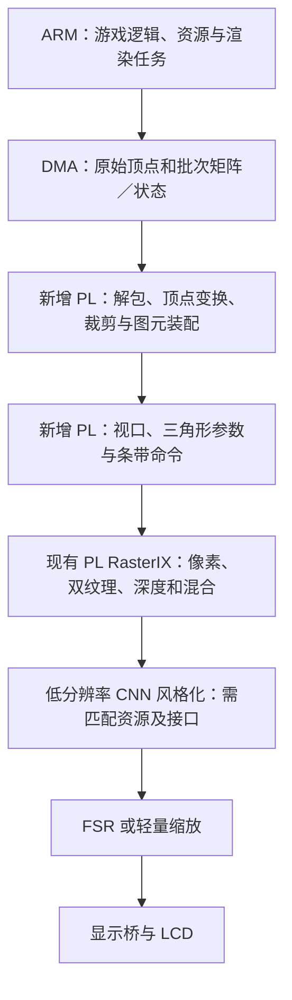

# Mali、PL 几何前端与 XCZU3EG 资源重新核对

> 后续进展（同日）：用户随后授权试验 Mali，现已完成原版 Java 1.2.5 的独立 RAM 世界测试。本文保留架构核对时的状态；最新实测和边界见 [Mali 路线记录](MALI_JAVA125_2026-10-28.md)。默认 RasterIX 路线仍保留。

2026-10-28。结论：**当前实现还没有达到“ARM 主要承担游戏逻辑，PS GPU 与／或 PL 承担完整渲染，再做硬件增强”的目标。RasterIX 像素后端与硬件后处理已实现，几何前端仍在 A53，而且未利用 PS Mali；持续优化 CPU 路径没有填补这个架构缺口。** 如果原意是利用现有 Mali 再由 PL 补充功能，当前独立 RasterIX 路线与之有实质差别。若选择继续以 PL 完成渲染，应把补齐 PL 几何前端列为主线；若选择利用 Mali，则完整帧交接给 PL 增强是接口更明确的分工。先明确原目标，再选择路线，不能因一次性能讨论便擅自切换。

最初的v1.0方案第7行及“几何处理”验收项明确采用PS软件变换／裁剪、PL像素处理；这是当前实现沿用的分工。后续希望把更多渲染阶段交给硬件的目标尚未落实，不能用最初文档替代后续需求，也不能把现有混合实现称为全硬件几何。

本次没有更换板上位流、修改 SD 或改用 Mali。只读打开已验收 v23 routed checkpoint，导出缺少的层级资源报告；Java 双 TMU 使用其已验收的 routed 层级报告。所有表格均来自完成布局布线后的设计，不用 HLS/OOC 估计冒充整机数值。

## 1. Mali-400 MP2 到底缺什么

ZU3EG 是带 Mali-400 MP2 的 EG 器件。AMD TRM 列出一个几何处理器 GP、两个像素处理器 PP、L2 及各处理器 MMU；它面向 OpenGL ES 1.1/2.0。[AMD UG1085](https://docs.amd.com/api/khub/documents/xzMsp_c5sG9J6A3u7NkJYQ/content?Ft-Calling-App=ft)

Arm 自己的文档明确把 Mali-400 MP 的几何／顶点处理交给 GP，像素渲染交给 PP；同一文档把依赖 CPU 几何的 Mali-55 单独列为另一种架构。因此，不能把 Mali-400 描述成“缺少顶点处理、必须用 FPGA 补上才能渲染”的 GPU。[Arm Mali 开发指南，1.1](https://documentation-service.arm.com/static/5e9861a89931941038dd32eb)

“不完整”需要区分为：

- **桌面 OpenGL 功能和兼容性有限。** 原版 Java/LWJGL 的桌面 API 不能简单等同 GLES。Lima 文档也说明只部分支持桌面 OpenGL，存在硬件限制；它没有完整的现代 OpenGL／GLES3／OpenCL／Vulkan 能力。这是功能、精度和软件接口边界，不等于没有基本几何阶段。
- **渲染 GPU 与显示控制器是两回事。** Mali 输出帧缓冲，独立显示引擎负责扫描输出；PL 的 RGB LCD、帧桥、后处理正可以补充系统显示能力。
- GP 几何处理器也不能与现代 API 中的 geometry shader 混为一谈。

上述 API 和显示边界见 [Mesa Lima 官方文档](https://docs.mesa3d.org/drivers/lima.html)。当前没有确认用户记忆中的具体缺失项，不能擅自指定是哪一种。

当前私有 `libGL` 是 RasterIX 后端，**没有调用 Mali 执行这款游戏的几何或像素处理**。`SOFTWARE_RENDERING=false` 仅表示像素走 PL 后端；CPU 顶点处理仍然存在。

### Java 1.2.5 不能直接把 GLES 当桌面 OpenGL 使用

用户指出的API缺口成立：Mali具备几何和像素硬件，不等于原版LWJGL桌面调用可以直接连接厂商GLES库。当前原版Java实际需要显示列表、桌面固定功能调用、GLX窗口／上下文接口、四边形等图元及ARB多纹理路径。GLES2需要用shader表达固定功能变换和纹理环境；GLES1.1虽有部分固定功能，仍不等于桌面API完整兼容。

本项目已经验证 `JAVA256_ARB_CAPS arb=true gl13=false`，原版1.2.5使用自带ARB分支；不必为这个版本先实现全套GL13／GL2.1，但必须真实实现它实际调用的功能。当前能跑世界，来自私有libGL补上的桌面入口、显示列表和两TMU适配，不能作为“厂商原生GLES已直接跑通Java”的证据。

Mali路线需要“Java/LWJGL→桌面GL兼容层→GLES／Mali驱动→GPU”。GL4ES提供桌面OpenGL1.5／2.x到GLES1.1／2.0翻译，并列出Minecraft案例，但有已知限制；这只是候选依据，尚未在本板、本JAR和本BSP验收。[GL4ES项目说明](https://github.com/ptitSeb/gl4es)

兼容层负责API语义和资源／批次组织，顶点矩阵运算仍可交给Mali shader执行；“API由软件翻译”不等于“逐顶点变换必须在CPU执行”。显示列表可转为缓存几何和状态，四边形可转为三角形，固定功能可转shader。是否满足完整像素、纹理、上下文及性能要求，仍需本板实测。Lima是另一种提供部分桌面GL的候选驱动栈，也不能只改版本字符串或用软件光栅回退冒充Mali成功。

## 2. 顶点变换、裁剪、三角形准备能否放进 PL

可以，这些算法均可设计为专用硬件流水线。但“可设计”不等于“当前器件剩余资源能直接装下全部模块”，目前没有新增几何核的 OOC 或整机实现结果。

| 阶段 | 可在 PL 承担的内容 | 实施要点 |
|---|---|---|
| 顶点读取／变换 | 解包原始位置、颜色和两组 UV，MVP 与需要的纹理矩阵计算 | 批次状态快照、索引、浮点次序、FIFO 所有权 |
| 裁剪 | clip code、整三角形接受／拒绝、六平面相交和新顶点属性计算 | 透视前后坐标约定、可变输出量、容量和背压 |
| 图元装配／视口 | 三角形／四边形装配、透视除法、视口映射 | 保留顶点顺序与精度，处理退化图元 |
| 三角形 setup | 包围盒、边函数、面积倒数、颜色／深度／双纹理插值参数 | 与现有 RasterIX 参数格式衔接，处理跨条带 |
| 低层命令生成 | 形成 RasterIX 三角形包及相关流控／结束标记 | 输出直接送现有后端，保护状态、容量和完成语义 |

ARM 仍适合承担游戏逻辑、资源加载、OpenGL 状态维护、内存分配和任务调度。把“每个三角形的大量参数计算／打包”移到 PL，不要求把 Java/JVM 或整个 OpenGL 驱动也硬件化。

建议目标链路：

这样才能减少 CPU 逐顶点搬运与逐三角形准备，也有机会用原始顶点替代当前较大的展开命令流。仅硬化矩阵乘法并不能消除整条 CPU 后端；R70 的 Mat44 样本占该工作线程约7.95%，所以不能只按一个矩阵核的吞吐承诺32/60 FPS。

Mali 的 GP／PP 与 PL 之间，当前工程和驱动没有实现“变换后顶点流”接入。工程上可明确比较的另一条路线是：**Mali 完整渲染帧 → 共享／交接帧缓冲 → PL CNN／超分／显示**。AMD 的参考软件栈支持 Mali DMABUF 分享，但当前 BSP、用户态驱动、格式与 fence 仍需验证；不能宣称本工程已做到零拷贝。[AMD TRD Mali 驱动说明](https://docs.amd.com/api/khub/documents/BRR17ik7UucR1MFiqjifYQ/content)

## 3. 整机资源：必须分清两个配置

最后一次板端核验加载的是 v23 位流 `035c3059…`。最近原版 Java 对照使用双 TMU 位流 `14fd58da…`，结束后已经恢复 v23。两套配置不是同一位流上随意开关的能力集合。

| 路由后整机 | v23：单 TMU + CNN + FSR | Java：双 TMU + FSR，无 CNN | 全片容量 |
|---|---:|---:|---:|
| LUT | 64,901（91.98%） | 65,624（93.00%） | 70,560 |
| FF | 71,349（50.56%） | 74,028（52.46%） | 141,120 |
| DSP | 325（90.28%） | 330（91.67%） | 360 |
| BRAM Tile | 216（100%） | 149（68.98%） | 216 |
| 余下 LUT | 5,659 | 4,936 | — |
| 余下 DSP | 35 | 30 | — |
| 余下 BRAM Tile | 0 | 67 | — |

Mali 是 PS 硬核，上表仅统计 PL，不包含 Mali 本身的硬件面积。

### 主要模块分布

每格顺序为 **LUT / DSP / BRAM Tile**。

| 互不重复的主要模块组 | v23 | Java 双 TMU |
|---|---:|---:|
| FSR | 20,291 / 173 / 78 | 20,317 / 173 / 78 |
| RasterIX 及帧桥／显示包装 | 12,938 / 84 / 54.5 | 18,026 / 154 / 42.5 |
| CNN | 4,466 / 65 / 55 | 不存在运算核 |
| 三组 AXI 互联合计 | 17,570 / 0 / 0 | 17,613 / 0 / 0 |
| PL DDR4 控制器／PHY | 7,640 / 3 / 25.5 | 7,647 / 3 / 25.5 |
| AXI DMA | 1,545 / 0 / 3 | 1,555 / 0 / 3 |

其余包含 GPIO、调试等。Vivado 会跨层级组合 LUT，不能把父、子模块再次相加；BRAM Tile=RAMB36+RAMB18/2，所以出现0.5。两套配置的帧缓冲／缓存等参数也有差别，不能将所有资源差额只归因于第二个 TMU。

为了进一步区分显示包装和像素运算，RasterIX 内核本身为：v23 **7,878 LUT / 84 DSP / 47.5 BRAM**；Java **12,912 LUT / 154 DSP / 35.5 BRAM**。这些是上一表中 GPU 组的子项，不另加到整机总量。Java 属性插值／透视修正占60 DSP，两个 TMU 各40 DSP，雾和其他像素阶段占其余部分。

## 4. 有空间做几何核吗，应该如何调整

现有余量值得验证一个**时分复用的小型变换核**，不足以直接承诺完整浮点几何前端、双 TMU、现有 FSR 和 CNN 同时装下。尤其v23的BRAM已满，Java虽然有67块BRAM余量，但仅余30 DSP及约4.9k LUT。

优先考虑以下资源调整，均需新综合／布线确认，不能把理论减法当成新方案资源验收：

1. **先验证几何前端，再恢复高成本增强。** 在独立实验配置中移除FSR，暂用已有轻量缩放／原尺寸输出，为完整几何路径腾出预算。Java中FSR单模块占20,317 LUT、173 DSP、78 BRAM；移除后的整机计数会受优化和互联变化影响，不能直接当作这些数值的精确差分。
2. **精简AXI互联。** 三组互联合计约25%全片LUT，应检查实际端口数、数据宽度、时钟转换、协议功能和寄存级；互联是必需功能，不能假设1.76万LUT全部可删。
3. **先小核、后完整前端。** 先实现原始顶点解包、MVP和粗裁剪，完成单核OOC、数值对照和端到端测试；再加入完整裁剪、装配、视口、三角形setup和直接命令输出。阶段性CPU回退必须明示，不能提前称全PL渲染。
4. **按新瓶颈重选增强配置。** 之后再比较完整FSR、精简FSR／边缘自适应缩放及低分辨率CNN。需要重新给算术、缓存和DDR带宽分配预算。

软件关闭FSR／CNN只减少活动，不释放已综合的LUT、DSP或BRAM。时分复用CNN／FSR／几何的运算资源也需要新的共享架构与调度，不是加一个配置开关。

如果选择保留现有PL渲染器，我建议把“**PL完整几何前端+现有RasterIX**”作为明确的架构方向，Mali用来做性能／功能参照。同时保留已验收v23作为演示回退。对于只追求游戏流畅度的另一目标，则另做“Mali完整3D+PL增强”对照。两条路线都需要真实应用测试，当前约4.89 FPS不能代表Mali能力，也不能证明加入一个矩阵核就能到32 FPS。

## 5. 可核验来源

- [资源解析及摘要](../report/architecture-audit-2026-10-28/resources.json)
- [新导出的v23路由后层级报告](../report/architecture-audit-2026-10-28/v23-utilization-hier.rpt)
- [原Java路由后层级报告](../build/minecraft-java-125/dual-tmu/board/utilization_hier.rpt)
- [只读Vivado日志](../report/architecture-audit-2026-10-28/vivado.log)
- [最新板端恢复核验](../report/board_serial/java_sequential_final_state_r78.log)

v23检查点SHA-256 `be0b3db6d87cb6ead908aa05485c09b8a8bb68b4bf86486c45aba59d2ae2aeda`，与原验收记录相同；本次未改写。Java层级报告SHA-256与R78本地验收的记录相同，检查点摘要另行记录但不冒称已有旧摘要验收。总量由脚本逐项对照，资源图已目视检查。
