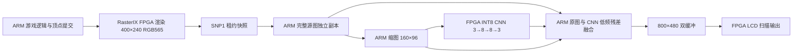

# MC 神经风格接入记录（2026-10-21）

这是首轮 v1 记录。当前公开入口已更新为 v2，同模型 ABBA 约 20.83 FPS；最新改动、验收和回退见 [第二轮优化记录](CLASSICUBE_STYLE_OPTIMIZATION_2026-10-21.md)。以下首轮数据作为历史对照保留。

本轮把 ClassiCube 接入已有 FPGA INT8 CNN，增加 MC 专用动漫、油画学生模型，并用原始画面的高频细节融合，避免整帧从 160×96 放大造成纹理和字形丢失。它是可选实验入口，画质和时间一致性尚未验收。

## 使用

开发板 Linux：

```sh
# 原来的普通游戏，默认键鼠输入
rix-classicube

# MC 专用动漫候选；仍使用键鼠，1800 秒后结束
rix-classicube-style --style anime --seconds 1800

# 油画候选，用于对照
rix-classicube-style --style oil --seconds 1800

# 风格强度：0..256，默认 128；0 精确保留原图
rix-classicube-style --style anime --strength 96 --seconds 1800

# 不需要键鼠的有界自动转向测试
rix-classicube-style --style anime --seconds 15 --autoplay
```

`--autoplay` 仅在明确指定时注入游戏运动；普通调用沿用原来的 SDL/X11 键鼠路径。物理 USB 键鼠此前尚未连接，本轮通过自动验证，不能称为已实测物理键鼠。

## 渲染和推理链路



这条路径的卷积在 FPGA 执行；缩图和细节融合在 ARM 执行。融合使用原图 nearest2× 基底，加上 160×96 的 `CNN输出－CNN输入` 双线性放大残差，按原图边缘衰减并裁剪 RGB。不是将网络整体放到 ARM，也不是 FSR 或学习型超分。

原图邻域 RGB 差值 8..64 渐进抑制风格修正，差值至少 64 的强边缘完全保留。默认保护源坐标 `0,0,400,34`、`0,192,400,48`、`194,114,12,12`。这些矩形保留原像素，也会保护其中的世界区域，不能等同于从引擎分离的 HUD。完整菜单也没有单独的无风格合成层。可通过 `--protect-rect x,y,w,h` 增加区域，或 `--no-hud-protection` 关闭默认矩形。

源图先在持有 SNP1 租约期间完整复制到 ARM 独立缓冲，再释放租约；CNN 输入、输出和融合底图属于同一源帧。额外候选源缓冲避免 SIGTERM 在下一次快照读取中覆盖最后已提交帧。没有把实时 PS 帧槽当作可长期持有的底图。双缓冲在扫描器确认后才可复用。

## 实机结果

同板、同 400×240 渲染配置、默认视距 32、12 秒无诊断输出的自动转向测量：

|路径|油画风格输出 FPS|动漫风格输出 FPS|ARM 融合耗时|
|---|---:|---:|---:|
|首轮标量融合＋旧通用模型|10.6674|10.5451|37.6 / 38.1 ms|
|NEON 融合＋MC 专用模型|13.4099|13.3741|18.0 / 17.8 ms|

第二轮 MC 原始渲染呈现约 58.16 FPS，但用户看到的最终风格画面只有约 13.4 FPS。LCD 的扫描刷新率、原始游戏 FPS、神经处理输出 FPS 是不同指标。上述是短时原型测量，不能宣称已达到稳定 30/60 FPS。

现有 CNN 核心仍为每帧 414738 周期，100 MHz 下约 4.15 ms；计入输入/输出 PIO 的推理调用约 18.7 ms。完整租约快照读取约 28 ms，800×480 缓冲写入约 8.2 ms。后续提速优先处理快照传输、PIO 以及 ARM 融合搬运，不能只靠缩短卷积核心周期。

NEON 使用整数乘高位及校正实现精确除法，没有以近似浮点换画质。A53 上 894730 项检查通过；主机 ASAN/UBSAN 814730 项通过。旧的四组 INT8 回归向量仍位精确。

两种 MC 候选均已实际装载到 FPGA：每种 CNN 张量与 NumPy 整数参考零差异，完整 384000 像素输出与独立融合参考 SHA 匹配，每种 6000 点 LCD 独立回读零差异，保护区域零差异。源图到 CNN 输入的配对检查也零差异。原通用模型的两组首轮结果另行保留。

## 模型边界

学生模型每份 7116 B，复用已有 3 层 3×3 卷积的 `RIXCNN1` 格式，感受野仅 7×7。本轮没有修改 bitstream、设备树或 FPGA 资源占用。

- MC anime：`d145a2d0eee63d1911109b3798f0eb4ce74ad52d56a4979b63abd72e31f70c31`。
- MC oil：`95afa4cf647c64dcf10689b1504c16b4979792d71a0fdb802ec67607f4e2dda1`。

训练使用 5 张同世界图，3 张同世界留出选择检查点，另 2 张不同世界测试。教师为已有公开预训练 Rain Princess / Paprika；损失加入源强边缘及保守 UI 区域约束。没有在教师目标里预混合强度，运行时统一控制强度。

动漫候选在这两张异世界图上的教师 MAE 从旧模型 16.49 降到 11.59，强边缘梯度误差从 19.16 降到 1.74。数据量很小，这不代表所有世界或视觉效果已经达标。油画有一张异世界图退步，目前主要改变天空和色调，不能声称复制出教师的大笔触。

当前 `quality_acceptance=false`、`temporal_acceptance=false`。没有用离散冻结视角冒充连续训练视频，也没有宣称移动闪烁已经解决。训练及主机预览的保护区域与运行时默认区域不同，具体设置都在各自元数据中。完整训练数据、损失和可复现步骤见 `report/classicube-style/training-v1/README.md`。

## 安装和证据

独立包 `build/classicube-style/mc-style-v1.tar.gz`，47779 B，SHA256：

```text
89c1478f4406a0f98d9862392caea619cde27dc1bc948b4dc1171b763917522b
```

SD 持久包 `/media/sd-mmcblk1p1/rasterix-mc-style-v1.tar.gz`；入口 `/usr/bin/rix-classicube-style` 每次校验包及成员 SHA，展开到 `/tmp/rix-mc-style-packages/<SHA前16位>`。拒绝用符号链接把 RAM 解包目录引到持久分区。保留根分区 32 MiB、SD 16 MiB 空间保护。

附加包中的私有 MC 启动器只增加协作退出选项：保留原有排空和故障检查，由外层会话在 CNN 与游戏均结束后恢复显示，避免自然退出时抢占后处理锁。原始 `rix-classicube` 包、全局神经运行时、原两模型、共享/私有 GL、BOOT.BIN 和 system.dtb 均保留。

关键证据位于 `report/classicube-style/`：`final-package.json`、`mc_v2-board.json`、`mc-anime-neon/verification.json`、`mc-oil-neon/verification.json`、`session-unit.json`、`session-board.json`、`public-session.json`、`install.json`、`board-state.json`、`acceptance.json`。完整构建与打包入口为 `scripts/build_mc_style.sh`、`scripts/package_mc_style.py`。
