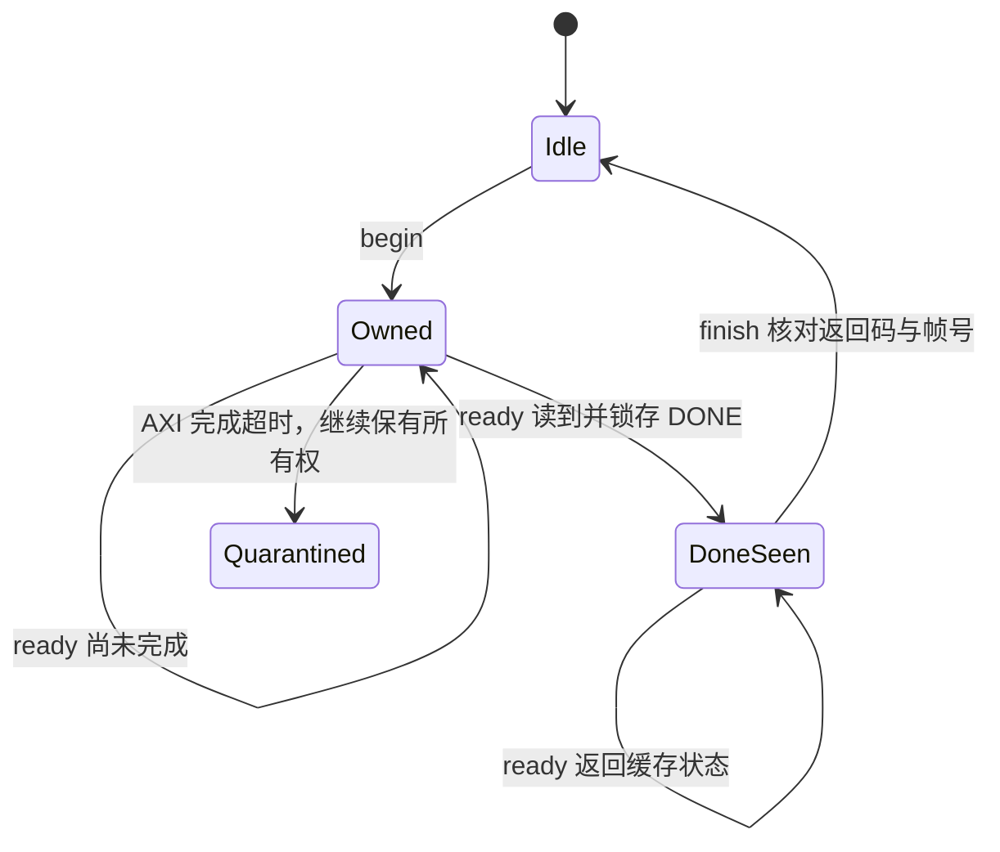

# 在 CNN 输出期间提前提交 FSR：实机优化记录

2026-11-02。继续优化已验收的跨帧流水：在下一帧 CNN 输出读取期间检查上一帧 FSR 的完成状态，核对返回码和帧号后立即提交显示银行。Neverputt 同一球洞短测由本轮对照的 **46.6809 提升到 50.7050 FPS，增加 8.62%**；油画为 **50.6319 FPS**。

上轮曾测得约 46.89 FPS，本轮重新测量旧程序作为直接对照。没有使用跨轮结果计算这次增益。CNN、融合、FSR 运算和两套 v8 权重不变，也没有增加 RTL、位流或 FPGA 资源。结果仍是固定场景的短时后处理呈现吞吐，尚不代表完整游戏稳定 60 FPS 或 Minecraft 帧率。

## 同场景 ABCCBA

沿用 Neverputt `map-putt/01_easy.sol`、400×240 源图、800×480 LCD、NGR1、group PIO、sleep 等待、四线程快照复制与快照 overlap。三个路径均已启用 CNN/FSR 跨帧流水。

| 路径 | 第一轮 FPS | 第二轮 FPS | 完成帧 / 总秒数 | 汇总 FPS |
|---|---:|---:|---:|---:|
| A：上轮 `rix-cfs-early` | 46.6696 | 46.6921 | 940 / 20.1367 | **46.6809** |
| B：新控制器，提前通知关闭 | 46.5633 | 46.5987 | 938 / 20.1369 | **46.5812** |
| C：CNN 输出期间提前通知 | 50.3630 | 51.0468 | 1021 / 20.1361 | **50.7050** |

漫画按 A/B/C/C/B/A 顺序，每次约 10 秒。B 相对 A 为 -0.21%，不将控制器重构视为收益；C 相对 A 为 **+8.62%**。油画 B/C 分别为 **46.9264 / 50.6319 FPS**。八轮总计 **3882 帧**，提交、完成与 FSR 启动/完成计数一致。

关闭 CNN/FSR 时，源场景约 **60.22 FPS**。独立新入口另完成 Neverball 199 帧回归，约 **24.6627 FPS**，其源场景约 24.91 FPS，不能把 Neverputt 的增益套用到该游戏。

## 完成事件与提交时机

上一轮在整个下一帧 CNN 输出完成后，才收回上一帧 FSR。FSR 经常已完成，但软件尚未提交银行，减少了显示确认可利用的时间。本轮在 CNN 核心完成之后及每 128 个 group ACK 后检查一次；一个 group 为八像素，即输出每前进 1024 像素增加一个检查点。

检查发生在完整 group 已读取、校验并 ACK 之后，不会暴露半个 CNN 输出组。所有控制仍在同一主线程执行，没有新增 FSR 控制线程。每次回调只在确有待收回 FSR 时访问状态，收回后后续回调直接返回。

关键是 **AP_DONE 为读清标志**。新 `ready()` 在读到 DONE 后将其锁存在软件所有者中；反复调用不再读硬件控制寄存器，`finish()` 消费已锁存的完成状态，并核对返回码和结果 tag。没有把“读到 DONE”直接当作允许提交。



DONE 已锁存时，软件所有权仍保留，新命令仍被拒绝。只有核对成功后才提交输出银行；异常时不提交该帧。析构仍先排空现有事务，再失效缓存，最后释放映射和共享锁。超时继续使用既有隔离与保有所有权的处理。

CNN 输出期间的回调提前提交上一帧，主线程继续读取当前 CNN 的剩余输出并执行 ARM 融合，让 POST ACK 有更长窗口。下一帧的 scratch 写入、FSR LOAD 和输出银行申请顺序保持原有所有权约束。

漫画 C 的 **1021 帧中有 1019 帧**通过 CNN 输出回调提交；其余是两次测试各自最后的排空帧。对应 **4028 次**有效状态检查。该计数描述提交所在的软件阶段，不是独立的硬件并行利用率测量。

## 阶段数据与剩余空间

漫画各组按总耗时/总帧数汇总：

| 每帧阶段 | 上一版 A | 新通知 C |
|---|---:|---:|
| ARM 缩小输入 | 1.394 ms | 1.392 ms |
| CNN 推理，含 PIO 与回调 | 9.317 ms | 9.333 ms |
| ARM 细节融合 | 4.251 ms | 4.256 ms |
| ARM 写 scratch | 1.997 ms | 1.991 ms |
| FSR LOAD | 0.810 ms | 0.812 ms |
| FSR 启动到软件收回 | 10.798 ms | **8.228 ms** |
| 前台等待 FSR | 0.019 ms | 0.017 ms |
| 显示银行等待 | 3.385 ms | **1.691 ms** |

主要收益是显示银行等待减少约 **1.69 ms/帧**。CNN 与融合本身没有明显变快，额外状态检查的时间已经包含在推理/PIO 统计中。并行阶段不能直接相加；`fsr_compute_us` 仍为主机启动到收回的驻留时间，不是硬件周期计数器。源供帧较慢时，该驻留时间可包含等待下一源帧的时间。

50.70 FPS 约为 **19.72 ms/帧**，距离 60 FPS 的 16.67 ms 还需减少约 **3.06 ms** 的关键路径。本轮源码检查确认：

1. **缩小输入仍为标量双线性，约 1.39 ms。** 400→160、240→96 是固定比例，可研究精确 NEON 重排、RGB565 展开与有符号舍入；必须保持每个输入整数值及边界一致。本轮尚未实现该候选。
2. **CNN PIO 仍约 4.69 ms**，输入约 1.40 ms、输出约 3.29 ms。输出统计包含本轮通知回调，不能将其全部视为纯总线传输。批量化需要保持 group 标志、ACK 和帧计数核对。
3. **融合约 4.26 ms，写回约 1.99 ms**，仍有研究空间。剩余显示等待约 1.69 ms，也受呈现时序影响，不能假设可全部消除。

这些数值用于选择下一候选，不代表尚未实现的收益，也不保证其他游戏达到相同帧率。

## 精度与退出验证

- 主机和 A53 的命令所有者测试均通过 **145 项**检查，新增读清 DONE 的重复查询、锁存后完成、锁存后退出、错误返回/帧号等场景。超时与错误使用假寄存器验证，真实 AXI 超时不作为正常退出处理。
- 两套 v8 模型的四组 CPU 整数黄金输出不变。
- 四幅静态真实 PL FSR 输出先反复调用 `ready()`，再 `finish()`；完整回读 SHA256 与既有 v23 定点参考一致，共 **1536000 像素**。
- 八轮实时末帧的 **983040 个 INT8 值**与独立 NumPy CNN 一致；**768000 个融合像素**及 **3072000 个 FSR 像素**的完整回读摘要与参考一致；实际 LCD 共 **48000 个样点**一致。
- 四种真实退出分别为第 1、2、7 次 FSR 启动后触发 SIGTERM，以及读到并锁存 DONE 后触发 SIGTERM。前三次完成 1、2、7 帧；锁存后退出继续完成已接受的下一帧，最终完成 2 帧。四次均排空、释放快照并恢复 POST。
- 四次退出的末帧另核对 **491520 个 CNN INT8 值**、**384000 个融合像素**和 **1536000 个 FSR 像素**的完整摘要。

每帧检查返回码、帧号和计数；完整 CPU 整数及像素复核针对上述十二组末帧，并非对全部 3882 帧逐幅执行 CPU CNN。GPU 错误、超时、下溢、扫描错误、快照重试和过期均为零。

## 入口与保存位置

板上 RAM 新入口默认使用 Neverputt、快照 overlap、FSR pipeline 和 CNN 输出通知：

```sh
python3 /tmp/rix-cnn-group-r1/cfs_poll_play.py --style comic --seconds 30
python3 /tmp/rix-cnn-group-r1/cfs_poll_play.py --style oil --seconds 30

# 上轮约 47 FPS 的入口仍保留，供对照
python3 /tmp/rix-cnn-group-r1/cfs_pipe_play.py --style comic --seconds 30
```

入口核对文件索引和静态证明，临时加载 NGR1，结束后恢复原 v23 和原生清晰菜单。普通菜单开关未接入此实验入口，也未设为开机默认；断电后需重新部署 RAM 包。

核心代码：[fsr_polled.hpp](../linux/neural_style/experimental/cnn_fsr_poll_r3/fsr_polled.hpp)、[协议测试](../linux/neural_style/experimental/cnn_fsr_poll_r3/test_polled.cpp)。生成/构建入口为 `scripts/prepare_cnn_fsr_pipe_r3.py`、`scripts/build_cnn_fsr_pipe_r3.sh`；联合运行时为 `build/neural-style/cnn-fsr-pipe-r3/runtime/rix-cfs-poll`，SHA256：`ea44b95f98329f791564d2dc84c44bf5c7cee6fb6aa7004fcadd5dbb16a4a593`。

证据：[独立验收](../report/neural-style/cnn-fsr-pipe-r3/acceptance.json)、[阶段汇总](../report/neural-style/cnn-fsr-pipe-r3/metrics-summary.json)、[最终状态](../report/neural-style/cnn-fsr-pipe-r3/acceptance-final.json)。独立复核脚本为 `scripts/accept_cnn_fsr_pipe_r3.py`。归档 823581 字节，SHA256：`3793176989b4323224d20002f0a5485224c5db7ba7eeea912611d3eb4f16317b`。

最终只读检查确认原 FPGA、原凭据和清晰菜单恢复，SD 启动文件哈希不变，没有遗留游戏/CNN/FSR 进程。原模型、运行时与 FSR 代码均保留。资源继续沿用 NGR1 路由结果：**65058 LUT、71711 FF、189.5 BRAM、325 DSP**；Vivado 工程仍为 `build/vcgr1/rix_cgr1.xpr`。
