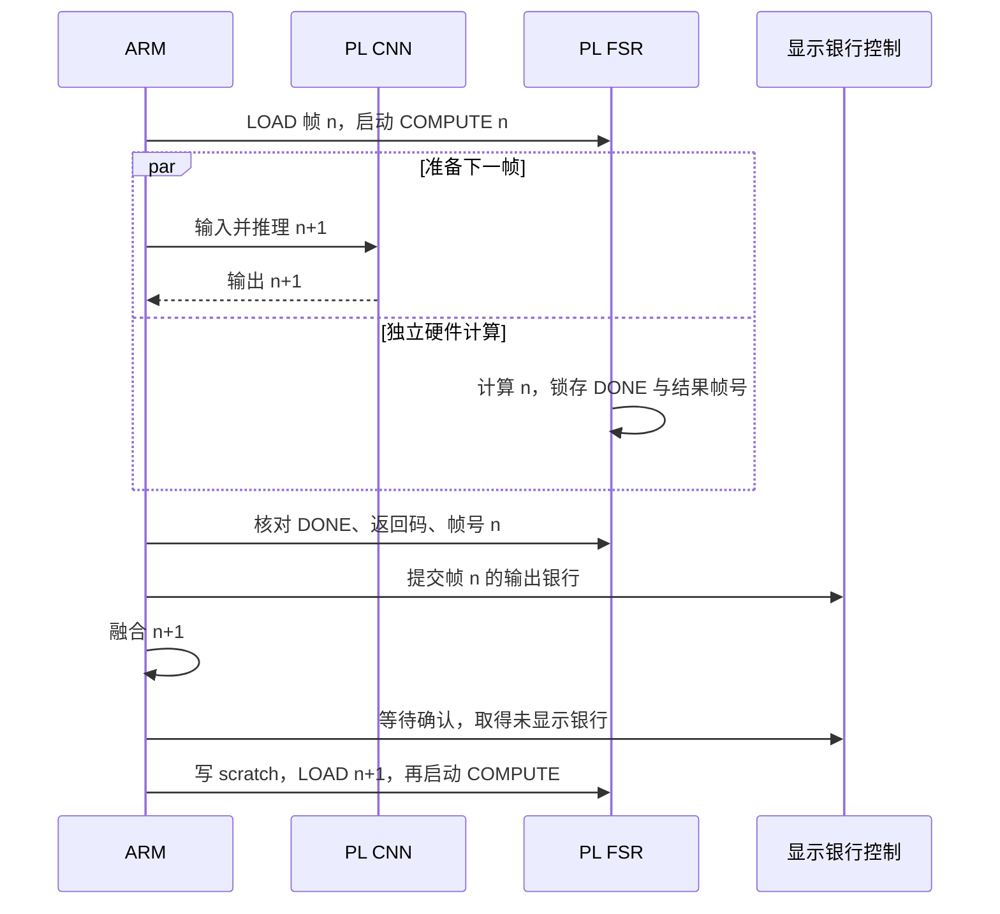

# CNN 与 FSR 跨帧流水调度：实机优化记录

2026-11-02。在上一轮约 38 FPS 的链路上，继续让**本帧 PL FSR 与下一帧 PL CNN 重叠运行**。经过两种提交时机的实机比较，最终采用 CNN 完成后、ARM 融合前提交上一帧的方案。Neverputt 同一球洞的漫画呈现吞吐从 **38.0627 提升到 46.8880 FPS，增加 23.19%**；油画为 **46.9431 FPS**。

CNN、FSR 的计算都仍在 FPGA；网络、两套 v8 权重、融合公式、FSR 算法和游戏画质保持原样。本轮仅改软件调度，没有新增 RTL、位流或 FPGA 资源。结果是固定场景的短时后处理呈现吞吐，尚未达到完整游戏稳定 60 FPS，也不代表 Minecraft 的帧率。

## 对照结果

保持同一次 Linux 启动、NGR1 位流、Neverputt `map-putt/01_easy.sol`、400×240 源帧、800×480 LCD、group PIO、sleep 等待和四线程快照复制。三个路径均使用上一轮的精确五相融合，并开启快照 overlap；区别仅为 FSR 控制器与提交顺序。

漫画按 **A/B/C/C/B/A** 各约 10 秒：A 为上一轮已验收的 `rix-cfs-poly`；B 为新控制器但 CNN/FSR 仍串行；C 为新控制器及提前提交的流水调度。

| 路径 | 第一轮 FPS | 第二轮 FPS | 完成帧 / 总秒数 | 汇总 FPS |
|---|---:|---:|---:|---:|
| A：上一轮最佳 | 38.0440 | 38.0812 | 766 / 20.1247 | **38.0627** |
| B：新控制器，仍串行 | 37.9009 | 38.0712 | 764 / 20.1126 | **37.9861** |
| C：跨帧计算＋提前提交 | 46.8946 | 46.8813 | 945 / 20.1544 | **46.8880** |

B 相对 A 为 -0.20%，没有把控制器重构当成提速。C 相对 A 为 **+23.19%**。油画 B/C 另测 **38.0732 / 46.9431 FPS**。八轮共呈现 **3331 帧**，每轮提交数、完成数及 FSR 启动/完成计数一致。

同一场景关闭 CNN/FSR 的源呈现为 **60.28 FPS**，说明本组主要限制在后处理调度；没有把切换游戏的供帧差异计为优化收益。新入口另在 Neverball 完成 198 帧功能回归，约 **24.4996 FPS**，其源场景仍仅约 24.57 FPS，不能由后处理优化推导出同幅度提速。

## 首版为何退化

首版也实现了计算重叠，但在**下一帧 ARM 融合结束后**，才收回上一帧 FSR 并提交显示银行，紧接着就申请下一个银行。该顺序没有给显示握手留下足够的并行工作窗口。

| 调度 | 漫画汇总 FPS | 前台 FSR 等待 | 银行切换等待 |
|---|---:|---:|---:|
| 原串行基准 | 38.06 | 8.15 ms/帧 | 0.19 ms/帧 |
| 首版：融合后提交，未采用 | **29.89** | 0.029 ms/帧 | **15.36 ms/帧** |
| 第二版：CNN 后、融合前提交，采用 | **46.89** | 0.019 ms/帧 | **3.32 ms/帧** |

首版确实隐藏了 FSR 计算等待，却引入更大的显示等待，因此被拒绝。第二版提前提交上一帧，并用当前帧的 ARM 融合时间等待显示确认。上述诊断基于两种调度的实机阶段耗时；没有把所有并行阶段直接相加来预测帧率。

首版的源码、二进制、实机日志和结果均保留；其结果记录一并进入第二版证据包的 `rejected-r1/`。

## 最终链路与所有权

每幅图像的顺序仍是：同帧源快照→PL CNN→ARM 400×240 细节融合→PL FSR→800×480 显示。只将相邻两帧的不同阶段重叠，并不混用两帧的颜色和细节。



FSR 控制拆成 `begin()` / `finish()`，仍然最多只有一条未收回命令。下一帧 CNN 与 ARM 融合可以使用自己的 CPU 缓冲；**写入下一帧 scratch、加载新 FSR 输入和申请下一输出银行前，均已收回上一帧 FSR**。本版没有在 FSR 运行时覆盖 scratch，也不需要新增 FPGA 缓冲。

`finish()` 核对 AP_DONE、返回码及结果 tag 后，才允许提交该银行。提交之后先融合当前帧，再等待 POST ACK 并取得未显示银行。每幅输出的 tag、源帧号和末帧数据保持配对。

异常或 SIGTERM 只请求停止。FSR 命令的所有者在析构时先完成正在执行的事务，再使缓存失效，最后才释放映射与后处理锁。如果 AXI 超时，继续保有锁和映射、撤销加载凭据并隔离设备，不能把超时当作事务已完成。原加载器的正常恢复与硬件所有者检查继续保留。

流水模式要求 PL CNN＋PL FSR，在线诊断只允许 `--dump-last`，避免将当前 CPU 帧误标为尚未呈现的前一帧。

## 真实开销与 60 FPS 的差距

漫画两次 C 按总帧数汇总：

| 每帧阶段 | 上一轮 A | 新流水 C |
|---|---:|---:|
| 缩小输入 | 1.389 ms | 1.394 ms |
| PL CNN，含 PIO | 9.279 ms | 9.304 ms |
| ARM 融合 | 4.232 ms | 4.255 ms |
| ARM 写 scratch | 1.979 ms | 1.992 ms |
| FSR LOAD | 0.793 ms | 0.802 ms |
| 前台等待 FSR 完成 | 8.154 ms | **0.019 ms** |
| 前台等待源快照 | 0.052 ms | 0.059 ms |
| 等待显示银行确认 | 0.189 ms | **3.316 ms** |

CNN 与融合本身并没有变快。主要收益来自隐藏约 8 ms 的 FSR 等待，新增的显示等待抵消一部分收益。CNN 核心仍为 **462816 周期**，输入约 1.40 ms、输出约 3.27 ms。后台快照总耗时约 9.07 ms，与主线程重叠，不能重复计入帧周期。

流水模式下 `fsr_compute_us` 是**主机启动到收回命令**的时间，约 10.78 ms/帧，包含主机处理下一帧及延迟收回的时间，不是硬件计算周期计数器。新增字段 `fsr_timing_kind=host_start_to_retire`、`fsr_foreground_wait_us` 用来区分两者。静态同核 COMPUTE 仍约 8.06–8.14 ms。

46.89 FPS 对应约 21.33 ms/帧，距离 60 FPS 的 16.67 ms 还需减少约 **4.66 ms** 的关键路径。下一步值得测量的是：

1. **更及时提交已完成的 FSR。** 当前等下一帧 CNN 全部输出后才收回命令，仍有约 3.32 ms 显示等待。可以研究在 CNN 输出读取过程中检查 FSR 完成，给显示确认更长窗口；必须避免读取 AP_DONE 后丢失其读清状态。
2. **减少 CNN 的 PIO 开销。** 输入输出合计约 4.67 ms，可研究接口和读取批量；不能删除完成校验或假定 AXI 已排空。
3. **继续减少 ARM 像素阶段。** 准备＋融合＋写回仍约 7.64 ms。更少的复制、数学等价的向量化或进一步硬件化需要各自实测与逐像素回归。

这些是后续候选，尚未计入本轮收益；不能据此承诺稳定 60 FPS。当前也没有“DMA 报错导致卡顿”的证据，读写、超时、下溢和扫描错误计数均为零。

## 正确性与退出验证

- 新命令所有者在主机和 A53 上通过 **84 项**协议检查：重复启动、错误帧号/返回码、自动重启、延迟完成、超时保有所有权、析构排空和异常展开。错误/超时情形使用假寄存器验证。
- 两套 v8 模型的四组 CPU 整数黄金输出继续一致；模型文件和上一轮运行时哈希均保持预期。
- 四组静态实际 PL FSR 整图回读与未改的 v23 定点参考一致，共 **1536000 像素**。
- 八轮实时末帧共 **983040 个 INT8 值**与独立 NumPy CNN 一致，**768000 个融合像素**的完整摘要一致，**3072000 个 FSR 像素**的完整 DDR 回读摘要一致。
- 八轮实际 LCD 采样共 **48000 点**一致；没有把参考重建图当作物理全屏照片。
- 实机另在第 **1、2、7** 次 FSR 启动后立即触发 SIGTERM；三次均排空，分别呈现 1、2、7 帧后正常退出。三组末帧另独立核对 **368640 个 CNN INT8 值**及 **1152000 个完整 FSR 像素**的摘要；快照释放，POST 恢复。
- 主对照与退出测试中，源帧号、FSR tag、启动/完成/呈现计数均检查；未对全部 3331 帧逐幅运行 CPU CNN，完整整数与像素复核针对上述末帧。

GPU 读写错误、超时、下溢、扫描错误、快照重试和过期均为零。验证结束时原 v23、原凭据和原生 800×480 菜单均恢复，没有遗留游戏或后处理进程；SD 的 BOOT.BIN 和 system.dtb 哈希不变。

## 使用与产物

板上 RAM 内新增入口默认 Neverputt、快照 overlap 和 FSR pipeline：

```sh
python3 /tmp/rix-cnn-group-r1/cfs_pipe_play.py --style comic --seconds 30
python3 /tmp/rix-cnn-group-r1/cfs_pipe_play.py --style oil --seconds 30

# 上一轮已验收的约 38 FPS 路径仍可对照
python3 /tmp/rix-cnn-group-r1/cfs_fast_play.py --style comic --seconds 30
```

入口检查完整文件索引和静态证明，临时加载 NGR1；结束后正常排空、恢复原位流和清晰菜单。新增入口另完成 Neverball 198 帧回归。它没有接入普通菜单开关或设为开机默认，断电后需重新部署 RAM 包。

核心所有权代码：[fsr_pending.hpp](../linux/neural_style/experimental/cnn_fsr_pipe_r1/fsr_pending.hpp)。生成/构建脚本为 `scripts/prepare_cnn_fsr_pipe_r1.py`、`build_cnn_fsr_pipe_r1.sh`、`prepare_cnn_fsr_pipe_r2.py`、`build_cnn_fsr_pipe_r2.sh`；独立运行时为 `build/neural-style/cnn-fsr-pipe-r2/runtime/rix-cfs-early`，SHA256：`0338523c145b4b52840c0591071e012562f6a27de6da622c320f95e17ce5fd77`。

完整证据：[独立验收](../report/neural-style/cnn-fsr-pipe-r2/acceptance.json)、[阶段汇总与退化数据](../report/neural-style/cnn-fsr-pipe-r2/metrics-summary.json)、[最终状态](../report/neural-style/cnn-fsr-pipe-r2/acceptance-final.json)。复核脚本为 `scripts/accept_cnn_fsr_pipe_r2.py`。证据包 753425 字节，SHA256：`179ad8a80aa66b8d43da04b9568b7892b8e1155b3cc6f7402a3547f8ffb27820`。

FPGA 资源继续沿用既有 NGR1 路由结果：**65058 LUT、71711 FF、189.5 BRAM、325 DSP**；Vivado 工程仍为 `build/vcgr1/rix_cgr1.xpr`。原 PL FSR、模型、旧运行时与首版退化候选均保留。miniDP、其他游戏的完整连续运行和输入到显示延迟不在本轮验收范围。
