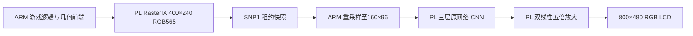

# 原网络 CNN r1：实机回归与游戏显示

2026-11-01，AXU3EG，COM11 PS 串口，Linux 同一次启动。**回收 BRAM 的 NIP1 候选已在实机通过固定输入 A/B/A 和 Neverball→CNN→LCD 测试，随后恢复原 v23 位流及清晰菜单。** 未替换默认模型，未开启普通菜单游戏的 CNN，未修改 SD 启动文件。

网络仍为 3→8→8→3、三层 3×3、INT8、160×96、64 MAC。资源沿用 [整机布线验收](CNN_INPLACE_R1_2026-11-01.md)：CNN **55→28.5 BRAM Tile**，整机 **216→189.5**，DSP **325**。本轮实际临时装载该候选，不是重新估算资源。

## 固定输入：原核→新核→原核

两套原权重，各取 real8、real22、real28 三个既有输入；每个输入分别测试 atomic 和 legacy 输出端口。每阶段 12 帧，共 **36 帧**。同一份新运行时识别真实 NNS2/NIP1 身份，三个阶段均从实测周期寄存器核对计数，没有冒用旧标识。

完整回读 **4,423,680 字节 HWC8 输出**，逐字节核对本地参考全部一致。该传输格式包含补零通道，实际网络输出仍为 RGB 三通道。

| 单次推理中位耗时，ms | 原核之前 | 新原地核 | 恢复原核之后 |
|---|---:|---:|---:|
| atomic，当前默认接口 | 12.405 | **12.873** | 12.387 |
| legacy | 18.799 | **19.249** | 18.771 |
| FPGA 计算等待，atomic | 4.148 | **4.628** | 4.148 |
| PIO 输入，atomic | 1.390 | **1.383** | 1.383 |
| PIO 输出，atomic | 6.854 | **6.857** | 6.853 |
| 实测 FPGA 核心周期 | 414,738 | **462,816** | 414,738 |

推理时间包含 PIO 和核心计算，不含权重上传、进程启动、游戏渲染、快照、融合或屏幕呈现。atomic 能力原方案已有，本轮确认新核正确兼容；不能把与 legacy 的差值当成本轮新增提速。

新核以约 **0.48 ms** 额外核心时间换回 **26.5 BRAM Tile**；默认接口的推理中位耗时约增加 0.47–0.49 ms。新核 static 测试的 PIO 输入/输出合计约占推理时间 **64%**，其中输出约占 **53%**。真实数据表明该接口下的数据读回开销大于 CNN 计算时间。

## Neverball 的实际链路

**FSR 未启用。** 这条链路使用原有 PL 五倍插值；不能将其称为 CNN→FSR，也没有改变之前保留的 FSR 代码。输入重采样、数据打包和写回仍有 ARM 参与，三层 CNN 卷积在 FPGA 执行。

本轮为 Neverball Level00 **关卡说明场景**的短测，不是完整游玩或长时间稳定性验收。游戏使用独立 `/tmp` 配置，正常 WM_DELETE 关闭后，确认进程退出和 GPU 队列排空，再恢复原 FPGA。

| CNN 风格 | 呈现完成帧 | 统计时间 | CNN 呈现吞吐 | 末帧源编号 |
|---|---:|---:|---:|---:|
| 动漫 | 74 | 3.012 s | **24.57 帧/s** | 80 |
| 油画 | 76 | 3.048 s | **24.93 帧/s** | 162 |

150 帧的提交与完成数一致，单帧 CNN 周期检查均通过。各风格另取最后一帧，完成以下独立验证：

- 本地 NumPy 重新执行三层 INT8 网络，与板上输出、板上 CPU 参考完全一致。
- 独立重建 800×480 的中心对齐、有符号整数舍入五倍插值，与显示参考逐像素一致。
- 板上运行时完整回读并比较 **61,440 字节**低分辨率 PL 显示缓冲。
- 每风格采样实际 LCD 的 6,000 个 RGB565 像素，共 **12,000 点零差异**。
- GPU 五项错误、DMA 运输错误、快照重试和快照租约过期均为 0。

这不是对全部 150 帧逐帧运行 NumPy；完整整数/显示/采样对照覆盖每组末帧。吞吐只覆盖该短时场景，不等于其他游戏 FPS，也没有同场景关闭 CNN 的性能 A/B。

左列为实际送入 CNN 的 160×96 输入，用最近邻放大预览；不是完整 400×240 原始游戏截图。右列为经 PL 缓冲回读及 LCD 采样核验的显示数值重建，未拍摄屏幕。每行左右来自同一帧；动漫与油画来自不同末帧。**原网络和权重未变，本轮没有画质提升或用户画风认可。** 菜单继续使用原生 800×480，不经过这些游戏风格化路径。

## 耗时揭示的下一步

两组每帧推理平均约 **12.81–12.86 ms**，其中核心约 4.63 ms；快照等待源帧平均约 **20.80–21.26 ms/帧**。snapshot 总时间包含等待及读取，不应与这些子项重复相加。

当前数据支持优先优化 **PIO 读回**，并排查 **源帧等待**。原子接口已做到每输出像素一次有效 MMIO 读取，下一步应评估批量/突发或 DMA 数据通路，而不能只减少无效轮询。等待还可能包含源渲染、调度和链路争用，本轮没有证明 ARM 某个函数或 DMA 带宽饱和。资源回收本身没有使游戏达到稳定 32/60 FPS。

## 保留、运输和证据

两次独立测试均正常停止并恢复原生菜单，三把资源锁保护重配过程；活跃渲染器或后处理器未确认退出时禁止恢复重配。原绑定、模块文件、FPGA 参数和原凭据均恢复。最终 FPGA Manager 为 operating，POST 为原生菜单 mode 2，GPU 错误为 0。

SD 启动文件前后长度/SHA-256 保持一致：

| 文件 | 字节 | SHA-256 |
|---|---:|---|
| BOOT.BIN | 6,685,588 | `f87bb0459812bd0a2a839d9dba86a3754c4f5643dd30bd7d36b05af8ee865ea4` |
| system.dtb | 31,292 | `f4a2d7c54efde6b05bff6974a41075687a2f546a8c84f99ff883fd1201cb42dc` |

首次大包的连续串口传输出现接收溢出，确认失败，未执行 FPGA 重配；失败日志保留。改用每块 CRC、ACK/重传、最终整包 SHA-256 后完成运输，并实测错误 CRC 被拒绝。最终包没有自然发生的重传。

| 证据 | 内容 |
|---|---|
| [固定输入独立验收](../report/neural-style/inplace-r1/bringup-r1/acceptance.json) | 36 帧、84 文件、计时与恢复 |
| [游戏显示独立验收](../report/neural-style/inplace-r1/bringup-r1/live-acceptance.json) | 38 文件、150 呈现帧、末帧整数/插值/采样对照 |
| [固定输入实机结果](../report/neural-style/inplace-r1/bringup-r1/evidence/qa/result.json) | 原始逐次计时和三个阶段 |
| [游戏实机结果](../report/neural-style/inplace-r1/bringup-r1/live-evidence/live-qa/result.json) | 源帧、NN 呈现、退出与原配置恢复 |
| [16 项控制器故障测试](../report/neural-style/inplace-r1/bringup-r1/profile-host-tests.json) | 错误身份/形状/ABI/周期拒绝及回退 |

固定输入 UART 证据包 **995,212 字节**，SHA-256 `4fde3fb7e00d51f3b606023b102f0969bd2050598da2b1ef7191067f82c1f00d`。游戏证据包 **1,203,863 字节**，SHA-256 `c977a8aa6a220cef88ef3957d0754f9a9e60c4db795aee2b04ec161c5e7aa4ac`。两包均完整回读并核验全部归档文件，未用只读摘要代替回读。

现有构建阶段验收文件继续保留当时的“未上板”范围。本页及上述新实机验收记录补充实际执行证据，未回写或覆盖旧验收文件。**当前留在原清晰菜单，实验 CNN 未设为默认；菜单 CNN 开关与 CNN→FSR 串联仍待接入。**
