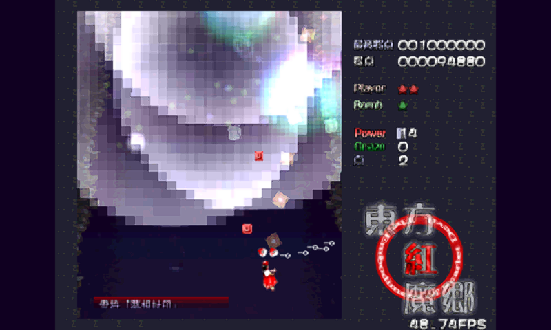
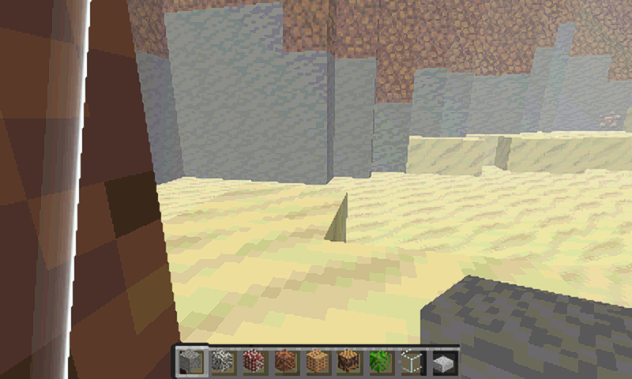
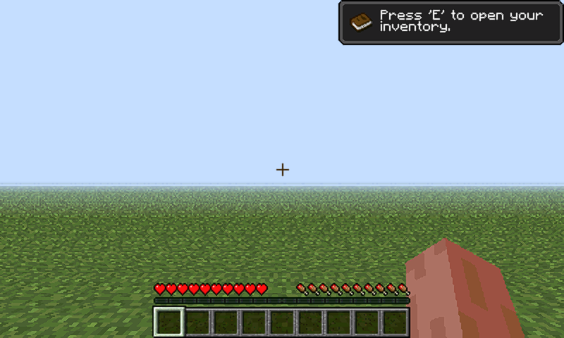

# 八游戏入口与 FPGA FSR 接入验收（2026-10-31）

八个固定游戏入口均已通过实机启动、开启 PL FSR、持续出帧、正常退出检查；Java 还验证了原始存档、保留画质、双 TMU 配置切换及原 v23 恢复。主机已独立核对整包和内层哈希、日志、384000 像素黄金输出及硬件状态。

## 界面与物理输出的区别

选择界面用于最终的板上显示器菜单，目前已完成板上 ARM 的 1080p／800×480 离屏运行和各 16 项交互检查。菜单画面尚未接到物理 LCD／miniDP 呈现。八款游戏本身使用已有 PL→RGB LCD 链路，FSR 已在该链路实机运行。miniDP 目前 disconnected，用户确认暂不接屏，本轮不将离屏截图作为 1080p60 物理输出证明。


## 渲染与切换链路

ARM 游戏逻辑／几何与命令 → DMA → PL RasterIX → SNP1 完整帧租约 → PL EASU12＋RCAS5 → HR 双缓冲与 POST ACK → 800×480 RGB LCD。

FSR 固定 400×240 → 800×480，CPU 负责控制和所有权，实时 EASU／RCAS 像素在 PL 计算。首页可选择开／关；关闭时启动器采用原来的 nearest 呈现。该版本沿用现有两个已验证位流，原 PL FSR 源码、二进制和归档保留。Java 使用 ARM 前端、完整 256 纹理与双 TMU，CNN 为 stub，本轮未启用神经风格化。

退出按 FSR 排空 → 游戏关闭和 GPU 队列排空 → Java 配置恢复顺序执行。FSR 的 AXI 所有者不会被强杀。状态设备每次采样后关闭，避免阻止卸载驱动。Java 私有凭据和渲染库固定路径凭据为同一文件的硬链接，只在实际位流加载并验证后生成，恢复时一并退役。

## 实机数据

以下为短时验收中 **FSR 处理速率**，并非统一场景性能排行或稳定游戏 FPS。正常入口测试没有自动退出计时和自动输入，由外部控制器 STOP 正常退出。自动验证单独启用 QA。

| 游戏 | 场景／方式 | 已处理帧 | FSR 平均帧/秒 |
|---|---|---:|---:|
| 东方·红魔乡 | 自动开局／巡游 | 1498 | 50.66 |
| ClassiCube | 自动开局／巡游 | 1698 | 58.88 |
| Minecraft Java 1.2.5 | 原始存档验证（含启动阶段） | 625 | 19.93 |
| 东方·红魔乡 | 正常入口 | 812 | 49.12 |
| ClassiCube | 正常入口 | 994 | 60.08 |
| Minecraft Java 1.2.5 | 正常入口主菜单 | 50 | 1.65 |
| Tux Racer | 正常入口 | 663 | 60.12 |
| Neverball | 正常入口 | 168 | 24.84 |
| Neverputt | 正常入口 | 677 | 59.97 |
| Quake | 正常入口 | 525 | 53.70 |
| Quake III | 正常入口 | 182 | 27.87 |

Java 的存档轮次 FSR 平均约 19.93 帧/秒，正常主菜单轮次约 1.65 帧/秒，主菜单仍明显慢。这里没有同场景开／关 FSR 的 A/B，不能把差异归因于 FSR。该结果不承诺 60 FPS；显示器 60 Hz 与游戏产出新帧也不同。

所有记录的重复源帧和租约过期为 0；最终 GPU 五项错误计数为 0。Java QA 通过原始 GUI 进入现有存档，确认 Tiny／Fast、AO 开、全部粒子、行走晃动等选定配置。PL 静态 FSR 全部 384000 像素与既有 v23 黄金数据一致。

普通 Java 启动日志的即时外框高度曾记录 206，完整初始化后独立 X11 查询确认 Minecraft 窗口与实际画布均为 400×240，正常关闭成功。原始日志保留，最终几何证明见 normal-java-window-probe.json。

## 真实 FSR 帧回读

下面均为板上 PL FSR 输出的 800×480 帧缓冲回读。Java 原先在游戏退出后保存的末帧为噪点，已经排除为视觉证据；改用完全未修改的生产 FSR 程序，在原始存档仍运行时分两次各运行 1.5 秒并完成回读。两次帧号均晚于世界运行检查点，画面均正常（本轮约 15.16／15.33 个 FSR 帧/秒）。退出末帧异常记录保留，未宣称其根因已修复。通过菜单控制服务 STOP 时会先停止 FSR；直接在游戏内部自行退出的瞬间末帧仍需显示接管策略处理。

### 东方



### ClassiCube



### Java 原始存档



## 文件和运行方式

- 源码：linux/launcher/main.cpp、launcher_control.py、play_game.py、game_specs.py、java_profile.py、JavaInteractive.java。
- 构建：`./build.ps1 -Action launcher`，产物在 build/launcher-v2。
- 当前板上代码：`/tmp/rasterix-launcher-v2e`；游戏存档与选项使用各自持久目录。
- 本次代码、JRE 和受保护 PL 组件在 RAM，重新上电后需要恢复运行环境，尚未设置开机菜单。

```sh
app=/tmp/rasterix-launcher-v2e
nohup python3 "$app/launcher_control.py" --socket /tmp/rix-menu/control.sock --board serve > /tmp/rix-menu-control.log 2>&1 < /dev/null &
# 在同一串口继续，先启动、正常停止，再启动下一款：
python3 "$app/launcher_control.py" --socket /tmp/rix-menu/control.sock start touhou --fsr
python3 "$app/launcher_control.py" --socket /tmp/rix-menu/control.sock stop
# 同样支持 classicube / minecraft-java 及其余五款固定 ID。
```

菜单尚未接到物理显示，以上接口可以操作真实游戏；本机 UI 预览服务默认不会启动真实游戏。详细构建和预览方式见 linux/launcher/README.md。

## 凭据与证据

- 安装包 3847505 字节，SHA256：`4a1b68534e1dfb9f11a5928cd5dcdf4408694f09a4adf1e12dcb99c72e63ca61`。
- 最终完整回读 7004160 字节，SHA256：`d16b0651def8ca54ef4cb13603ae301c694fc95d8126ddec7ef5b4fc0e55a57c`。
- 最终启动 UUID：`96c1f908-544c-4efe-ad7e-3ae488082f3c`。
- 独立验收：report/launcher-games-fsr-v2e-live/acceptance.json。
- 最终保护检查：report/launcher-games-fsr-v2e-live/rasterix-launcher-v2e-qa/final-guard.json；三把锁成功获取并释放，无游戏／FSR／接收器残留，原 v23 凭据有效。
- 原 FSR 归档：preserved/pl-fsr-v23-20261029/snapshot.tar.gz，SHA256 `0009bffd730853ddc8ab60a3ded6239330b9c694b01f5ddbbd2daeb8c6d957e1`。

调试中保留了日志目录校验拒绝、设备句柄阻止卸载，以及缺少 Java 固定路径凭据的主动退出记录。后者发生于 RasterIX 命令数为 0 时，仍按现有隔离规则完整软重启，保留旧隔离文件并通过原控制器恢复。旧启动 100 个证据文件已逐文件回读校验，存放 report/launcher-pre-reboot。

第一轮数据包等待 ACK 曾超时，源日志和完整回读均保留，之后重新取得三把锁确认释放和健康。加入运行中 Java 帧后重新导出 7004160 字节，完成外层／内层校验并在期限内 ACK，实际观察到 LAUNCHER_V2_EVIDENCE_RELEASED。

## 接屏后的下一步

1. 读取 miniDP EDID，验证 PS DisplayPort 的 1920×1080@60 Hz 模式与测试图。
2. 完成 UI 和游戏的完整帧发布／DRM 缓冲所有权，接到 PS DPDMA 扫描；不能直接读正在被 PL 覆写的输出银行。
3. PL FSR 当前输出 800×480，送 1080p 时再按比例放到 1800×1080、两侧各 60 像素；整数模式可用 1600×960。
4. 接入全局返回、焦点和真实 USB 键鼠体验检查，再固化启动准备与开机菜单。
