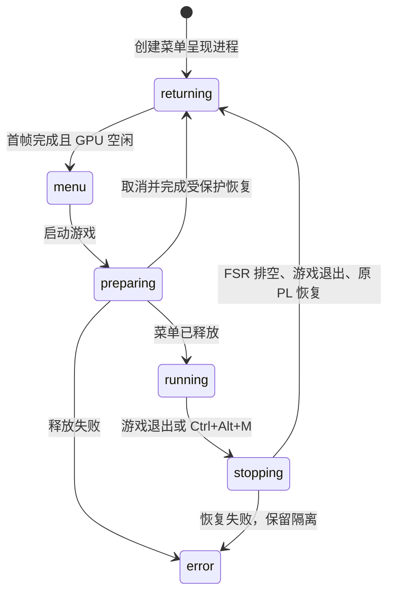

# 多游戏菜单会话 v3：返回键、LCD 适配与交接

**同日后续更新：菜单已改为原生 800×480 显示，用户确认文字明显清楚。** 当前目录为 `/tmp/rasterix-launcher-v3-native`，构建输出 `build/launcher-v3-native`，详见 [原生菜单修复与验收](LCD_NATIVE_MENU_2026-11-01.md)。以下保留此前 400×240 纹理菜单的实现和验收记录；当前启动与显示方式以上述新报告为准。

2026-11-01 更新：**v3 已部署到开发板 RAM，并通过东方 → ClassiCube → Minecraft Java 1.2.5 的正常入口、PL FSR、全局返回和菜单恢复测试。** COM11 已恢复，当前 LCD 留在不限时游戏选择界面。最终图像、数据、故障修复和验证边界见 [实机验收报告](GAME_LAUNCHER_V3_BOARD_FSR_2026-11-01.md)。

## 实现范围

- `session.py`：一条命令管理中文 SDL 菜单、控制服务和键盘监视器。普通游戏入口没有自动输入或退出计时。
- `global_input.py`：观察键盘 evdev 的 `Ctrl+Alt+M`，通过私有 Unix socket 请求正常返回。支持设备后插、左右修饰键、跨键盘组合、重复按键抑制、移除和 SYN_DROPPED；不独占键盘、不直接终止 GPU/FSR 进程。
- `lcd_menu.py`：独立进程持有 GPU 上下文及三把互斥锁，只读取原子发布的完整 CPU 菜单。启动游戏前必须确认该进程正常释放；游戏退出、FSR 排空及 Java 原 PL 恢复后才重建菜单。
- `play_game.py`：补齐准备阶段的取消检查；在受保护的 PL 切换中按返回，先完成恢复，再跳过原生游戏创建。正常关闭会等待实际游戏窗口出现。
- `install_session.py`：先核验整包和全部文件，再安装到新的 `/tmp/rasterix-launcher-v3*` 目录；旧包保留。

八游戏的卡片和统一适配器继续保留；本轮 v3 实机复测三款新增游戏，其余五款的上板依据仍为 v2 验收。本轮未改变 FSR 数学、游戏画质或几何前端，也没有把神经风格迁移串入该菜单入口。

## LCD 输入和呈现

SDL 生成完整 **800×480** CPU 菜单。板上 Xorg 为 **400×240**；输入窗口改用无边框全屏，实测客户区确为 400×240，避免 Matchbox 将窗口压成 400×174。鼠标按实际窗口尺寸映射到菜单坐标，并由软件绘制可见指针。点击启动前重新获取控制器状态，避免刚返回菜单时使用过期的 `returning` 状态。

LCD 适配器将菜单采样为 400×240，以八个最大 128×128 的纹理块交给原 v23 RasterIX，再通过 PL 最近邻呈现到 800×480 RGB LCD。文字实际经过 400×240 采样。它与游戏的 **PL FSR 400×240 → 800×480** 路径不同。



Java 冻结加载器要求 POST `requested=active=1`、style 0、快照租约和过期计数为 0。菜单释放前恢复并核验这些条件；菜单浏览期间使用 POST nearest mode 0。没有放宽加载器、清除同次启动隔离或强杀 AXI 所有者。

菜单 GL 库固定到实际已 strip 运行包文件：`f042f8a4f7f2751557a48ebcf66d9d6abe20981168de32ee8067ffe3c0678bc1`，来自固定运行包 `6d35f2b7bafbf054b1a32c44cd4a3c9d71add5010bb91702db3be60d1f428269`；独立放在菜单私有目录，不替换游戏 GL 库。

## 构建与证据

```powershell
./build.ps1 -Action launcher
```

输出 `build/launcher-v3`。最终已上板包：**4,267,231 字节**，SHA256 `791f351536bb1e2791107b12f5bddda71f1bb7af335521b98b870b7c99ea0ddc`。原 v2 包及本轮早期包保留；README 和本报告在完成验收后更新，安装包身份保持冻结。

- UI：1080p、800×480、实际 400×240 输入窗口共 **48 项**检查。
- 会话／输入：**11 组**检查，覆盖八入口交接、取消与失败、键盘重同步、真实 Unix socket、延迟窗口关闭和完整预览会话。
- 宿主 GL：Mesa GLX pbuffer 的三个图案合计 **288,000 像素**，逐像素验证方向、接缝和更新；这项单独不证明 FPGA 显示。
- 实机：同次启动三游戏连续切换、PL FSR、新鲜源帧、内核虚拟键盘经 evdev 返回、Java 启动中取消、5 次菜单呈现进程正常释放、原 v23 恢复；独立回读核验 **86 个文件**。
- 鼠标：XTEST → Xorg → SDL → 完整 CPU 帧 → RasterIX 完成帧 → LCD 内部抽样；独立回读核验 4 个文件。实体 USB 鼠标未验证。

本地证据为 `build/launcher-v3/{ui-tests.json,session-tests.json,lcd-gl-tests.json,build-proof.json,package-manifest.json}`。`build-proof.json` 的 `board_executed=false` 仍描述构建阶段；独立实机证据为 `report/launcher-v3-cycle/acceptance.json`，不要混用两者范围。

## 启动与使用

本机预览不接触开发板：

```sh
root=/mnt/f/1FPGA/Xilinxprj/prj2/rasterix-linux
python3 "$root/build/launcher-v3/host-session/session.py" --size 800x480
```

本轮最终已安装在板上 `/tmp/rasterix-launcher-v3b`。当前不限时会话已经启动，**不要再启动第二个会话**。停止现有会话并确认资源已释放后，可用：

```sh
python3 /tmp/rasterix-launcher-v3b/session.py --board --lcd-menu
```

方向键选游戏，Enter 启动；鼠标点选；首页 `FPGA FSR` 开关影响下一次启动；游戏中 `Ctrl+Alt+M` 正常返回。启动或恢复中应等待，不强制关闭硬件所有者。

当前部署在 RAM；断电或重启后，菜单、Java JRE 和实验位流需要恢复。最终恢复包已本地生成并逐文件校验，见 `build/launcher-v3/recovery-final/verification.json`；该组合包尚未重新上板执行。本轮没有写入 SD 开机服务。

实体 USB 键鼠、长时间交互游玩和 miniDP 1920×1080@60 Hz 均待验收。miniDP 后端尚未实现，1080p UI 预览不代表 DP 输出已接通。Java 当前实机截图是正常主菜单；v2 的世界游玩和黄金比对证据继续保留。
