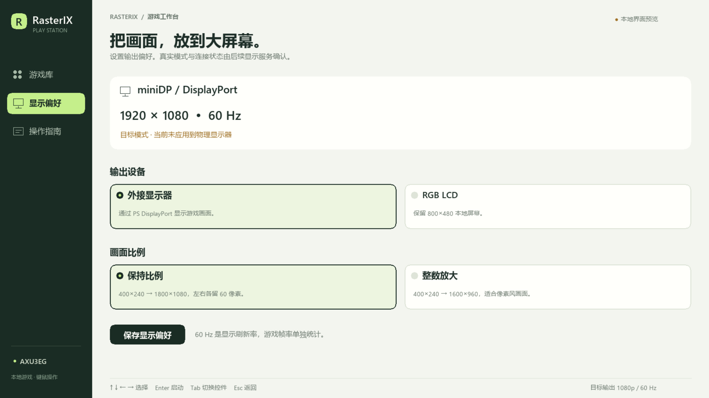

# 多游戏选择界面 v1

2026-10-31，最新修订为 v1b，已完成可编译运行的原生中文菜单，并在开发板上完成 ARM 离屏交互检查。当前验收范围为 UI 与预览控制协议；真实游戏切换、LCD 菜单呈现、miniDP 游戏输出和全局返回热键尚未验收。

## 界面

浅色主区、深绿色侧栏与绿色选中状态。游戏卡片使用已有实机回读图片，明确作为历史预览；图片中的旧 HUD 数字不作为本次帧率测量。


显示偏好页可保存 DP／LCD 和保持比例／整数放大选择。页面明确区分目标模式与物理显示是否已应用；保存偏好不会直接修改 FPGA 或 DRM。



## 已实现的功能

- 八游戏选择：Tux Racer、Neverball、Neverputt、Quake、Quake III Arena、东方、ClassiCube、Minecraft Java。
- 全部／竞速休闲／射击弹幕／方块世界分类，保持正确的筛选后选择与导航。
- 方向键选择、Enter 操作、鼠标选卡、Tab／Shift+Tab 焦点切换、Esc 返回。
- 弹窗独占焦点，阻止穿透点击背景；未接入或未连接的入口给出明确提示。
- 显示偏好通过临时文件、同步与原子替换保存，并进行白名单回读。
- 本地 Unix 控制协议，限定游戏 ID 和请求操作；预览模式不会创建真实游戏进程。
- 原五游戏的常规游玩适配器源码，默认无 1800 秒限制；正常关闭、日志排空、GPU 状态检查和异常隔离均纳入流程。新适配器尚待真实游戏生命周期验收。

东方、ClassiCube、Java 的专用启动适配器保留待接入状态。Java 当前的自动测试运行器没有被误用为普通游玩入口。跨游戏全局热键尚未接入，UI 当前只能在自身收到快捷键时发送 STOP；后续需实现并验证焦点／鼠标捕获下的返回行为。

## 实现与构建

菜单使用 SDL2 软件绘制，不依赖浏览器、Mali 或 RasterIX 上下文。中文字体在电脑构建时生成字形图集，包中不包含字体二进制。启动服务采用 Python 标准库；配置表位于 `config/launcher-games.json`。

```powershell
./build.ps1 -Action launcher
```

输出为 `build/launcher-v1`，包括：

| 文件 | 用途 |
|---|---|
| `host/rix-launcher` | WSL 桌面交互预览 |
| `arm/rix-launcher` | AArch64 原生菜单 |
| `rasterix-launcher-v1.tar.gz` | ARM 程序、私有 SDL2、资源及控制脚本 |
| `ui-tests.json` | 本地 SDL 事件及控制协议检查 |
| `previews/` | 原生程序离屏生成的页面图片 |
| `build-proof.json` | 构建、输入与包身份；描述打包时尚未上板的状态 |

本次上板使用的运行包为 **2,687,653 字节**，SHA256：`67c314cc97b7eadcd57e0b5febdf09203ea452524955e6136c7d4e7bb404cfe1`。后续重建如得到新摘要，应重新绑定部署与验证记录，不沿用旧包的上板结论。

详细预览命令与接口说明见 [launcher/README.md](F:/1FPGA/Xilinxprj/prj2/rasterix-linux/linux/launcher/README.md)。`--frame-output` 目前用于调试图像导出，不是已接入 DP 的实时完整帧发布协议。

## 验证结果

宿主与开发板 ARM 程序均完成两种尺寸各 14 项真实 SDL 事件检查，覆盖键盘网格导航、鼠标选卡、预览启动／返回、弹窗焦点隔离、分类导航、Tab 操作、显示偏好保存和回读、Esc 返回。预览协议检查未启动任何真实游戏。另检查了单游戏互斥、正常结束返回与异常结束后阻断。

开发板运行时使用 SDL dummy 视频驱动，只在内存中绘制，没有输出到物理 LCD／DP。真实 ARM 截图及 JSON 已从板端回读，与包身份、窗口尺寸、检查结果和前后 GPU／POST 状态独立核对。

- 启动 ID：`ea7e22fa-e644-46e0-8ce3-ebfc3387ee3e`。
- 完整回读：1,136,640 字节，SHA256 `782850186e909f2cd81adb065403028605e9a450cff76eb6673ba70bbe47c346`。
- 两张 ARM 截图均通过尺寸、摘要与宿主图像差异检查；服务状态文字不同，所以没有宣称全图字节完全相同。
- UI 执行前后 GPU／POST 状态及活动凭据一致；最终空闲、零硬件错误、无残留 UI 控制进程／接收器，原锁均已释放。
- 首轮记录中，首次直接暂存非对齐长度 gzip 数据时导出进程发生 SIGBUS；原 UI 结果与截图已完整保存。改用 512 字节 TAR 块后导出及 SHA 校验通过，首次源代码与失败日志保留。随后视觉检查发现自检截图中的空提示色块，已在 v1b 修复并重新完成全部离屏检查；首版包与原始图另行归档。

证据：[独立验收](F:/1FPGA/Xilinxprj/prj2/rasterix-linux/report/launcher-ui-v1b/acceptance.json)、[最终空闲核验](F:/1FPGA/Xilinxprj/prj2/rasterix-linux/report/launcher-ui-v1b/final-verification.json)、[ARM 1080p 离屏图](F:/1FPGA/Xilinxprj/prj2/rasterix-linux/report/launcher-ui-v1b/1920x1080/frame.png)。

运行包仅解包在开发板 `/tmp/rasterix-launcher-v1b`，重启会清空；没有改写 SD、自启动、内核、位流、原游戏库或 PL FSR 保留代码。现有主线仍保持原选择。

## 下一步

1. 给菜单增加 LCD 或 DRM 显示后端，使界面在物理屏幕上显示。
2. 对新常规游戏适配器逐一做真实启动、正常退出、返回菜单与存档保留验收。
3. 接入东方、ClassiCube、Java 专用运行配置和受保护位流切换。
4. 实现全局返回及鼠标焦点交接；接显示器后验证 1080p60，再接游戏完整帧发布。

这些工作继续依据 [多游戏与 miniDP 总方案](F:/1FPGA/Xilinxprj/prj2/rasterix-linux/docs/GAME_SWITCH_MINIDP1080_PLAN_2026-10-31.md)推进，不把 UI 离屏通过当作 DP 或真实游戏切换通过。
