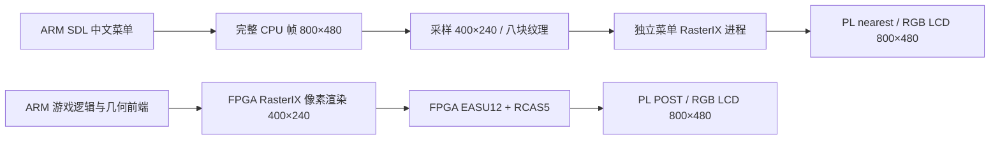
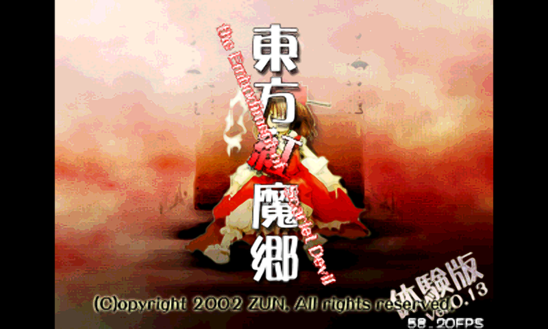
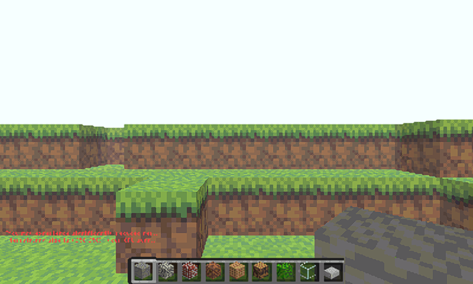
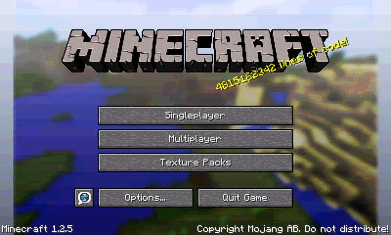

# 游戏菜单 v3 与三游戏 PL FSR 实机验收

2026-11-01，AXU3EG，800×480 RGB LCD。**中文选择界面已接入实际 LCD 路径，东方、ClassiCube、原版 Java 1.2.5 均通过带 FPGA FSR 的正常启动、持续出帧、Ctrl+Alt+M 返回和菜单恢复。** 本轮结束时保留不限时菜单会话，首页 FSR 偏好为开。

## 1. 界面和渲染链路

下图是从当前板上会话回读的 **800×480 CPU 菜单文件**，含软件鼠标指针。它用于说明界面布局；实际 LCD 菜单经 400×240 RasterIX 渲染后放大。


另有独立的 [LCD 内部扫描采样图](assets/launcher-v3/menu-live-lcd-debug.png)：硬件调试接口仅取 100×60 点，展示图为最近邻放大，不能用它判断文字锐度，也不是相机拍摄。



菜单进程和游戏串行使用 GPU。菜单退出并释放后才启动游戏；FSR 排空、原生游戏退出，以及 Java 的原 v23 配置恢复后，才再次显示菜单。实时超分像素在 FPGA 计算，ARM 负责源帧所有权和调度；本轮未把神经风格迁移串入这条入口，也未改变游戏画质或 FSR 算法。

## 2. 实机覆盖范围

最终测试在同次 Linux 启动 `5c0f0cc8-a132-4bdf-bf5d-ed332e10afa8` 完成。使用普通游戏入口，`qa_seconds=0`、`qa_autoplay=false`；测试程序通过外部输入请求返回。

| 项目 | 结果与依据 |
|---|---|
| 菜单启动及 LCD 呈现 | 首帧完成、原子 CPU 图像和 LCD 内部采样对应；菜单可重复创建 |
| 输入窗口 | 实际 X11 客户区 400×240，全屏；返回后键盘焦点恢复 |
| 键盘启动 | 内核 uinput → Xorg → SDL，选择并启动正常游戏入口 |
| 三游戏返回 | 均经 uinput → evdev 的 Ctrl+Alt+M 请求 STOP，等待正常交接 |
| Java 准备中取消 | 在受保护 PL 切换期间返回；未创建原生 Java 进程、未启动 FSR，原配置恢复 |
| 菜单资源释放 | 5 个菜单呈现进程全部正常退出并恢复 POST mode 1 |
| 游戏帧 | 三款均产生新的 FSR 源帧，重复源帧和快照租约过期均为 0 |
| 测试结束硬件 | 原 v23 凭据有效；Java 两份临时凭据已退役；GPU 队列排空、五项硬件错误为 0 |
| 鼠标指针 | XTEST 鼠标移动经 Xorg/SDL 进入完整 CPU 帧；RasterIX 确认同帧，LCD 采样区域随指针变化 |
| 实体输入及外接屏 | USB 键鼠未实测；miniDP disconnected，未做真实 DP 输出 |

内核虚拟键盘验证了真实 Linux 输入链路，不能代替实体 USB 热插拔验收。鼠标是 XTEST 注入；没有把它标为实体鼠标通过。鼠标采样中有 5 个 LCD 点变化，3 个采到指针白色填充；100×60 调试采样会跳过一像素轮廓，完整 CPU 图像另行核验轮廓与位置。

## 3. 三游戏图像和数据

以下均由本轮实机 FSR 在原生游戏关闭前导出 **800×480 XRGB 完成帧**，不是离线绘制。数据是短时联调的 FSR 完成吞吐，含源帧等待和部分启动开销，不能当作稳定游戏 FPS；没有开展同场景关闭 FSR 的性能 A/B 测试。

| 正常入口及本轮场景 | FSR 完成帧 | 统计时长 | FSR 完成吞吐 | 返回菜单 |
|---|---:|---:|---:|---|
| 东方·红魔乡，标题画面 | 317 | 8.279 s | 38.29 帧/s | 通过 |
| ClassiCube，本地 64³ 世界 | 496 | 8.277 s | 59.92 帧/s | 通过 |
| 原版 Minecraft Java 1.2.5，主菜单 | 17 | 10.776 s | 1.58 帧/s | 通过且原 PL 恢复 |

三组每帧 FPGA COMPUTE 均约 8.2 ms。Java 本轮 FSR 源帧等待累计约 10.62 s，说明这个场景主要在等渲染源帧；不能据此声称整个游戏性能都由 FSR 决定。Java 主菜单仍慢，本轮没有解决这个问题。ClassiCube 的近 60 帧/s 结果也仅覆盖短测，不是长期稳定性结论。



东方保留原 4:3 内容比例，左右黑边是比例保护。标题画面上的游戏自带 FPS 与本报告 FSR 总统计区间不同，不能直接互换。



板子未联网，ClassiCube 仍可能显示皮肤下载失败的红色提示；日志记录本地世界正常加载。现有 `glHint not implemented` 提示仍保留，GPU 硬件错误计数为零不表示所有 OpenGL 功能都已实现。



Java 本轮没有自动进入世界。此前世界、存档、黄金比对和 v2 八游戏 FSR 验证见 [v2 验收](GAME_LAUNCHER_GAMES_FSR_V2_2026-10-31.md)，不把历史结果重复计入 v3。

## 4. 发现并修复的问题

1. **菜单 GL 文件身份不一致。** 本地未 strip 库与真实运行包库不同；菜单改为使用已核验运行包中的私有库，保留游戏库。宿主 GL pbuffer 三图案共 288,000 像素逐点通过，实机另有 LCD 采样。
2. **测试在菜单停止后请求新快照。** 原测试先停止菜单再申请 SNP1，而该请求等待下一次 swap，导致过期。保留故障归档和隔离，正常 Linux 重启后改用独立 LCD 采样；没有清零错误绕过检查。
3. **准备中取消仍创建 Java。** 首轮取消发生在 PL 切换间隙，旧逻辑随后仍创建 Java，关闭时窗口尚未出现。补齐准备阶段检查，先完成受保护恢复，再跳过原生进程；正常关闭另行等待实际窗口。本轮专门回归通过。
4. **控制器已恢复而 UI 仍缓存 returning。** 启动前主动获取最新状态，暂时忙改为短提示；宿主检查刻意构造过期缓存，实机再按正常入口验证。
5. **400×240 窗口被压成 400×174。** 改为无边框全屏，并按实际窗口尺寸映射输入；最终实测 400×240。加入可见软件指针。

两次早期硬件失败均先保存证据，再正常重启 Linux。旧启动的隔离记录仍保留；没有删除当前启动隔离、放宽冻结加载器或强杀 FSR/AXI 所有者。最终同次启动的两次 UI 时序失败也纳入证据，再由修复版本完成全流程。

## 5. 包、证据及恢复

最终包为 `build/launcher-v3/rasterix-launcher-v3.tar.gz`，**4,267,231 字节**，SHA256：

```text
791f351536bb1e2791107b12f5bddda71f1bb7af335521b98b870b7c99ea0ddc
```

已安装至 `/tmp/rasterix-launcher-v3b`。此次 UI 修正版相对前一个准备取消修复包，仅原生 `rix-launcher` 可执行文件变化；最终测试及回读均对应上述包。验收后更新了仓库 README 和报告，未改动已测运行代码或重写已验收包。

| 证据 | 身份与用途 |
|---|---|
| [最终总记录](../report/launcher-session-v3-board-20261101.json) | 关联最终包、运行源码、输入验证、图像及边界 |
| [三游戏独立验收](../report/launcher-v3-cycle/acceptance.json) | 86 文件逐个长度/SHA256 核验；完整运输包 1,382,400 字节，SHA256 `3af48d18fb2ba254674298823022452f772b47472c15494317399b38cc79f3fa` |
| [三游戏原始结果](../report/launcher-v3-cycle/qa/result.json) | 各游戏 FSR 统计、正常退出、Java 取消及恢复 |
| [鼠标独立验收](../report/launcher-v3-mouse-live-r2/acceptance.json) | 4 文件核验；94,398 字节 UART 包，SHA256 `03718850361cda4f9fb88c6d7c9608fa1bee7b41ca8c4ff22ae851a964df55b4` |
| [首次快照失败](../report/launcher-v3-smoke-failure/review.json) | 保留原始失败，不计通过 |
| [早期准备取消失败](../report/launcher-v3-cycle-failure/review.json) | 保留旧程序和故障状态，不计通过 |
| [最终 RAM 恢复包校验](../build/launcher-v3/recovery-final/verification.json) | 新组合包 67,205,120 字节，SHA256 `f2930ad4a1ddc724d7c2ab1611ac81b6e2b1b70d81e33869fe9d2a9f9e6492dc`；仅本地验证，未重新执行该组合包 |

本地 48 项 UI、11 组会话／输入检查及 GL 逐点验证通过；构建证据 `build/launcher-v3/build-proof.json` 专门保留构建阶段的 `board_executed=false`。上表独立上板验收才证明实际执行，二者不互相替代。

原 PL FSR 代码与归档保留，SHA256 仍为 `0009bffd730853ddc8ab60a3ded6239330b9c694b01f5ddbbd2daeb8c6d957e1`。最终恢复组合包保留同一 native/JRE 身份和已验收菜单包；旧的实际恢复包也保留，没有用新组合包冒充已经执行过的恢复流程。

## 6. 当前使用和后续顺序

板上当前运行正常不限时会话；不要并行启动第二套菜单。方向键/鼠标选游戏、Enter 启动、首页切换 FPGA FSR；游戏中 `Ctrl+Alt+M` 返回，等待恢复后再启动下一款。

本轮**仍为 RAM 部署**，未写 SD 开机自启动；断电或重启会丢失 `/tmp` 中的菜单、JRE 和实验配置，需恢复。屏幕图像是数字回读，尚未取得人眼观察或相机确认。

接下来优先接入实体 USB 键鼠，验收连续操作、鼠标捕获释放和至少 30 分钟反复切换；随后落实持久化启动和回退。miniDP 按既定 [1080p60 方案](GAME_SWITCH_MINIDP1080_PLAN_2026-10-31.md) 另行推进：先有真实接屏的 EDID/DRM 模式，再接完整帧发布与缩放，最后才验收游戏画面。当前 miniDP 后端未实现，菜单有 1080p 布局不代表物理输出完成。
