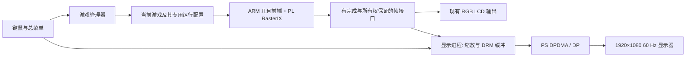

# 多游戏切换与 miniDP 1080p60 输出方案

2026-10-31。按用户决定结束本轮 Java／ARM／DMA 帧率深挖，转向多游戏入口和外接显示。保留现有优化结果、位流、PL FSR／CNN 源码与回退包。本文件是实施方案，没有部署启动器或改写显示配置。

## 目标与现状

目标：开机进入游戏菜单，用键鼠选择游戏，正常退出或使用统一返回快捷键回到菜单；外接显示器采用 **1920×1080@60 Hz**，现有 RGB LCD 保留作调试和回退。内部渲染维持各游戏已验证配置；显示刷新率与游戏产生新帧的速度分别统计。

已核对的基础：

- 五个原有游戏已有 `rix-games` 命令入口、独立配置与存档、正常关闭和硬件空闲检查；它目前是命令行入口，还不是统一图形菜单。
- 东方、ClassiCube 有各自入口；ClassiCube 有键鼠默认模式及 FSR 运行器。Java 1.2.5 的最新验收主要依赖有热身、自动选世界和限时退出的试验运行器，需另做日常游玩入口。
- Java 采用独立的 256 纹理／双 TMU 位流与库；ClassiCube 的已验收 FSR 配置又有对应硬件与运行时。不能只换可执行文件或令所有游戏共用一个 `libGL.so`。
- 2026-10-31 通过 COM11 只读查询：系统已有 `/sys/class/drm/card0-DP-1` 和 `/dev/dri/card0`；DP 状态 `disconnected`，没有显示模式，`modetest` 尚未安装。见 `report/board_serial/dp_switch_plan_20261031_probe.log`。尚未完成外接显示器的 EDID、链路训练或 1080p60 出图验证。
- 之前的硬件核对表明该接口连接 PS MGT；板卡手册同样说明 DP 视频通道接 BANK505 的 PS MGT LANE2／LANE3。接口属于 PS 显示子系统，图像仍可由 PL RasterIX 渲染。[ALINX 手册](https://www.alinx.com/public/upload/file/AXU3EG_User_Manual.pdf)

## 推荐架构

PS 的 DP 控制器通过 DPDMA 扫描内存帧缓冲。首版采用这条路径，复用 Linux DRM/KMS；不把 Mali 渲染加入依赖，也不把现有 PL LCD 引脚改成 DP 引脚。AMD 文档区分内存输入与 PL live 输入，live 路径还受内核版本影响；项目当前是 Linux 5.4，应按实际驱动核对，不直接套用 2025.1 之后的配置方式。[AMD DP 驱动说明](https://xilinx-wiki.atlassian.net/wiki/spaces/A/pages/18842105/ZynqMP)

DP 链路先做独立测试图，再接游戏帧。RGB LCD 的像素时钟、同步信号和固定 800×480 时序不作为 1080p DP 的视频源时序。

## 游戏菜单与切换

首批登记现有八个游戏，以一个 2×4 菜单呈现；实现时先贯通原五游戏，再接后三个专用适配器。

| 菜单项目 | 现有基础 | 接入重点 |
|---|---|---|
| Tux Racer | 原生游戏与正常退出已验收 | 复用运行包及原生显示提交入口 |
| Neverball | 已有统一命令入口 | 保存控制设置，退出后释放鼠标 |
| Neverputt | 已有完整球场入口 | 保留球场进度与配置 |
| Quake I | 已有独立 basedir | 保留存档，正常退出 |
| Quake III | 已有独立策略及原生模块 | 保留专用库、异步策略与配置 |
| 东方 | 已有独立运行器 | 复用 balanced 图集与专用输入配置 |
| ClassiCube | 已有键鼠／FSR 入口 | 位流、FSR 子进程与帧输出能力匹配 |
| Minecraft Java 1.2.5 | 已有真实游戏和图像验收 | 新建无自动游玩、无限时测试逻辑的交互入口；持久化 JRE、素材和存档 |

管理器使用清单登记每个游戏的可执行文件、私有库、素材、配置目录、硬件 profile、输出帧格式及可用特效。保持项目当前选定的 Java 原画质，不再继续本轮帧率搜索。

菜单建议提供：游戏选择、输出设备、保持比例／整数放大、该游戏已验收的特效、状态与日志。普通游玩不继承 autoplay、截图、性能采样等 QA 环境变量。神经风格迁移、配色滤镜和 FSR 分别标注；Java 当前位流 CNN 为 stub，不能在菜单中标为可用神经风格迁移。

日常入口统一改为用户主动退出才结束，限时运行保留为独立诊断选项；现有部分入口的默认 1800 秒上限不直接带入成品。持续排空日志并限制落盘体积，保留错误与尾部记录，避免长时间游玩时日志阻塞或写满。

键鼠行为：方向键／鼠标选择，Enter 启动；建议 `Ctrl+Alt+M` 返回总菜单，游戏内 Esc 继续用于游戏自己的菜单。实现时核对热键冲突；返回时释放鼠标捕获和所有按住的键，再把焦点交给启动器。现有 X11 dummy 输入链路保留，DP 图像由独立显示进程提交；不会因为改成 DP 就自动获得游戏输出。

切换按以下顺序执行：

1. 总菜单显示正在退出，向当前游戏发送正常关闭请求，让其保存数据。
2. 等待几何、上传、DMA、后处理及快照租约排空，验证无残留 GPU 客户端。
3. 显示进程切到自己持有的菜单／加载画面，释放 PL 寄存器及图像映射。
4. 如硬件 profile 相同则复用；如不同，调用现有受保护加载／恢复流程，建立当前启动的新凭据。
5. 验证位流、库、纹理容量与能力匹配，再启动下一个游戏。

管理器与子运行器需统一锁的所有权，防止父进程持有原 `flock` 而子进程再次获取造成死锁。硬件异常沿用当前隔离与恢复规则；不在未确认排空时强行启动下一游戏。重新配置 PL 期间，DP 保持显示它自己的 PS 内存缓冲。

## 1080p60 的图像与缓冲策略

首版输出模式为 1920×1080@60 Hz；内部图像按当前每个游戏的大小产生。以 400×240 为例：

| 显示策略 | 游戏画面区域 | 边缘 |
|---|---|---|
| 默认保持比例 | 1800×1080 | 左右各 60 像素 |
| 像素风整数 4 倍 | 1600×960 | 左右各 160、上下各 60 像素 |
| 真正 4:3 的内容 | 1440×1080 | 左右各 240 像素 |

每个适配器提供有效画面区域与显示比例；不对带 HUD 的游戏自动裁边。拉伸或裁剪铺满作为可选项，默认保留比例。上述 1080p 显示模式不会增加原始几何与纹理细节；25 FPS 游戏在 60 Hz 显示器上会重复扫描最近一帧。

`rix-displayd` 作为唯一 DRM/KMS 所有者，申请双缓冲或三缓冲；按照实际枚举到的 plane 支持格式，优先评估 RGB565，必要时用 XRGB8888。不预设 KMS plane 可完成任意缩放，应先生成可直接扫描的最终尺寸缓冲。显示进程按新 frame ID 更新图像，使用换页事件管理缓冲寿命，繁忙时保留最新完整帧，避免排长队增加操作延迟。

首版缩放用最近邻和行复用，随后按实测决定是否默认双线性；只在有新游戏帧时缩放。总菜单可软件绘制并走同一显示接口，不额外占用游戏的 RasterIX 上下文。

这条软件菜单路径适用于 DP。若先在现有 LCD 上交付菜单，需单独提供 RasterIX 菜单后端，只在菜单状态持有 GPU 上下文，启动游戏前完整排空并释放。PL 重配置期间 LCD 允许短暂黑屏；PS 的 DP 菜单画面可继续保持，不能把两种输出的切换表现混为一谈。

最低有效像素数据量估算如下，MB 为十进制；未包含总线额外开销及其他游戏访问：

| 项目 | RGB565 | XRGB8888 |
|---|---:|---:|
| 1080p60 扫描读取 | 248.8 MB/s | 497.7 MB/s |
| 每秒更新 30 张全尺寸图的写入 | 124.4 MB/s | 248.8 MB/s |
| 三个全尺寸缓冲容量 | 12.44 MB | 24.88 MB |

缓冲由 DRM/CMA 等正规内存分配路径管理，与现有 32 MiB GPU 预留区隔离。检查连续内存余量、实际 pitch 和格式后再确定数量；不把扫描吞吐估算视为已测性能。

### 完整帧接口是关键改动

现有 `/dev/plgpu_display` 主要提供状态与等待，不是通用的 DRM 帧缓冲导出接口；现有 PS 渲染槽也不能在被 GPU 重用时任意读取。首版建议在各呈现适配器中，于完成确认且槽位尚未重用的时点，将低分辨率帧复制到独立的普通内存帧池，再交给显示进程。若实际提交链路无法保证这一时点，必须增加明确的槽位租约或完成握手。

帧描述至少携带：游戏／运行代次、frame ID、宽高、stride、格式、有效画面区域和所有权状态。PS DDR 原始帧与 PL 后处理帧分别适配；不能把 `FINISH_XFER` 当作所有渲染均完成，也不能用无所有权保证的“双读相同”代替完整帧保证。退出或重配时丢弃旧代次图像。

优先验证从已完成的低分辨率 PS DDR 帧取得原图，避免把高分辨率 PL DDR 回读变成 DP 首版的必经路径。需要保留特效时，再为已经完成的后处理输出建立单独的安全发布接口。

## FSR、风格迁移与后续硬件路线

第一验收目标是原图与基本缩放的外接显示。现有 PL FSR 固定 400×240→800×480；它不能直接生成 1920×1080。若通过 DP 展示其结果，还需最终尺寸适配与安全帧发布，并比较其额外回读成本。

特效按游戏能力逐一开放：先接已经验收的 ClassiCube FSR 等配置；神经网络风格迁移作为独立后处理链路验证，不承诺所有八游戏共用。原 PL FSR、CNN 和相关证据继续保留。

如果 CPU 输出桥明显拉低游戏帧率，再评估 PL 缩放器写 PS DDR 或 PL live 输入。前者需要核对 AXI 可达地址、帧缓冲导出与资源余量；后者需要新时钟、时序、PL 和设备树／驱动配合。两条路线均不作为首版必需项，也不预先宣称能装下或能达到 60 个新游戏帧／秒。

## 部署与理想排期

将已验证的库、位流、加载器、游戏、JRE 与素材归档到 SD 上按版本管理的目录。配置与存档独立保存，兼容现有位置并先备份；`/tmp` 只用于可重建工作区。开机服务按当前 PetaLinux 的 init 方式接入，不预设 systemd。每次启动校验包身份并创建新凭据，消除目前 Java 每次重启都要从电脑补回 RAM 环境的问题。

| 时间 | 交付内容 | 通过条件 |
|---|---|---|
| 第 1～2 天 | 图形菜单、原五游戏生命周期和 profile 清单；补齐 libdrm／modetest | 能启动、正常退出、保留配置和返回菜单 |
| 第 2～3 天 | 显示器 EDID、1080p60 测试图和 KMS 换页 | 真实显示器稳定显示，格式与模式明确 |
| 第 3～5 天 | 完整帧发布、DP 显示进程、最近邻缩放与比例处理 | 游戏到 DP 动态出图，无撕裂／颜色错误，记录新增 CPU 开销 |
| 第 5～7 天 | 东方、ClassiCube、Java 适配及硬件 profile 切换；SD 持久部署 | 八游戏逐一验收；重启后可直接进入菜单 |
| 第 8～10 天 | 已验收特效接入、双线性选择及故障恢复 | 不开放未通过的能力，游戏与显示统计分开 |
| 第 11～14 天 | 连续切换、长时运行、冷启动与展示材料 | 稳定版本、回退包、截图／视频和说明齐全 |

这是依赖顺利时的排期估计；显示器兼容性和各 profile 的连续帧发布是主要待验证项。截止前优先交付“多游戏可返回菜单＋稳定 1080p60 输出”，高级特效按验收进度加入。

建议验收项目：每游戏至少三次启动／退出、五轮完整游戏循环、一次至少一小时运行、三次冷启动；检查存档、键鼠焦点、旧进程／映射／租约清理、硬件错误计数、DP 热拔插后恢复，以及 Java 与通用 profile 双向切换。软件注入输入只能作为自动检查，实体键鼠手感与真实显示器图像另行确认。

## 拟新增组件

- `rix-launcher`：菜单和输入焦点。
- `rix-supervisor`：游戏生命周期、能力清单、profile 切换和恢复。
- `rix-displayd`：DRM/KMS、比例与缩放、显示帧率统计。
- `FramePublisher`／游戏适配器：完成帧与所有权交接。
- 游戏清单与版本化 SD 运行包：恢复当前已验证配置，保留历史包和回退入口。

现有工程依据：[五游戏验收](F:/1FPGA/Xilinxprj/prj2/rasterix-linux/docs/GAME_OPTIMIZATION_2026-10-19.md)、[既有 DP 核对](F:/1FPGA/Xilinxprj/prj2/rasterix-linux/docs/RACE_AND_DP_2026-10-18.md)、[Java 当前选择](F:/1FPGA/Xilinxprj/prj2/rasterix-linux/docs/JAVA125_CURRENT_PROFILE.md)。
