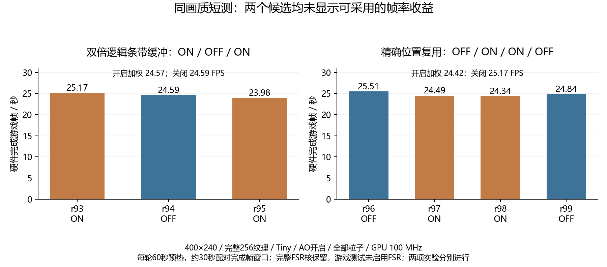

# 原版 Java：条带缓冲与精确位置复用实验

本轮保持原版 JAR、400×240、256 纹理、实际 Tiny、Fast、AO 开启、全部粒子及十二项画质设置。使用既有双 TMU 位流，GPU 100 MHz、完整 FSR 核保留；游戏对照仍为最近邻呈现。没有改动 SD、驱动 ABI 或 RTL，没有把上轮节省 LUT 的互联候选并入本轮对照。

## 实验一：扩大软件条带命令空间

CPU 在缓存内构造两倍容量的逻辑条带，再由原 DDU 按原 DMA 槽容量分包。只允许在完整 GPU 命令边界切分，保持所有命令及纹理 STORE 顺序，不插入帧缓冲提交或重新加载。原驱动的七个命令槽及独立资源槽保持原样。

原始命令容量为 1,048,568 字节，逻辑容量为 2,097,136 字节。六个在用条带缓冲共使用 12,582,816 字节普通缓存内存，原 DMA 内存不扩容。若命令超出逻辑容量，继续使用原有受保护 band spill；缓冲扩大不是取消边界检查。

异步源缓冲复用、完整流预验证、截断命令拒绝、纹理旁路均通过；原有 65,536 顶点可见压力与像素测试通过。三轮同一库的结果为：

| 轮次 | 开关 | 游戏 FPS | 游戏内分包次数 |
|---|---|---:|---:|
| R93 | ON | 25.1654 | 0 |
| R94 | OFF | 24.5878 | 不适用 |
| R95 | ON | 23.9801 | 0 |

ON 两轮按完成帧及时间加权为 **24.5725 FPS**，比 OFF 低约 0.062%，没有可重复增益。两次 ON 游戏的最大命令体分别为 932,632 和 1,042,188 字节，均未超过原容量，因此这组 Tiny 游戏没有真正用到扩大空间。保留为大场景候选，不把它推广为当前游戏提速成果。

库 SHA256：`db94786a7e3f97e1952dc6fc52826349ad65f3f1722a2a3af281c700dcccf88d`。完整归档为 1,034,240 字节，SHA256 `e13e54737ff8c4d286aa4f4ba26c5287f4482eeb093cb34d4871293d2e5f0f05`。R93/R94/R95 已完成独立离线验收并恢复原配置。

## 实验二：只复用位置，不复用顶点属性

旧顶点索引缓存会缓存完整变换后顶点，顺序绘制路径已绕过它。本次新增独立的 128 槽位置缓存，用完整四分量浮点位模式作键；只有键完全相同才复用已经计算的投影位置。相同位置可以具有不同颜色、UV、法线和点大小，这些属性继续按原代码处理。

缓存只在未开启固定管线光照及用户裁剪平面的路径使用。每次 DrawNewElement 都更新缓存世代，矩阵变化后的新绘制不会读取旧结果。未命中仍执行原来的 model-view 及 projection 两次变换，公式及运算顺序不改；没有采用矩阵预合成、近似浮点或半精度。

所有改动局限于新名字的私有计算器和 GLX。原核心静态库、共享数学头、DDU、纹理上传和 GPU 提交流程保持字节冻结，445 个公开 GL 导出保持不变。该实验与大条带缓冲分别测量，没有叠加两个未确认的效果。

纯缓存单元覆盖精确位比较、正负零、哈希碰撞和世代重置。每轮加载 PL 前，还在 ARM 上运行原计算器、新计算器 OFF、新计算器 ON 的几何对照：96 个绘制、11,520 个输入顶点，覆盖不同颜色/UV 的相同位置、矩阵重置、三角形/四边形/线/点及光照回退，要求三个输出文件逐字节一致。此项已在 R96 通过；它证明测试集的几何一致性，不代表穷尽全部游戏输入。

采用 OFF / ON / ON / OFF 的 R96～R99，同一二进制、同次开机，每轮预热 60 秒、测量约 30 秒。四轮均通过几何、可见像素、交换计数与原位恢复的独立验收：

| 轮次 | 开关 | 游戏 FPS | 位置命中 / 可复用路径输入 |
|---|---|---:|---:|
| R96 | OFF | 25.5112 | 不启用 |
| R97 | ON | 24.4943 | 61,034,958 / 86,974,912 |
| R98 | ON | 24.3406 | 61,110,462 / 87,080,548 |
| R99 | OFF | 24.8382 | 不启用 |

ON 按完成帧和时间加权为 **24.4162 FPS**，OFF 为 **25.1691 FPS**，观测差约 −2.99%。合并位置命中率 **70.1761%**，但没有端到端收益，因此该候选同样不推广为默认方案。命中计数是整个游戏进程累计值，FPS 为中间约 30 秒窗口，二者不能直接相除推算每帧命中数。

缓存查找、精确键比较及结果读写自身有成本；本次实验没有把这些成本与场景差异独立分解，不能只凭命中率就断言计算时间减少了 70%。保存的四轮最终玩家位置、旋转均与冻结世界一致；动物、动画等负载仍不完全相同。

库 SHA256：`cf5341f69c06e6e57f2434562e2045534021ff54999ae1e3a0d05c148cb177de`。整组回读 6,031,360 字节，SHA256 `a7b59701753dc1c9020fba88d12e229a095536be7a0cda6b37ed2780d302ecd6`。保留全部运行、纯 CPU 几何证明及分片校验，没有把失败或无收益结果改写成提速成绩。

绘图来源是各轮独立验收 JSON，SVG 和 PNG 均可用于作品文档。两项实验分别测量，图中不将两套候选叠加。

## 解释限制与下一步

两组游戏来自相同冻结世界和姿态，但动物、动画及 GUI 仍可能令每帧工作量变化。因此比较短测 FPS 时还需要查看命令量、顶点数和缓存命中率，不能凭一轮较高值宣布提升。所有 FPS 都来自硬件完成帧，不将重复命令重放计入游戏帧数。

上轮 RPL2 重放记录依赖进程中已经驻留的纹理及状态，并不是可直接冷启动的硬件 A/B 包。完整的同命令跨位流对照仍需补齐启动资源及寄存器状态，不能通过绕过现有加载守卫来完成。本轮先分别验证缓冲和几何优化，不声称已经完成同命令互联性能对照。

后续可以继续评估精确复用透视除法与 viewport 结果，或重新实现 110/120 MHz 候选；均应独立测量。FSR 实际与游戏并行运行、完整 CNN 风格网络和稳定 60 FPS 不属于本轮已验收结果。

本轮还确认了一个更值得量化的方向：位置实验各轮最繁忙线程约占 66.6～67.5% 的单核，累计 DMA FINISH 等待与窗口长度之比约 27.9～29.0%。这个等待量可能与其他线程重叠，不能当作独占阶段或直接换算成可提升的 FPS 百分比。当前源码的 `DeviceDataUploader::writeToDeviceMemory()` 在检查纹理影子之前先等待一次，真正发送回调里也会等待；后续应测量是否可以仅在实际发送时等待，并扩大连续资源页合批。所有实际 DMA 槽复用完成栅栏仍必须保留，这个方向尚未实施、没有提速数据。

末尾读取 CPU 当前频率为 1,066,666 kHz、governor 为 userspace；它是 PS CPU 频率，不是本轮保持的 PL GPU 100 MHz。没有记录每帧频率曲线，未进行提频。

## 代码与证据入口

- 大条带：`ports/java_large_command_device.hpp`、`sim/test_java_large_command_device.cpp`、`scripts/prepare_java_large_commands_r1.py`。
- 精确位置复用：`ports/java_position_cache.hpp`、`sim/test_java_position_cache.cpp`、`scripts/prepare_java_position_cache_r2.py`。r1 是被源码锚点检查拒绝的初始准备稿，未编译、未部署，使用 r2。
- 几何逐字节检查：`linux/java_minecraft/verify_position_geometry.py`；源和链接审计：`scripts/audit_java_position_cache_r2.py`。
- 大缓冲验收汇总：`report/minecraft-java-125/large-command-r1/summary.json`。
- 位置复用验收汇总及姿态：`report/minecraft-java-125/position-cache-r2/summary.json`、`poses.json`。
- 原始独立验收：`report/minecraft-java-125/swap-fence/board-acceptance-r93.json` 至 `board-acceptance-r99.json`。

本轮源码及二进制均保留为可复核实验，不修改默认启动。结束后恢复 v23 原位流，释放所有测试/回读锁，关闭 COM11；SD 启动文件未改动。
