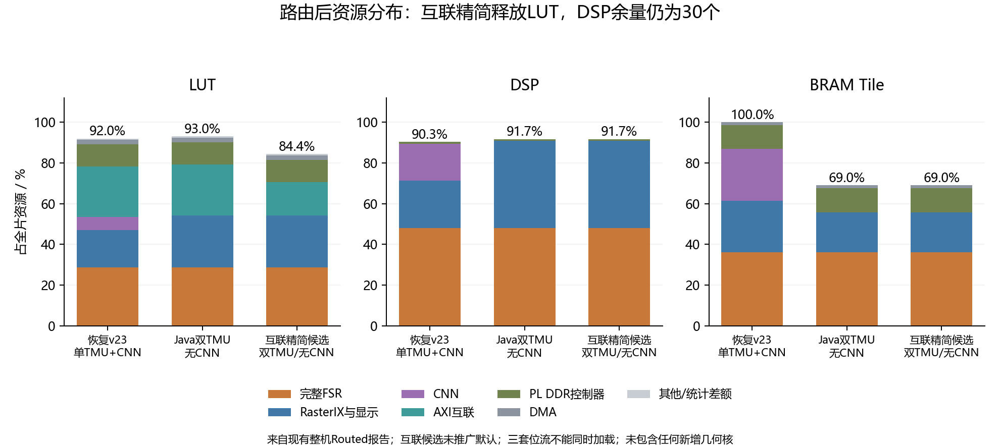
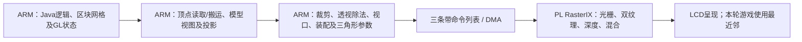
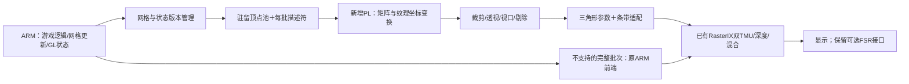
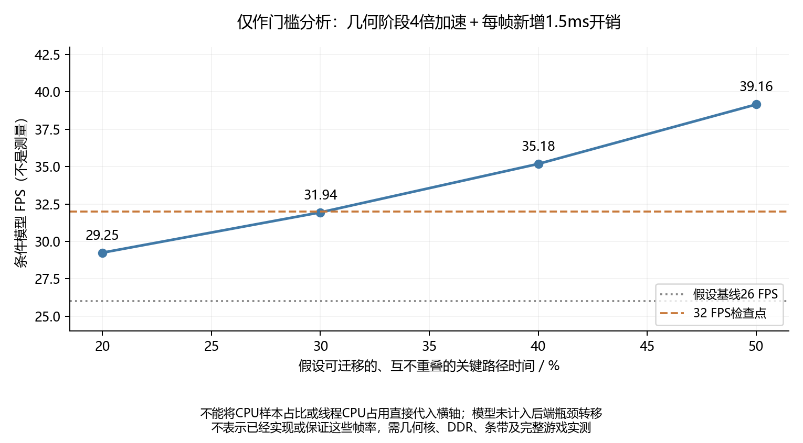

# 原版 Java 1.2.5：几何前端硬件化可行性研究

> 后续路线已更新：用户现明确先移除 PL FSR，将资源优先用于完整几何前端；本文保留 FSR 的约束属于先前方案。新预算和 Mali 后处理研究见 [无 FSR 几何路线](JAVA125_NOFSR_GEOMETRY_MALI_PLAN_2026-10-29.md)。

2026-10-29。结论：**将变换、裁剪、视口和三角形参数准备作为一段完整通路移入 PL，值得作为下一项主要优化；仅把矩阵运算外包再返回 ARM，收益很可能被搬运和同步侵蚀。** 当前确有 CPU 几何开销，但尚不能据此保证 32 或 60 FPS。首版应采用共享算术单元和有明确资格判断的批次路径，保留完整 FSR。

本研究重新解析已有整机路由报告、核对已编译冻结源码，用当前 AArch64 宏编译结构布局探针，并核对实测库的反汇编。**未生成几何核 RTL/HLS IP、未做几何核 OOC 综合、未更换板端位流或改动 SD。** 以下资源是现有位流实测报告；几何预算和帧率模型均有单独标记。

## 1. 三种配置必须分清

| 配置 | LUT | FF | DSP | BRAM Tile | 角色 |
|---|---:|---:|---:|---:|---|
| v23：单 TMU＋CNN＋完整 FSR | 64,901 / 70,560，91.98% | 71,349 / 141,120 | 325 / 360 | 216 / 216 | 上一轮退出时恢复的配置 |
| Java：双 TMU＋完整 FSR，无 CNN | 65,624 / 70,560，93.00% | 74,028 / 141,120 | 330 / 360 | 149 / 216 | 当前 Java 游戏对照使用 |
| Java 互联精简候选，双 TMU＋完整 FSR | 59,565 / 70,560，84.42% | 65,053 / 141,120 | 330 / 360 | 149 / 216 | 已实现并板测过，未推广默认 |

这是对已有报告及最后已验收状态的核对，不是本次重新读取板端实时状态。三套配置不能当作同时加载的一套硬件；Java 配置中 CNN 为占位，不能把 v23 的 CNN 能力列作 Java 双 TMU 的并行能力。

Java 游戏配置的同级模块分布如下。BRAM Tile 按 RAMB36＋RAMB18/2 计算，表内不重复相加父子实例：

| 模块 | LUT | FF | DSP | BRAM Tile |
|---|---:|---:|---:|---:|
| 完整 FSR | 20,317 | 19,494 | 173 | 78 |
| RasterIX＋显示路径 | 18,026 | 15,772 | 154 | 42.5 |
| 三组 AXI 互联 | 17,613 | 26,637 | 0 | 0 |
| PL DDR4 控制器 | 7,647 | 8,959 | 3 | 25.5 |
| AXI DMA | 1,555 | 2,240 | 0 | 3 |
| 其他及层级 LUT 统计差额 | 466 | 926 | 0 | 0 |
| **总计** | **65,624** | **74,028** | **330** | **149** |
| **剩余** | **4,936** | **67,092** | **30** | **67** |

“RasterIX＋显示”内部的真正 RasterIX 子实例为 12,912 LUT、154 DSP、35.5 BRAM，此外包含缩放、时序及显示配套逻辑；父子数字不再与上表相加。FF 和 BRAM 不是 Java 配置最紧的资源，LUT 与 DSP 更紧。恢复配置 v23 则已占满全部 BRAM，不能直接叠加新核。

互联精简候选省下 **6,059 LUT、8,975 FF**，可用 LUT 增至 **10,995**，但 DSP 仍只剩 30。此前候选与原互联的游戏负载不完全一致，没有证明精简本身提升了 FPS；它首先是新增几何核的空间候选。不能恢复到删除 FSR 的旧建议，也不能把“软件关闭 FSR”当成释放其 DSP。

## 2. 为什么方向有价值，证据又到哪里为止

当前通路为：

R85 原生工作线程的 5,599 个用户 CPU 样本中，94.53% 在 GL 库。归属包括 Mat44 变换 12.04%、Vec4 复制赋值 11.39%、已解码顶点读取 7.63%、视口变换 4.72%、三角形装配 4.27%、Rasterizer 参数生成 2.43%。这些归属含内联与共享帮助函数，不是可相加的独占墙钟阶段；不能说“94.53% 帧时间都可交给 FPGA”。

最近六轮游戏对照大多约 26 FPS，最忙线程约占单核 66%，DMA FINISH 累计等待/采样区间约 28%～30%。一次纹理等待后移实验没有建立稳定收益。CPU 对空闲 DMA 槽的连续写入可达约 3.3 GiB/s，而游戏提交约 32 MiB/s，也不支持先把大块映射写入当作主瓶颈。

已有 R91 驻留资源条件下的三帧命令重放约 44.35 FPS，说明移除部分上游工作后后端曾达到更高吞吐。但它依赖进程中的纹理和状态，有额外恢复与等待，负载也不等同于当前六轮，**不是实际游戏帧率、冷启动重放或硬性性能上限**。

较合理的判断是：完整前端搬移有机会减少实质 CPU 工作；GPU 后端、DMA、条带和同步仍可能接替成为瓶颈，不能承诺线性加速。

## 3. 本次核实出的接入细节

### 3.1 现有 CPU 命令不是 FPGA 顶点包

`ports/java_push_vertex_batch_cmd.hpp` 明确将批对象的进程虚拟地址拆成两个 32 位字。这是 CPU 异步队列的内部命令，**不能转发给 FPGA 当物理网格地址**。新路径必须定义网格句柄、版本、设备可访问地址、字节范围和消费完成 fence。区块重建、显示列表删除/重定义、纹理更新均需保留其版本和寿命。

已用当前双 TMU 宏、AArch64 SDK 编译，并从 ELF 常量段读出：

| 对象 | 实际字节数 | 含义 |
|---|---:|---|
| `VertexParameter` | 88 | 含法线、点大小、两路四维纹理坐标和 CPU sourceIndex |
| `TransformingVertexParameter` | 84 | 含变换后的中间属性 |
| `TriangleDesc::param` | 120 | 包围框、边函数、颜色、深度等 |
| 单路纹理参数 | 36 | 初值及 X/Y 增量 |
| 双 TMU `TriangleDesc` | 192 | 当前实际 GPU 负载 |
| 一个三角形命令 | 196 | 192 字节负载＋4 字节命令字 |

一个候选地形格式为位置/颜色/两路四维 UV 共 **64 字节/顶点**，省略仅在特殊路径需要的法线、点大小和 CPU 索引；这仍是协议设计，不是已有硬件 ABI。三个原始顶点就有 192 字节，再加包头并不比当前 196 字节三角形命令天然更省。

**真正值得做的是网格在区块创建/更新时上传并驻留，每帧主要传句柄、矩阵与状态；PL 读取原始顶点并直接生成后端命令。** 该路径仍由 ARM 构造游戏区块网格，不等于把 Java 逻辑或方块面生成也搬到 PL。

### 3.2 存储空间不能凭地址空隙假定

当前编译配置的纹理池从图形区偏移 8 MiB 开始，12,288 页×2,048 字节，即 24 MiB，规划到图形区 32 MiB 末尾。24 MiB 是池容量，不是测得的已用量；8 MiB 前段也不能未经核对直接当作网格空闲区。

新增网格池必须先统计纹理/显示/网格同时存活的水位，明确共享分配或独立预留。现有 AXI HP0 路径可供新主设备接入，但需要新的主接口、仲裁、地址映射与驱动内存协议；并非已经有可直接使用的网格读取端口。首版优先评估保留 PS DDR，因为现有 GPU 与 DMA 已访问 PS DDR。放 PL DDR 是另一个需要验证连接和成本的方案。

### 3.3 数学工作超过两个矩阵

普通路径还涉及：

- 两路纹理矩阵与可选纹理坐标生成；Minecraft 的双纹理光照贴图必须保留，不能默认两套纹理矩阵都是单位阵。
- 齐次六平面裁剪及属性插值、图元装配、背面剔除、`1/w`、视口和深度范围。
- 参数准备中的面积倒数、边函数、双纹理/颜色/深度的初值与 X/Y 梯度。
- 当前开启 `ENABLE_ATTRIBUTE_SCALING`，存在 W 向量归一化，其代码包含平方和、`sqrtf` 和倒数，以及 UV 范围调整。不能只实现几次乘加就声称参数准备完整迁移。

现有裁剪列表最多预留 9 个顶点，裁剪后扇形化最多对应 7 个三角形的容量上界。完整实现需处理可变输出、背压和有界队列，不只处理“全在屏内”的三角形。

首版可以先支持无固定功能灯光、无用户裁剪平面等普通批次；不支持的纹理生成、双面模板、点线、特殊 polygon offset 等整批走旧路径。**AO 是游戏传入的顶点颜色，保留颜色插值即可保留这项效果，不能关闭 AO 换取覆盖率。** 双纹理光照贴图不等同于 GL 固定功能顶点灯光。

### 3.4 浮点参考必须以真实二进制为准

冻结的 `Rasterizer.cpp` 与工作区通用源码存在差异，包括边函数初始采样位置的半像素偏移。新核应参考冻结版本，否则即使公式看起来一样也可能产生边缘像素差异。

本次反汇编实测库的实际 `SequentialVertexTransformerCalc::transform()`，其中有 **15 条静态融合浮点指令**；这是整个变换函数、含纹理分支的指令数，不是每顶点执行次数，也不是只有位置矩阵的数量。调试库重新 strip 后，与六轮使用的 `939c95a0…` 库逐字节一致。因此既不能随意把两个矩阵预合并，也不能假定用独立 fmul/fadd 就会复现 ARM 的舍入。

首版建议保留 FP32，并逐阶段比对实际 FMA/舍入、近裁面、退化三角形、深度边界和固定点转换。FP32 也不自动保证全部 IEEE 行为一致；AMD PG060 说明若干算子对非正规数有特殊处理。[Floating-Point Operator PG060](https://docs.amd.com/v/u/en-US/pg060-floating-point)。直接改 FP16/定点应另设画质实验，不能作为同画质迁移的默认前提。

## 4. 推荐结构与三条带选择

图中是研究结构，新增链路尚未实现。新旧批次必须在同一有序提交体系中合流，不能在一个批次已输出部分三角形后再让 CPU 补画剩余部分。矩阵、纹理绑定与页版本、颜色、混合、深度及透明顺序需形成状态快照。

当前 400×240 共 96,000 像素，每片内部帧缓冲容量 32,768 像素，使用 **3 个各 80 行条带**。ARM 先计算参数，再按覆盖条带复制及调整参数。前端硬化必须选择：

| 方案 | 好处 | 代价与条件 |
|---|---|---|
| 每条带重放驻留网格并重新计算 | 易保留原有顺序、较少命令暂存 | 最坏处理同一网格 3 遍；OOC/实机吞吐预算必须按重算量计算 |
| 一次几何计算，写入三个有序条带列表 | 免去重复变换，CPU 不读取三角形结果 | 需 DDR 输出缓冲、列表容量/溢出协议、状态分发和额外读写流量 |
| 只算矩阵再回传 ARM | 接口局部改动少 | 保留 CPU 裁剪和 setup，新增往返与等待，不建议作为主线 |

建议先以现有条带顺序的网格重放版本做最小 OOC/命令级验证；它只有在包括最坏三遍的吞吐仍够时才值得接游戏。若不够，再评估一次计算＋DDR 分桶，**不能把三遍代价遗漏后承诺收益**。两者都应直接向 RasterIX 路径供命令，不让 ARM 读取每个顶点/三角形结果。

“整批完全在裁剪体内”的快速路径可由保守包围盒证明，允许初版省去相交多边形生成；需限定有限数、已验证 W 等条件。相交批次完整回退。它只是分阶段路线，不是完整裁剪已搬移的证明。若实际地形覆盖率很低，必须加入六平面裁剪或调整方案，不能把低覆盖率隐藏起来。

## 5. 资源与性能应怎样设门槛

30 个 DSP 仍可构成多周期、复用的浮点计算通路，不能仅凭数量断言做不了。也不能把它们当作 30 个原生 FP32 CUDA 核：UltraScale+ DSP48E2 是定点乘加基础，浮点运算还需相关逻辑与可能多个 DSP；精确成本取决于算子配置。[UG579](https://docs.amd.com/api/khub/documents/pTysoma4TYgNH95BrY1Sbw/content)。

首轮建议在互联精简候选之上，为**几何核及其本地接口**先设 OOC 继续/停止门槛：不超过 8,000 LUT、24 DSP、16 BRAM Tile。这是设计上限，**不是已估计或已综合得到的占用**。按这个上限做静态算术，整机将达到 67,565 LUT（95.76%）、354 DSP（98.33%）、165 BRAM Tile；新增系统互联若不在核内，还须另计，因此不能据此宣布整机可放下。

设计上应评估少量浮点乘加通道、共享除法/开方、批次上下文交错和有界 FIFO，避免为每个矩阵元素复制一套运算器。HLS 的 ALLOCATION 可限制资源实例并在吞吐与面积之间取舍，但必须检查作用域、实际调度、II 和报告，不能只写 pragma 就认定已经共享。[UG1399 算子数量限制](https://docs.amd.com/r/en-US/ug1399-vitis-hls/Limiting-the-Number-of-Operators)。

若几何 OOC 证明 30 DSP 不够，还有一条保留 FSR 的备选：**不改 FSR 数学，只降低并行度、复用算术单元，争取腾出 DSP**。已有 EASU/RCAS 像素循环 II=4；在 200 MHz、800×480 下，理想像素节拍下限为 7.68 ms。假设做到 II=8/12，下限分别为 15.36/23.04 ms；32 个新游戏帧每秒的预算为 31.25 ms，因此值得做资源/吞吐对照。

这些下限未计 DDR 争用、启动和其它阶段，也没有测得任何 DSP 节省。II 翻倍不等于 DSP 自动减半；算子能否共享须由调度和综合报告证明。若要求每秒处理 60 张新图，II=12 的下限已经超过 16.67 ms，II=8 也很接近预算，不能同时承诺更低资源和完整 60 新帧吞吐。LCD 的 60 Hz 扫描与游戏产生 60 张新图应分开统计。这条备选目前未实施。

现有约 26 FPS 对应 38.46 ms/帧。到 32 FPS 需净省 **7.21 ms/帧**；到 60 FPS 需净省 **21.79 ms/帧**。这包含新增通信、回退、条带和同步，不能只看算术核峰值。

下面仅作条件门槛分析：假设可迁移部分在串行关键路径占比为 p，该部分实际加速 4 倍，且每帧新增总开销 1.5 ms：

`Tnew = 38.46 × ((1 − p) + p / 4) + 1.5 ms`

| 假设 p | 条件模型 FPS，非预测/实测 |
|---|---:|
| 20% | 29.25 |
| 30% | 31.94 |
| 40% | 35.18 |
| 50% | 39.16 |

在这组假设中，p 约需超过 **30.2%** 才到 32 FPS。当前 CPU 采样不能直接给出 p，模型也未包含后端瓶颈转移。故 **32 FPS 可作为首个验收检查点；60 FPS 暂不能靠这项研究作保证**。

## 6. 两周窗口内的建议推进

| 阶段 | 产物与继续条件 |
|---|---|
| 第 1～2 天 | 同窗统计顶点/图元、裁剪分类、纹理矩阵及特殊状态比例、存活网格/纹理水位；捕获有界原始网格＋状态。先知道候选覆盖多少真实负载 |
| 第 3～5 天 | 共享 FP32 算术与完整参考模型；先 OOC 综合和 C/RTL 一致性。包括三条带最坏重复量，超预算或吞吐不足即调整，不急接整机 |
| 第 6～10 天 | 普通批次子集直连原 RasterIX，完整有序回退；整机布局布线、驱动/地址/凭据、原生双纹理和裁剪/深度/透明测试 |
| 第 11～14 天 | 视覆盖率加入相交裁剪；同画质交错对照、移动/转向/区块更新长测，保存失败/原始图和回滚包。避免最后两天才更改体系结构 |

顺序应按“覆盖率→算术与调度→命令一致性→整机→实际游戏”推进。没有独立测得的关键路径占比、OOC 调度、落地资源和实际游戏结果之前，不宣传加速倍数。完整桌面 GL、所有特殊图元、双 TMU＋CNN＋FSR＋完整几何同时运行，不作为两周内已经可承诺的交付。

## 7. 可复核证据

- 新的解析与条件计算：`scripts/analyze_java_geometry_feasibility_r1.py`；结果 `report/geometry-feasibility-2026-10-29/analysis.json`。三份整机层级报告哈希均与既有验收记录一致，未重复累计父子模块。
- AArch64 布局源码、对象及 ELF 段：`build/minecraft-java-125/geometry-feasibility-r1/layout.cpp`、`layout.o`、`layout.bin`、`layout.json`。首次编译的头文件相对路径错误已修正；没有因此部署任何程序。
- 已编译几何源码快照：同目录 `frozen/`、`additional-sources.json`。冻结的 Renderer/Rasterizer 与工作区不同，其哈希已记录。
- 实际变换汇编与身份核对：同目录 `matrix-assembly.txt`、`matrix-assembly.json`、`math-library-proof.json`。第一次寻找独立 Mat44 符号未找到，改查实际被内联的变换函数；未把它误报为未使用 FMA。
- 绘图：`scripts/plot_java_geometry_feasibility_r1.py`；PNG/SVG：`docs/assets/java-geometry-feasibility/`。
- 当前帧率/等待及内存测试范围见 [最近六轮实测](JAVA125_TEXTURE_WAIT_OPTIMIZATION_2026-10-29.md)；互联候选与重放边界见 [互联与重放](JAVA125_INTERCONNECT_REPLAY_2026-10-28.md)。

本研究只新增证据快照、探针与文档。板端运行状态、位流、现有源码、默认启动与 SD 启动包均未因本研究改变。
