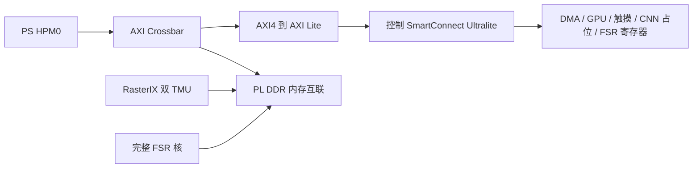
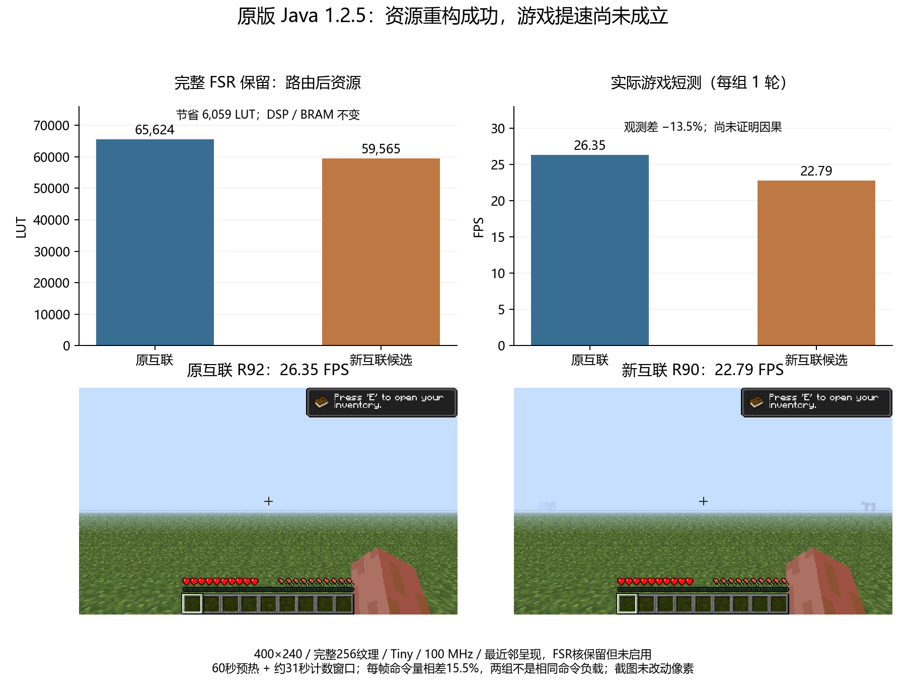

# 原版 Java：保留 FSR 的互联拆分与真实命令重放

后续七轮软件候选实验及对比图见 [条带缓冲与精确位置复用](JAVA125_BUFFER_POSITION_OPTIMIZATION_2026-10-28.md)。两项候选均未显示游戏提速，未修改默认配置。

2026-10-28。本轮落实两项工作：将混合控制与内存互联拆开，以及用实际游戏命令诊断 PL 后端。完整 FSR、双 TMU、GPU 100 MHz、FSR 200 MHz 均保留，未修改原版 JAR、SD 启动文件或默认启动器。400×240、完整 256 纹理、实际 Tiny、Fast、AO 开启和全部粒子沿用原设置。

## 已完成的硬件

原先一组 SmartConnect 同时通向控制寄存器和 PL DDR。新结构保持 PS HPM0 及设备地址不变，在前面分流内存访问，控制支路显式转为 AXI Lite，使控制 SmartConnect 进入 Ultralite 模式。

| 路由后资源 | 原双 TMU 配置 | 新互联候选 | 变化 |
|---|---:|---:|---:|
| LUT | 65,624 | 59,565 / 70,560（84.42%） | −6,059 |
| FF | 74,028 | 65,053 / 141,120 | −8,975 |
| DSP | 330 | 330 / 360 | 0 |
| BRAM Tile | 149 | 149 / 216 | 0 |

以上使用整机路由报告，没有把 OOC 模块数直接相减。时序通过：全局 WNS 0.105 ns、WHS 0.010 ns；GPU 所在 100 MHz 时钟域 setup 余量为 2.278 ns。全局最小 WNS 来自其他时钟域，不能据此认定 GPU 没有提频空间，也不能把单次余量推算成已认证的最高频率。

地址维持 DMA `0xa0000000`、GPU `0xa0010000`、触摸 `0xa0020000`、CNN 占位 `0xa0030000`、FSR `0xa0040000`，CPU PL 窗口 `0xa1000000`。212 项源文件冻结包含原硬件全部 209 项及三个新构建脚本。

Vivado 工程：`build/vivado_java256_ic_r1/rix_java256_ic_r1.xpr`。
位流：`build/minecraft-java-125/interconnect-r1/board/java256.bin`，SHA256 `1529ab06d818423e52c97ded61ec71eaca27cbd66afdc043168e6462677fa8eb`。
构建、资源与门禁证据在 `build/minecraft-java-125/interconnect-r1/`。

加载器绑定新位流 SHA，八项能力寄存器改值均拒绝，旧硬件不读取新 CSR。所有测试继续遵守原有全局锁、隔离和启动轮次凭据。原 GPU 核模拟证据仅说明未改的 GPU RTL，不能冒充新互联的仿真覆盖；新互联依靠完整实现报告及实际加载、像素和交换压力测试验证。

## 重放究竟测什么

先运行真实原版世界，预热 60 秒并采集普通 30 秒窗口，再记录三个实际帧的 GPU 命令及有序纹理 STORE。捕获阶段在下一次真实交换前申请 SNP1，之后校验两轮逐帧图像完全一致。计时阶段停止重复 JVM 逻辑、几何计算，重放已经生成的三帧，按硬件完成计数与配对时间戳测吞吐。

纹理页使用有界初始版本影子，每轮恢复被修改的既有纹理页，恢复上传计入计时。不是去掉纹理上传或把空命令当作游戏。RPL2 文件是进程内驻留资源条件下的诊断记录，不能当作独立冷启动重放包。

R89 的后端测得约 36.0754 帧/秒：3.07689 秒完成 111 帧，另外每轮包含 2,230,272 字节的纹理恢复。两轮验证加最终帧共比较 1,344,000 字节像素。这是冻结命令吞吐，**不是游戏 FPS，也不是严格的游戏性能上限**：诊断有额外纹理恢复和分组等待，正常运行还有 JVM、几何处理及重叠执行。

修正计数的 R91 整轮及独立验收均通过：3.043680136 秒完成 135 帧，后端 **44.3542 帧/秒**，同样每周期包含 2,230,272 字节的纹理恢复，逐像素验证 1,344,000 字节。R89/R91 使用相同重放库；三帧捕获负载分别为 7,791,552 和 8,116,660 字节，不能把两个吞吐值的差异当作库提速。R91 普通游戏诊断窗口为 23.3416 FPS，含诊断影子开销，明确排除于性能优化对比。

普通 Java 交换、验证重放、预热重放、计时重放和最终取证帧必须分别计数。诊断额外交换为 `计时完成帧 + 3×(2轮验证+1轮预热) + 1最终帧`。独立解析器同时检查命令边界、三角形长度、TMU 索引、纹理地址、完整帧计数、错误计数及像素文件，而不是只相信库打印的 PASS。

## 保留的失败和恢复记录

- R86：暂停渲染后才申请“下一次交换”快照，没有后续交换可满足它，导致租约超时。保留隔离和原始失败资料，正常 Linux 重启后按原保护加载流程恢复，没有跳过守卫。
- R87：生成过修正库 r2 的包，未部署。
- R88：重启恢复包缺少历史种子来源证明，测试前置阶段报 FileNotFoundError，成功恢复原位流。随后从原归档补回原文件，逐项核对冻结世界哈希，没有改写失败结论。
- R89：重放子测试通过，普通 Java 交换校验未计入额外 121 次诊断交换，整轮仍保留失败；正常退出并恢复原位流。后续轮次在独立验证重放之后核对两类计数。

## 游戏帧率与判断

正确 Tiny 的历史 R79/R80 加权参考为 25.7183 FPS。本次同次开机、同一正常渲染库的两轮均通过 13 项测试、原位恢复和离线独立验收：

| 测试 | 互联 | 完成帧 / 配对窗口 | 游戏 FPS | 每帧命令拍数 | 命令拍 / 秒 |
|---|---|---|---:|---:|---:|
| R90 | 新互联候选 | 706 / 30.9795746275 秒 | 22.7892 | 371,083 | 8,456,683 |
| R92 | 原互联 | 816 / 30.96986722 秒 | 26.3482 | 321,208 | 8,463,238 |

观测帧率差约 −13.5%，但新候选每帧命令量约多 15.5%，每秒命令吞吐差不到 0.1%。新候选整个游戏期间记录了 2,105 次 band spill，旧互联为 0；这不是测量窗口内单独统计。批次形态确实不同，因此尚不足以声称“AXI 协议转换器使硬件慢了 13.5%”。先调查显示列表批次、分片和画面负载差异，再做相同命令的硬件 A/B。资源节省已成立，游戏提速未成立，候选不替换默认配置。

两轮源存档哈希、软件库哈希相同；保存的最终玩家位置、旋转与冻结基准完全一致，世界最终时间也相同。截图仍存在实体等差异，命令负载不是逐帧一致。R90/R92 回读五项主要运行设置，原始 options 相同；R91 另外回读 AO、粒子等共十二项设置。所有测试只进行一轮短测，不能声称稳定帧率或统计显著的优化幅度。

上图可以引用到作品文档，配套 SVG 与来源哈希在 `docs/assets/java-interconnect-r1/`，生成脚本为 `scripts/plot_java_interconnect_r1.py`。图中的截图来自原始 RGB565 的逐像素转换，未修改画面内容。

本轮游戏帧率测试仍是最近邻呈现，FSR 核完整保留但未启用为这组游戏画面做超分。加载过程包含 FSR 协议检查；这不能冒充新位流下 FSR 全帧运算或与 Java 并行运行的验收。Java 双 TMU 配置的 CNN 位置为能力明确的占位核，并未同时装入原完整 CNN。

## 提频与下一步

提频可以作为下一阶段独立实验，先做 110/120 MHz 的完整时序实现和相同画质对照，保留 FSR 的 200 MHz 域与 DDR 时钟契约。不能直接修改运行时分频寄存器，不能把 100 MHz 的余量当作更高频率已通过，也不能承诺同比例游戏提速。

现有证据同时指向 CPU 几何成本和 PL 后端成本。下一步应在同次开机对照后决定是否优化寄存器轮询延迟；保存下来的 LUT 可用于有界的顶点缓存或部分几何加速。DSP 仅余 30 个，完整浮点几何流水线需要重新预算，优先评估少量乘加器时分复用及 CPU 裁剪回退。FSR 真正并行启用时还需要独立测量内存带宽、帧龄和完成帧率。

60 Hz 的 LCD 扫描与游戏每秒生成 60 个新帧是两回事。本轮没有达到或承诺稳定 32/60 FPS。

## 验收和最终板端状态

R90/R91/R92 各完成 Windows 与 POSIX 九项故障恢复逻辑检查，均为独立编号；R89 的整轮失败原文保留，只有重放子测试另行验收。整组 6,830,080 字节的 RAM 回读归档 SHA256 为 `e7e33d7848d3861556fc5732299916aaaaa783a9fc0edefe4274549d3d77226d`，四轮归档及所有分片哈希均已复核。

证据入口：

- `report/minecraft-java-125/swap-fence/board-acceptance-r90.json`：新互联的实际游戏与像素、计数、恢复验收。
- `report/minecraft-java-125/swap-fence/board-acceptance-r91.json`：真实命令重放诊断，`accepted_performance_run=false`。
- `report/minecraft-java-125/swap-fence/board-acceptance-r92.json`：旧互联正常游戏对照。
- `report/minecraft-java-125/swap-fence/r89-replay-subtest.json`：保留整轮失败，仅接受经过独立验证的重放子测试。
- `report/minecraft-java-125/swap-fence/optimization-r1-poses.json`：冻结基准与三轮最终玩家姿态。
- `report/board_serial/java_optimization_final_verified.log`：回读确认之后的最终板端检查。

结束时恢复默认 v23 位流 `035c30597ce7ed94dff24a733dbbb81fa68998e8d3fba52ef45902d23ccb01d9`。GPU 已使能且空闲，五项错误计数均为零；POST=1，SNP 状态与过期数均为零，无游戏客户端，回读锁已释放。保留旧开机轮次的隔离文件，没有删除或伪造恢复证明；COM11 已关闭。
