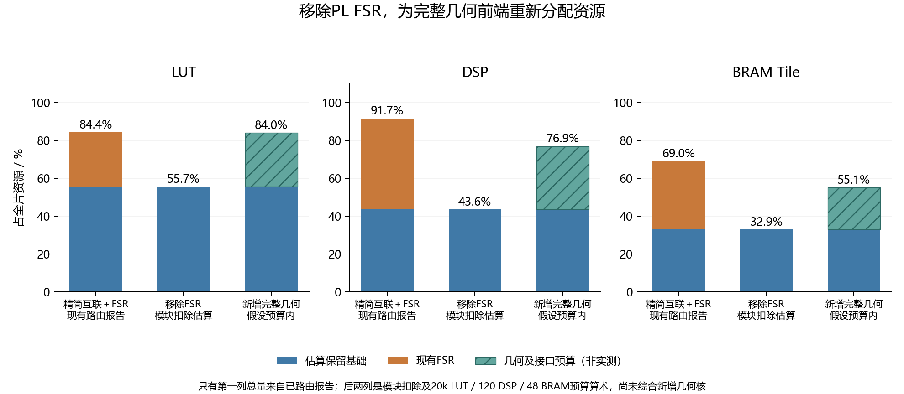
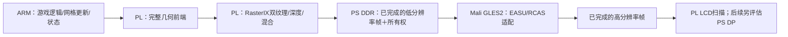

# 去除 PL FSR，优先完整几何前端；Mali 超分后续路线

2026-10-29。用户最新决定：**先不使用 PL FSR，将其资源留给完整几何前端，FSR 后续评估迁至 Mali。** 这替代上一份研究中的“必须保留 PL FSR”约束。旧位流与结果继续保留为回退和对照。

结论：**从现有模块占用预算看，移除 FSR 后，完整固定功能几何链路具备合理的资源空间，远比只剩 30 DSP 时宽裕。** 但资源够用、流水线吞吐够用、完整功能正确是三项不同的验收。Mali 可研究 GLES2 片元着色器形式的 FSR1 EASU/RCAS 适配版，当前不能宣布原版 FSR 直接兼容、零拷贝或 60 FPS 已可达。

本轮只完成预算、既有 Mali 证据及上游算法核查，没有生成无 FSR 位流、综合新几何核或执行新的 Mali FSR 板测。下表是从已路由报告中扣除 FSR 同级模块的估算，不是新的路由结果。

## 1. 移除 FSR 后的空间

| 项目 | 当前 Java 双 TMU | 原互联扣除 FSR后，估算 | 精简互联扣除 FSR后，估算 |
|---|---:|---:|---:|
| LUT 已用 | 65,624 | 45,307 | 39,293 |
| LUT 剩余 | 4,936 | **25,253** | **31,267** |
| FF 已用 | 74,028 | 54,534 | 45,595 |
| FF 剩余 | 67,092 | 86,586 | 95,525 |
| DSP 已用 | 330 | 157 | 157 |
| DSP 剩余 | 30 | **203** | **203** |
| BRAM Tile 已用 | 149 | 71 | 71 |
| BRAM Tile 剩余 | 67 | **145** | **145** |

原互联 FSR 为 20,317 LUT、19,494 FF、173 DSP、78 BRAM；精简互联的 FSR 为 20,272 LUT、19,458 FF、173 DSP、78 BRAM。两份报告各用各的模块数，没有把一套报告的局部数直接扣另一套总数。层级 LUT 统计受合并影响，重综合后互联、时钟、控制与布线也会变化，因此最终数以新整机报告为准。

推荐沿精简互联分支建立新的无 FSR 候选，保留双 TMU、触摸、LCD、PL DDR、DMA 和原资源/交换保护。关闭软件开关不能释放资源，必须从新硬件设计中删除 FSR 实例及不再使用的端口、时钟和地址段，再重新综合实现。

新的能力寄存器、配置标识与加载契约必须诚实报告“FSR 不存在”，软件拒绝调用已移除硬件；不能只删 IP 却继续让旧加载器验证 FSR 存在。原回退镜像和证据保持不动。本轮尚未进行这些硬件改动。

## 2. “完整几何前端”的目标边界

目标主链：原始顶点/索引及状态读取 → 模型视图和投影 → 两路纹理矩阵 → 齐次裁剪 → 图元装配/剔除 → 透视除法 → 视口与深度映射 → 包围框/边函数 → 颜色、深度、双纹理插值参数 → 有序条带命令 → 现有 RasterIX。

六平面相交裁剪、属性插值、最多 9 个裁剪顶点的有界缓冲，都是完整链路的一部分。仅做“完全在屏内”批次可作为调试阶段，不能把 ARM 仍处理相交三角形的阶段当作完整迁移完成。两路纹理和 AO 顶点颜色继续保留。

ARM 继续处理 Java 游戏逻辑、区块网格创建/更新、GL API 状态和资源管理；这不等于还在逐顶点执行几何。法线/灯光、用户裁剪、纹理生成、点/线展开、双面模板与 polygon offset 等既有特殊分支需要逐项列清。现有驱动全部固定功能分支硬化的开发量大于单纯三角形主链；资源空间不自动意味着能在两周内保证所有桌面 GL 行为。

需要保留的研究结论包括：

- 当前 CPU 批量命令存的是进程虚拟指针，不能直接发给 PL。需要设备可访问的驻留网格、句柄/版本与释放 fence。
- 当前 400×240 采用三个 80 行条带。每条带重算网格最坏要算三遍；一次计算加有序 DDR 分桶则增加缓存、列表、地址和内存流量。完整核的吞吐评估必须计入选定策略。
- 实际双 TMU 三角形参数是 192 字节，普通 CPU 顶点结构 88 字节。原始顶点逐三角形流送不天然减少带宽，驻留和索引复用才值得优先设计。
- 当前纹理池容量已规划至图形区 32 MiB 末尾。BRAM 多了不表示 PS DDR 地址池已自动扩容，网格和纹理的同时存活水位仍需统计。
- 实测 ARM 库的变换函数含 FMA；实际冻结的三角形采样规则含半像素偏移。新硬件按已验收数值参考验证，不能默默改运算次序或固定点精度。

## 3. 一个可检验的初期资源预算

为“几何算术、FIFO、状态与新增接口/互联”先设一个继续/停止预算：**20,000 LUT、30,000 FF、120 DSP、48 BRAM Tile**。这是设计目标，不是已经综合出来的消耗，也不是对完整核成本的保证。

在精简互联扣除 FSR 的估算基础上，加上该预算后为：

| 资源 | 假设合计 | 全片利用率 | 余量 |
|---|---:|---:|---:|
| LUT | 59,293 | 84.03% | 11,267 |
| FF | 75,595 | 53.57% | 65,525 |
| DSP | 277 | 76.94% | 83 |
| BRAM Tile | 119 | 55.09% | 97 |

这说明可以从“极小几何子集挤进 30 DSP”转向更完整的 FP32 几何设计，仍为互联调整和布局布线留有余地。实现宜适度流水化、共享低频使用的除法/开方/特殊状态路径；不必为所有罕见功能各复制一套峰值算术器。

是否真的足够，下一项证据应是完整核的参考输出、OOC 综合资源与调度，以及整机布局布线。若核加新增系统逻辑超出预算，按真实热点调整并行度；不能把预算表当成资源验收。

## 4. Mali 能否接管 FSR

既有真实板测已证明：厂商 r9p0 headless 驱动能建立 EGL 1.4/GLES2 上下文，renderer 为 `Mali-400 MP`；矩阵顶点着色器和双纹理采样的 96,000 像素与参考完全相同。它证明 Mali 可运行片元处理，不是 FSR 已经运行，也不是其超分性能测试。

**可研究 FSR1 EASU＋RCAS 的 GLES2 片元适配。** 两遍处理可以用全屏三角形/四边形和纹理 FBO 完成，算法不要求一定使用 compute shader。Mali-400 的 GLES2 级别不适合直接套现代 Vulkan/compute 入口；此次路线也不包含 FSR2/3 时域超分或插帧。

需要处理的兼容问题：

1. 上游头文件的现代 GLSL 路径包含 gather 和整数/位重解释辅助代码。GLES2 适配需改为显式 `texture2D` 采样、合适的常量表示及数学帮助函数，不能只改一个宏就宣称直接兼容。[AMD FSR1 主实现](https://github.com/GPUOpen-Effects/FidelityFX-FSR/blob/master/ffx-fsr/ffx_fsr1.h)、[GPU 抽象帮助代码](https://github.com/GPUOpen-Effects/FidelityFX-FSR/blob/master/ffx-fsr/ffx_a.h)。
2. Arm 文档明确 Mali-400 片元端不支持 highp，采用较低精度运算。当前本地探针没有记录 `glGetShaderPrecisionFormat`，正式接入时仍需查询并保存驱动返回值。EASU 权重、倒数、平坦区域的零方向、RCAS 除数和锐化噪声都要做数值/画质检查。[Arm 浮点精度说明](https://developer.arm.com/community/arm-community-blogs/b/mobile-graphics-and-gaming-blog/posts/benchmarking-floating-point-precision-in-mobile-gpus)。
3. 改写采样、倒数近似和精度路径后，应标为 FSR1 EASU/RCAS 适配版，并与原版参考、原 PL 固定点实现及双线性分别比较，不能承诺逐位等价。
4. 先分开测双线性、RCAS 单独、完整 EASU＋RCAS，记录着色完成、上传、读回和显示耗时，不能用之前 Java Tiny 的 40.76 FPS 推断超分能跑多少帧。

建议先测试 400×240→800×480。按 12 点 EASU＋5 点 RCAS 的显式采样估算，是每秒约 2.09 亿次逻辑纹理查询（32 新帧/s），或 3.92 亿次（60 新帧/s）；它们不是外部 DDR 事务数，也不是 Mali 已测吞吐。缓存、编译、算术与渲染块组织均会影响结果。

## 5. 最大的系统风险：PL 与 Mali 的帧交接

此图是目标结构，不是已经接通的链路。Mali 是 PS 硬核，其片元后处理不消耗 PL DSP，但会占 PS DDR 带宽、CPU 提交/交接及等待时间。

当前 RasterIX 源颜色缓冲为 RGB565，PL 桥再扩为 32 位颜色。首版可从已完成并持有所有权的 PS RGB565 帧上传到 Mali，以 GLES2 两遍渲染后读回结果，写入 PL 可扫描的输出缓冲。该拷贝参考通路用于先验证正确性，不能当作最终零拷贝方案。

按 RGB565 输入和 RGBA8 输出，仅交接负载为 192,000＋1,536,000＝1,728,000 字节/帧，32 帧约 **52.73 MiB/s**、60 帧约 **98.88 MiB/s**。这是负载下限，不含重复 CPU/驱动拷贝、FBO 中间读写、缓存维护、显示扫描和通道转换，不能据此宣布实时性能无问题。

必须解决：

- 渲染完成、Mali 采样完成、输出可显示和扫描结束是不同的 fence。至少明确三缓冲的索引、所有者、帧号、释放条件与背压，不能渲染覆盖 Mali 正在读取的缓冲。
- 现有源 RGB565、Mali RGBA/BGRA 和 PL 的 32 位颜色字序不同，alpha、stride、大小端和行方向需用角点色块实测。不可直接把 `glReadPixels` 字节塞入 PL 当作同一格式。
- 已记录的 `GL_OES_EGL_image` 不证明 `EGL_EXT_image_dma_buf_import` 或输出导出可用。当前未保存 EGL 扩展查询、modifier/格式与共享缓冲验证，因此零拷贝仍未确认。
- LCD 的扫描刷新率与每秒新的完成游戏帧需分别统计。流水线可以重叠，但新增整帧缓冲也会增加帧龄。

若 Mali FSR 算术或读回过重，先保留 PL 全几何＋最近邻输出，后处理降为较轻的锐化/边缘缩放对照，避免让完整几何主线依赖一个未验证的 Mali 超分通路。之后再按实测决定 DMA-BUF/共享缓冲或 DP 直接呈现的投入。

## 6. 接下来的执行顺序

1. 建立独立无 FSR 硬件分支，诚实修改能力标志、加载契约和地址验证；跑整机基线报告，确定真正腾出的资源。旧 v23 与双 TMU＋FSR 镜像保留。
2. 完整几何核按变换、裁剪、参数准备逐段验证后串接；保留双纹理、AO 和原画质，完成条带与资源生命期协议。部分接通不等于完整功能验收。
3. 无 FSR 的完整几何链路先测游戏 32 FPS 检查点及移动/区块更新，确认瓶颈转移位置。
4. Mali 另做静态图双线性/RCAS/EASU＋RCAS 的质量和耗时测试，通过后再接 PL 连续帧。只替换后处理，保留 PL 几何与光栅研究主线。

资料与机器计算：`report/no-fsr-geometry-mali-2026-10-29/analysis.json`；可复算脚本 `scripts/analyze_java_no_fsr_geometry_r1.py`。此轮未改变正在使用或回退的位流，也未写 SD 启动包。
