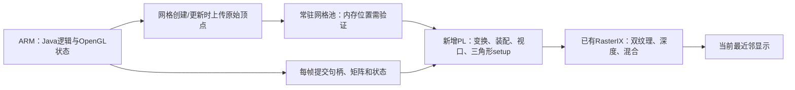

# 原版 Java 的下一轮 PL 优化：先分清瓶颈，再重新分配硬件

> 后续执行约束：用户明确要求保留 FSR。本文删除 FSR 的建议已撤回，本轮仅实施完整 FSR 不变的互联拆分和真实命令重放；GPU 保持 100 MHz。实际构建与测试见 [互联与重放记录](JAVA125_INTERCONNECT_REPLAY_2026-10-28.md)。下文初始设计建议不能当作本轮实施结果。

2026-10-28。本文是针对当前源码、路由后报告和实机证据的设计建议，**不是新功能或新帧率验收**。本次未连接开发板、替换位流或修改SD。保持400×240、完整256纹理、实际Tiny、AO开启、全部粒子和当前最近邻呈现。原版JAR及既有回退保留。

推荐主线为：**真实命令重放定位 → 独立硬件配置腾资源并完善计数 → 常用地形路径的几何硬化与顶点常驻**。提频和CPU批量SIMD作为辅助候选，不再把命令复制微调作为主要突破口。

## 1. 为什么值得调整优化重点

正确Tiny的R79/R80参考为25.7183FPS，即每个完成帧约38.88ms。若先把32FPS作为阶段检查点，需要降到31.25ms，约少7.63ms、吞吐提高24.43%；这只是建议目标，不是已实现成绩。60FPS需要16.67ms，显然不是把一个配置数改成120就能得到。

R81～R84命令暂存的+2.73%未超出基线范围，非编译CPU占用也未降低。R85当前Tiny采样，原生顶点工作线程94.53%的用户CPU样本仍在GL，矩阵、向量搬运和顶点读取是显著热点，但不能把这些样本比例直接等同于墙钟瓶颈。

同时存在明显的资源分配矛盾：

| Java双TMU配置的路由后资源 | LUT | DSP | BRAM Tile |
|---|---:|---:|---:|
| 全部已用 | 65,624 | 330 | 149 |
| 剩余 | 4,936 | 30 | 67 |
| 本场景未运行的FSR模块 | 20,317 | 173 | 78 |
| 三组SmartConnect合计 | 17,613 | 0 | 0 |

FSR占全片48.06%的DSP，但当前Java测试并未使用它；CPU却每帧重做几何计算。**独立实验配置暂去掉未用FSR，不改变当前最近邻画质，却可能为几何核腾出实际空间。** 软件关FSR不会释放资源；必须生成新硬件、保留能力标识和回退。删除后的精确资源不能用本表简单相减冒充新的路由结果。

## 2. 第一项：用真实游戏命令重放分开前后端

CPU采样只能说明CPU在做什么，不能单独证明PL已经充分运行。建议从同画质真实游戏中录制一个有界命令序列，在冻结资源和正确帧缓冲轮转下重放，直接测DMA＋PL后端吞吐。

必须包含有序的纹理上传、寄存器状态和真实三角形命令，不能只复制裸三角形字节。保留每包边界、双TMU、纹理页版本、条带提交/重载、换页及完成fence；按原有三缓冲地址周期回放，不能重复向被扫描的前台写入。先核对对应原生像素和错误计数，再报告吞吐。资源删除/重用需等消费完成。

| 比较结果 | 对下一步的含义 |
|---|---|
| 重放明显快于正常游戏 | 优先减少CPU几何生成、对象搬运和每帧提交 |
| 重放也接近当前25FPS | 优先查PL像素/纹理、条带搬运、DMA及显示完成节奏 |
| 去掉重复资源上传的另一重放模式明显更快 | 进一步分离纹理供数与纯命令/像素代价 |

这是诊断用后端吞吐，**不能称为游戏FPS提升，也不能用重复同一画面证明游戏达到60FPS**。它能避免接下来花几天改错环节。

## 3. 第二项：控制互联存在具体的精简机会

路由后`control`单独占**7903 LUT**，`pl_memory`5043、`ps_memory`4667。创建脚本显示，`control/M03_AXI`连接`pl_memory/S02_AXI`，其它出口还连接DMA控制、显示控制、触摸、CNN占位及FSR寄存器。也就是说，这张网络同时承担整块DDR访问和轻量控制。

建议把PL DDR窗口访问和寄存器访问分开：寄存器网络仅连接32位AXI-Lite端点，DDR数据路径走独立完整AXI通路。可评估未启用的另一PS HPM口，或明确的协议转换/数据路由，逐项验证PS地址窗口、驱动DT、访问宽度、时钟和复位。不能只把一个布尔属性改成低面积模式，因为现有内存出口是完整AXI且网络存在级联。

AMD说明，仅当出口都满足32位AXI-Lite等要求时，SmartConnect才可自动进入低面积模式；2026.1的Ultralite还有不级联、地址布局等条件。完整AXI的Reduced Area选项也要求没有位宽和时钟转换，不能套用到当前跨时钟、变宽的存储网络。[PG247低面积模式](https://docs.amd.com/r/en-US/pg247-smartconnect/Low-Area-Mode)、[高级属性条件](https://docs.amd.com/r/en-US/pg247-smartconnect/Non-GUI-Advanced-Properties)。

这项首先是**节省资源和降低布线压力**，不承诺它单独就提高游戏FPS。需做独立综合和整机实现后再决定是否保留。

## 4. 第三项：几何加速应覆盖一段完整通路

当前`OwnedBatch`已经在ARM缓存解码后的数组，但每次重放仍进入`drawObj`，后台逐顶点构造参数、变换、裁剪、装配和三角形setup。下一步值得研究的是**原始网格常驻＋每批状态快照＋PL直接产生后端命令**，而非再给相同对象加一层复制缓存。

先比较网格放在保留PS DDR与PL DDR的代价；已有GPU存储访问主要通往PS，PL DDR另有显示/FSR通路，不能假定现在已有零成本的PL顶点读取接口。网格上传可发生在显示列表创建、区块重建时，摄像机运动后仍用新矩阵重新绘制，不能把上一帧图像当新帧。

网格格式还可评估无损紧凑化：仅当局部坐标、颜色等属性编码再解码后逐位一致时，使用较紧凑的表示；其它数据保留FP32。不要每帧在CPU压缩又解压，应与常驻网格及PL解包结合。是否减少实际带宽必须计入纹理和条带流量，不能预设原始顶点流一定比当前剔除后的三角形参数流更小。

不推荐首版“PL只算矩阵，再DMA回ARM做裁剪和setup”：它保留大量CPU工作，增加往返和同步；Mat44的12.04%也只是该工作线程的采样比例，无法据此承诺大幅提速。

**首个可控子集建议是普通地形批次。** 保留双纹理和原有像素效果；仅对已证明无需用户裁剪、无需固定功能灯光/纹理坐标生成等特殊处理的批次启用新路径。可以在批次创建时计算保守包围盒，调用时只变换8个角点；若能证明整批完全在裁剪体内，则交PL直接处理；相交或不确定的整批走旧路径。这个判断是硬件快速路径的资格判定，不宣称重新发明了游戏原有的视锥剔除。先测可覆盖的顶点比例，覆盖率太低就不值得按此子集继续。

首版不在同一批次已输出部分三角形后临时让CPU补画剩余部分，以免破坏透明顺序和状态。新旧批次保留同一提交顺序、矩阵/纹理/颜色快照、网格版本和删除fence；不支持的效果继续完整回退，不关掉效果换取通过。四边形拆分与数学次序按原实现验证；不能默默将ModelView和Projection合并后宣称逐位相同。

这仍应称为**部分几何硬化**。六平面精确裁剪、全部图元/灯光/纹理生成和完整桌面GL语义不是首版已有能力。几何核需先做数值及OOC测试，再报告整机资源、实际游戏像素和吞吐，不给未经实现的DSP预算盖章。

## 5. 提频可作为辅助，但要检查正确的时钟域

现有报告中GPU/通用AXI域`clk_pl_0`为100MHz，同域setup余量2.375ns；另一个`mmcm_clkout0`域仅0.142ns。因此“整体WNS很小，所以GPU一定不能提高”也不准确。

建议先评估110、120、125MHz独立候选。不能直接写时钟寄存器了事：当前`pl_clk0`还连接AXI DMA、PS端口及多组互联，必须重做约束、跨域、hold、复位和运行时实际时钟验证。100→125MHz只表示该域频率增加25%，不等于游戏FPS增加25%。若命令重放已显示CPU供数主导，提频优先级应降低。

补充统计也应在独立候选完成：命令输入握手/空泡、`rasterizerRunning`、光栅`valid && !ready`反压、实际片段输出握手，以及必要的纹理/AXI等待。现有`perfTriangleRendering`是多个占用状态的合取，不等于有效片段数；`gpu_busy_cycles`仅为命令解析器非COMMAND_IN状态。计数需同窗快照，长测用足够宽度避免回绕歧义，不能将可重叠状态直接相加为100%。

## 6. 后续仍想同时保留FSR/风格化怎么办

去掉FSR只用于当前Java画质不变的几何实验，原有完整增强配置继续保留。后续可再分配几何、缩放和风格化资源。

另一个可评估方向是**相同FSR数学的算术复用**：v23 EASU/RCAS当前II4，200MHz下HLS整帧估计约7.707ms，并非本轮实测。II8时800×480的纯像素节拍下限约15.36ms，接近16.67ms预算，实际DDR等待与其它阶段会继续占时，因此不能预先保证60输出。历史v10/v13已经试过较大II和单元共享，需结合其旧时钟/缓冲结构重新分析，不能把旧实现当作新突破，也不能假设仅改II就自动省一半DSP。

同数学复用应保持像素参考；若之后换轻量缩放或模型，就另列画质对照，不混入本轮同画质收益。风格网络仍优先在低分辨率运行，再放大；Java双TMU现有配置没有CNN核，不能把另一位流的功能直接列为可同时运行。

## 7. 具体推进和通过条件

| 顺序 | 可审查产物 | 决策条件 |
|---|---|---|
| 1 | 真实命令重放＋正常游戏同窗对照 | 明确前端与后端差距，诊断不计游戏成绩 |
| 2 | 独立无FSR/精简控制互联/计数配置 | 同画质原生图通过；布局布线、冷暖恢复和驱动均通过 |
| 3 | 符合条件批次比例＋几何OOC及参考输出 | 覆盖足够真实负载、数值/顺序/生命周期通过才接整机 |
| 4 | 新几何或提频候选的完整交错对照 | 同一合格场景计数；不要只挑最快两轮 |
| 5 | 移动、转向、区块更新和透明场景长测 | 报告完成帧率、间隔尾部及错误，不能只验静止超平坦世界 |

CPU侧有针对性的批量SIMD可以并行作为过渡：先检查实际汇编，避免重复优化编译器已经向量化的部分；保留浮点次序和异常值，不能默认改用fast-math或融合乘加。[Arm指令参考](https://arm-software.github.io/acle/neon_intrinsics/advsimd.html)区分FMUL/FADD与FMLA。旧Far默认Vec值语义候选无明显收益，不作为当前Tiny已验证升级。

已有推荐及SD保持原样。本文新增判断的源文件和资源/时序/预算校验见[机器可复核分析](../report/architecture-audit-2026-10-28/java-pl-next-analysis.json)；上一轮实机热点、全部失败边界与未采用候选见[命令暂存记录](JAVA125_COMMAND_STAGING_2026-10-28.md)。
