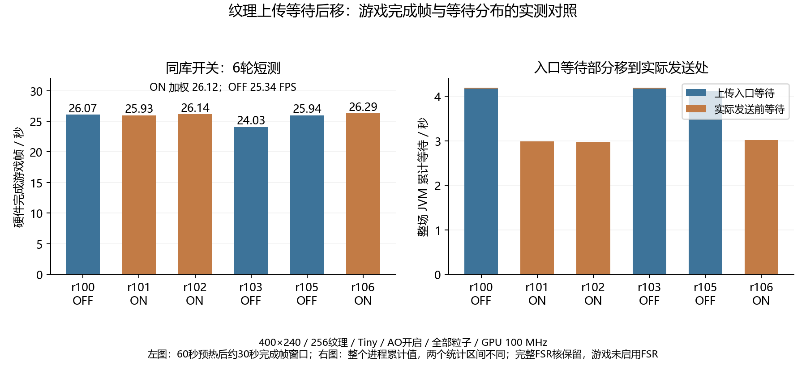
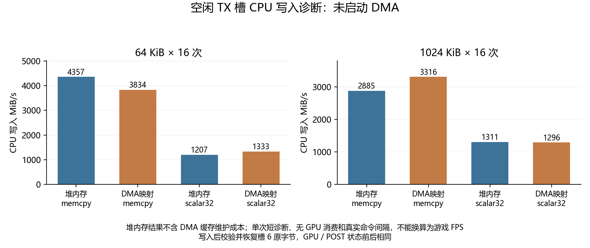

# Java 1.2.5：纹理等待后移与 DMA 写入诊断

本轮延续既有画质：400×240、256 纹理、实际 Tiny、Fast、AO 开启、全部粒子。使用既有双 TMU 位流，PL GPU 100 MHz；完整 FSR 核保留，游戏性能对照仍使用最近邻呈现。没有修改原版 JAR、SD、默认启动文件、驱动 ABI 或 RTL。

## 验证的问题

原 `DeviceDataUploader::writeToDeviceMemory()` 在检查 CPU 纹理影子前等待设备空闲，真正发送资源时又等待一次。实验将前一个等待作为独立开关，仅在实际需要发送时等候，允许未产生新资源发送的影子命中继续运行。真实 DMA 槽复用、命令流提交和回读的完成栅栏全部保留。

实现采用新的私有 `DeferredDeviceDataUploader`，原核心归档、计算器和其他冻结源码不改。开关为 `RIX_JAVA_DEFER_TEXTURE_WAIT=0/1`，默认关闭。64 KiB 资源合批、位置计算及命令缓冲容量均保持既有值，没有叠加上轮未确认收益的实验。

时钟统计在两个模式均启用。入口和真实发送处分别累计等待；统计覆盖整个 JVM 生命周期，不能与中间约 30 秒测量窗口直接相除。入口等待减少也不能自动当作提速：它可能后移到发送处或命令流栅栏。

## 检查与实验设置

主机及 ARM 单元使用延后读取源数据的假总线，覆盖发送尚未结束时影子命中、真实修改时等待、源缓冲复用、命令流/回读栅栏、发送失败后的影子失效。每轮在加载 PL 前运行 ARM 开启和关闭单元；之后执行原有原生像素与大批次压力检查，再运行原版游戏。

同一个共享库先进行 R100 OFF / R101 ON / R102 ON / R103 OFF，随后追加 R105 OFF / R106 ON，每轮预热 60 秒，按硬件完成计数配对测量约 30 秒。固定世界与姿态，保存世界源文件哈希、运行时十二项设置、原生像素、DMA/CPU 采样、位流事务与恢复凭据。动物和动画仍可能造成短测负载差异。

共享库 SHA256：`939c95a07c583f9b30bd0bce6dcc75d2f9f4c9d8d28e7f1e1f19f704707fb2c1`。

本次开机后 RAM 环境已清空，先用原保护流程恢复运行时与冻结 R24 世界证明，再进行实验。所有试验保持原锁、隔离守卫和恢复流程。R100 以前轮次的证据仍保留，未重新利用旧轮次号。

## 结果

| 轮次 | 等待后移 | 游戏 FPS | 命令拍 / 完成帧 | 整场条带溢出 | 入口等待 s | 发送等待 s |
|---|---|---:|---:|---:|---:|---:|
| R100 | OFF | 26.0722 | 321,260.9 | 0 | 4.1796 | 0.0142 |
| R101 | ON | 25.9283 | 322,277.0 | 0 | 0.0000 | 2.9923 |
| R102 | ON | 26.1370 | 321,392.7 | 0 | 0.0000 | 2.9803 |
| R103 | OFF | 24.0281 | 348,185.7 | 594 | 4.1752 | 0.0172 |
| R105 | OFF | 25.9435 | 322,290.9 | 0 | 4.1106 | 0.0159 |
| R106 | ON | 26.2863 | 320,826.8 | 0 | 0.0000 | 3.0161 |

六轮全部通过独立图像、计数、设置、资源生命周期和回滚验收。开启三轮按完成帧和测量时间加权为 **26.1172 FPS**，关闭为 **25.3415 FPS**，原始观测差约 **+3.06%**。这不是已确认的因果增益，暂不推广默认配置。

原因是 R103 的负载明显不同：每个硬件完成帧约 348,186 个命令拍，比 R100 多 **8.38%**；整场出现 594 次条带溢出，队列批次由其它轮的约 6 万增至 568,755。批次数与溢出统计覆盖整个 JVM，而命令拍/帧来自相同完成帧窗口，不能把二者直接相除。R103 是通过正确性验收的真实运行，完整保留在表格和加权值中，没有删除或改成失败；它不适合单独用来证明开关收益。

为核对波动，追加 R105 OFF / R106 ON。第一组 R100→R101 是 **−0.55%**，追加组 R105→R106 是 **+1.32%**，方向和幅度不稳定。仅有这些短测，尚不能建立可采用的稳定提升，也没有达到 32 或 60 FPS。五轮相近负载的结果大致仍为 25.93～26.29 FPS。

所有最终玩家位置、朝向和世界类型与冻结基线完全相同；结束世界时间为 2279～2319 tick，并非所有轮次完全相同。R100/R101/R102/R105/R106 的保存世界截图字节相同，R103 不同，但单幅截图也不能证明整个窗口具有相同动画、实体与区块工作量。负载变化的根本触发原因仍待进一步跟踪，不把它未经验证地归因于某个 Java 子系统。

入口等待在 ON 归零，实际发送等待变成约 2.98～3.02 秒；OFF 的入口约 4.11～4.18 秒、发送约 0.014～0.017 秒。这说明等待后移并有重叠机会，但它没有消除纹理发送的完成依赖。时间为整场累计值，不能用来声称每帧节省固定毫秒。

测量窗口内最忙原生线程约占单核 65.8～67.0%，累计 DMA FINISH 等待与采样区间之比约 28.2～29.5%。等待可能与其他线程重叠，不是独占时段，也不等于纯 PL 光栅时间。`gpu_busy_cycles` 为 32 位命令解析器非 COMMAND_IN 状态累计；汇总保留取模差值，不把它解释为有效像素利用率。

## 空闲 DMA 内存写入诊断

本轮另测 CPU 写入映射内存是否过慢。诊断在默认 v23 空闲状态，持有三把原运行时锁并通过隔离守卫，只写未使用的 TX 槽 6。唯一 ioctl 是 ABI 查询，不发 START/XFER/FINISH、不修改状态/长度字段；每种模式校验写入结果，结束回填并核对整槽原字节，GPU 与 POST 状态前后完全相同。

每项 16 次连续写入；这是一次短诊断，不是统计置信区间或真实命令流吞吐测试：

| 大小 | 写入模式 | 普通缓存堆 MiB/s | DMA 映射 MiB/s |
|---|---|---:|---:|
| 64 KiB | memcpy | 4357.3 | 3834.5 |
| 64 KiB | 标量 32 位写 | 1206.9 | 1333.3 |
| 1 MiB | memcpy | 2885.0 | 3315.7 |
| 1 MiB | 标量 32 位写 | 1311.3 | 1295.9 |

游戏采样的 CPU→DMA 提交数据约 32 MiB/s，远低于这里的连续写入速度。这组结果不支持“DMA 映射大块写入本身极慢，所以必须先更改缓存映射”的假设；实际结构体小写、写入间隔、缓存未命中、DMA 启动开销和 PL 访问等待尚不能由本诊断排除。

普通堆结果未包含向设备交付数据时的缓存维护，不能直接当作可替代 DMA 映射的性能。没有因此修改驱动缓存属性，亦没有将 MiB/s 换算成游戏提速百分比。

## 后续路线与保留状态

1. 先补充命令输入空泡、光栅反压、有效片段等独立硬件计数，区分 CPU 供数、PL 等待与实际计算。现有 busy 和 DMA 等待不足以作这种区分；新增计数尚未实施。
2. 沿已有 Tiny CPU 热点，评估连续顶点读取、Vec 搬运和完整批量几何路径，并对条带溢出触发条件记录有界诊断。先前位置缓存及命令暂存没有稳定收益，不重复包装成成果。
3. 更大提升仍需独立验证常驻网格和部分几何硬化，或对应时序与运行时验证的 PL 提频。FSR 核继续保留；本轮未新增几何硬件，未启用游戏 FSR/CNN，未更换画质。Java 双 TMU 位流使用 CNN 占位，尚未交付双 TMU、FSR 和神经风格网络同时运行。

本轮 6 次游戏试验均使用独立私有库和旧双 TMU 硬件，不叠加互联实验。既有推荐软件仍为 `8e89c36f66e497f26044c779551e5703fbbb7a1a02ff938c76315d8c99d4a993`；等待后移库作为未推广候选保留。RAM 最后一次 staging 为 R106，运行时开启仅由测试进程环境变量指定，该进程已退出，库的默认开关仍是 OFF。

最终检查：v23 位流凭据 `035c30597ce7ed94dff24a733dbbb81fa68998e8d3fba52ef45902d23ccb01d9`，隔离守卫通过，无活动游戏客户端，GPU 错误和 POST 快照过期均为零，两次证据暂存锁已释放，RAM 接收器停止，COM11 已关闭。CPU 末尾读取 1,066,666 kHz、userspace；这是一时点读数，不是整场频率轨迹。SD 启动包和系统默认启动配置未更新。

## 证据归档

- 首四轮回读：1,372,160 字节，SHA256 `5c9acf05ccd717affc587375f01d24ff589d972a2477f63d11fdd90e94c414f5`。
- 追加两轮回读：686,080 字节，SHA256 `4d6f797bbb62626b9cfbbc1755b0abd0e6161311dd68b5327cd0996886b95047`。
- 内存诊断证明 SHA256：`675e3ca2f54e3c1186d25a9f3f6b8480e17f8a863dea5e43ffffb9298db941f5`。
- 最终守卫证明 SHA256：`d08f12f6fb3b9c5bdf89fdd2ce2213c12ad69dcce6a605ea8aafa94cb0995c6d`。
- 六轮汇总与原始姿态：`report/minecraft-java-125/deferred-wait-r1/summary.json`、`poses.json`。
- 内存诊断与独立源码核对：同目录 `dma-memory-probe.json`、`dma-memory-acceptance.json`；最终状态为 `final-guard.json`。
- 每轮原始证据和独立验收：`report/minecraft-java-125/swap-fence/` 中 R100～R103、R105、R106。R104 为内存诊断工具传输、R107 为追加证据工具传输，不是游戏帧率轮次。
- 绘图可重现：`scripts/summarize_java_deferred_wait_r1.py`、`scripts/plot_java_deferred_wait_r1.py`。PNG/SVG 均已生成。

初次长串口证据输出与下一条命令回显交错，未通过 JSON 验证；损坏输出保留在串口日志，未作为验收输入。之后采用单命令压缩回读并核对完整 SHA256，完整证明已通过。

## 文件入口

- 准备/构建：`scripts/prepare_java_deferred_wait_r1.py`、`scripts/build_java_deferred_wait_r1.sh`。
- 冻结源码及导出审计：`scripts/audit_java_deferred_wait_r1.py`。
- 等待语义单元：`sim/test_java_deferred_wait.cpp`。
- 私有实现及构建证明：`build/minecraft-java-125/deferred-wait-r1/`。
- 各轮独立验收：`report/minecraft-java-125/swap-fence/board-acceptance-r100.json` 至 `board-acceptance-r103.json` 及 R105/R106。
- 空闲内存诊断：`linux/java_minecraft/dma_memory_probe.cpp`、`run_dma_memory_probe.py`。只操作未使用的 TX 槽 6，保留实际发送和所有状态字段；不发送 GPU 命令，结束恢复原字节。缓存堆基准不含 DMA 缓存维护成本，不能当作替换驱动后的预期帧率。
