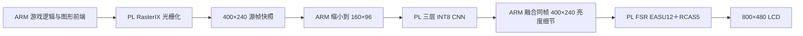

# 多游戏优化、CNN/FSR 扩展与实机验证（2026-11-02）

本轮把检查范围扩展到 Tux Racer、Neverball、Neverputt、Quake I、Quake III、东方演示和 ClassiCube，11 月 3 日完成关卡补测及最终复核。已将有效的供帧设置接入普通菜单，并提供七游戏独立 CNN＋PL FSR 入口。原网络、权重、画质档、Java 主线及旧位流保留。

## 已接入普通菜单的改动

普通菜单继续使用原 v23 FPGA。通过真实 `play_game.py` 启动、正常退出、恢复配置后测得：

| 游戏与测试场景 | 修改前源呈现 FPS | 修改后源呈现 FPS | 增幅 | 修改后开启 PL FSR 的源呈现 FPS |
|---|---:|---:|---:|---:|
| Neverball，独立关卡介绍页 | 24.96 | 45.28 | 81.37% | 45.15 |
| Quake III，现有默认关卡 | 30.27 | 54.73 | 80.81% | 53.48 |

Neverball 采用 `RIX_PRESENT_STRATEGY=async`，减少串行呈现等待；Quake III 保持 async，将 `com_maxfps` 从 30 调到 60。没有降低分辨率、纹理、光照或视距。更改落在 [`game_specs.py`](../linux/launcher/game_specs.py)，板上当前 RAM 菜单也已采用；并非只在测试脚本里生效。

这里统计的是 GPU 实际 `presented` 增量除以单调时钟时间。普通菜单每次运行 18 秒，在启动后 8–16 秒取样，六次运行分别覆盖原设置、优化设置和优化＋PL FSR。FSR 日志确认使用 PL、未启用 CPU 实时像素处理，所记录 FSR 段的重复源帧为零。尚未据此宣称完整游戏稳定 60 FPS。

Neverball 真实开局补测另列于下节，避免把关卡介绍页的提速扩大为所有玩法场景。

## 各游戏的选择

首轮以私有 HOME 复制必要设置，避免覆盖玩家存档。源供帧采用 baseline/candidate/candidate/baseline，每段约 6 秒；东方只有原设置一段。CNN 对照在同一游戏进程上采用早提交 R2 / 提前通知 R3 / R3 / R2，每段约 6 秒。低于 3% 的差异不作为切换运行时的依据。

| 游戏 | 源供帧原设置→候选 FPS | CNN＋FSR R2→R3 输出 FPS | 当前取舍 |
|---|---:|---:|---|
| Tux Racer，自动开始滑雪 | 60.07→48.24 | 44.60→44.95 | 保留原供帧与 R2 |
| Neverball，补测实际开局 | 28.97→45.17 | 43.97→44.12 | 采用 async，源供帧约 +55.92%；保留 R2 |
| Neverputt，固定首球洞 | 60.10→60.10 | 46.86→50.11 | 原供帧＋R3，后处理约 +6.92% |
| Quake I，补测 e1m1 关卡 | 58.47→56.64 | 46.37→50.28 | 原 pipeline＋R3，后处理约 +8.42% |
| Quake III，默认关卡 | 30.31→54.64 | 46.32→49.50 | 60 FPS 上限＋R3，后处理约 +6.88% |
| 东方演示，自动弹幕 | 56.65→未改动 | 46.36→46.32 | 保留原设置与 R2 |
| ClassiCube，自动世界场景 | 60.11→53.79 | 46.37→49.37 | 保留原 120 上限与 R3，后处理约 +6.47% |

Tux Racer 的显式 pipeline 候选变慢，ClassiCube 将内部上限改成 60 也变慢，因此未采用。这并不表示显示器刷新率达到 120 Hz；该设置影响游戏内部节拍与异步提交。东方的弹幕波次会改变负载，0.1% 差异不具备选择价值。

**源供帧 FPS 与 CNN 输出吞吐分别统计。** 后处理可读取同一游戏源帧，CNN 的 `processed_frames`/呈现次数不能直接当成游戏更新帧数；尤其源游戏变慢时，应先检查源帧标签。上表源供帧与 CNN 是不同测试阶段，不能逐行取最小值后声称端到端唯一新帧率。

### Neverball 实际开局补测

已完成独立 `nb4c` 补测：窗口匹配后通过 XTEST 左键点击，等待 ready/set/go，再按相同源供帧与 CNN ABBA 方法测量。源呈现 **28.97→45.17 FPS（+55.92%）**；CNN＋FSR R2/R3 为 **43.97/44.12 FPS**，差异仅约 0.34%，继续保留 R2。补测使用 NGR1，普通菜单采用原 v23；这两组场景与位流分别标明，不混合计算增幅。


图中已进入带球体、倒计时、金币与目标 HUD 的实际关卡，没有关卡介绍覆盖层；本次没有自动移动鼠标控制球，所以仍只是关卡起点短测，不能覆盖全程移动和复杂关卡负载。

## 修复了两个容易误判的入口问题

Quake I 把启动参数拼进 256 字节缓冲区。首轮私有目录使参数达到约 273 字节，出现 `Unknown command "host_m"`，`+map` 没有执行，画面停在菜单。那组约 50.66 FPS 已排除出关卡性能结论。普通菜单参数约 242 字节，未受这个私有测试目录问题影响。

补测和新七游戏入口使用随机短 `/tmp/q4b-*` 或 `/tmp/gq4-*` 别名，并在启动前检查参数长度小于 255 字节。补测画面已确认是带武器/HUD 的 e1m1 关卡；整数 CNN、整图 FSR 和 LCD 样点独立核验通过。独立新入口还完成油画实测：409 帧、8.06 秒，CNN＋FSR 输出约 50.74 FPS，正常恢复原 FPGA 与菜单。

Neverputt 的固定球洞基准使用 `--hole map-putt/01_easy.sol`，HUD 中 Par 为 0，只适合固定场景复现。正常七游戏入口改为 `--course holes-putt.txt`，使用完整球场定义；保留基准原始文件，避免把测试入口当作正常比赛规则。

## CNN 与 FSR 的实际链路



R2 将上一帧的 FSR 与下一帧 CNN 重叠，并提前提交显示。R3 进一步在 CNN 等待/分组输出时轮询 FSR 完成，以软件锁存 DONE，验证返回码和帧标签，再提交显示。它减少的是跨阶段等待，没有减少 CNN 层数或改变图像计算；不同游戏是否受益取决于源供帧和 CPU 竞争。

本轮保留 3→8→8→3、三层 3×3、INT8、160×96 的原网络和 v8 较强漫画/油画权重。没有新增 RTL 或位流；NGR1 原有资源仍为 65058 LUT / 71711 FF / 189.5 BRAM / 325 DSP。本轮不等于新一轮风格质量认可。画面可见 HUD、小字仍可能被风格网络软化，原生清晰菜单继续单独输出；后续质量优化宜先保护 HUD/文字，再调整风格强度。

缩小输入仍为约 1.39 ms 的标量版本，没有实现或宣称 NEON 提速。原有 PL FSR 代码与历史运行时均保留。

## 使用入口与采用范围

普通菜单的 Neverball/Quake III 供帧优化已经生效，普通菜单风格开关未自动替换成新 CNN 实验。七游戏独立入口在板端执行：

```sh
python3 -B /tmp/rix-cnn-group-r1/cfs_games_play.py --game quake --style oil --seconds 30
python3 -B /tmp/rix-cnn-group-r1/cfs_games_play.py --game neverputt --style comic --seconds 30
```

支持 `tuxracer neverball neverputt quake quake3 touhou classicube`，风格支持 `comic oil both`，默认开启 `--upscaler pl-fsr`。正常入口移除测试自动操控变量，维持现有键鼠/触摸输入。加载前检查已有模型、运行时、收据、内核身份和空闲状态；退出时正常停止渲染与后处理，排空队列后恢复原位流及清晰菜单。

Java Minecraft 继续使用原 ARM 前端＋双 TMU RasterIX 配置，其位流 CNN 是 stub；没有把 NGR1 收据强套到 Java，也没有把本表 ClassiCube 数据称为原版 Java Minecraft。miniDP 实际显示器尚未连接，本轮输出/像素验收均针对 LCD，未声称验证了 1080p60。

源码镜像见 [`linux/game_opt`](../linux/game_opt/README.md)，发布包在 `build/multigame-opt-r4/play-v2/`。当前部署在 RAM，重启后需要按既有部署流程恢复；项目源码已更新，未重新制作或烧录 SD 启动镜像。普通游戏可正常保存自己的偏好/成绩，因此历史结果中的 `SD_written=false` 只表示测试没有主动改写启动包，不能当作整张 SD 完全无写入的结论。

## 证据、图片与边界

主矩阵、Quake 与 Neverball 关卡补测合计 10216 帧 CNN 呈现，独立复算 36 组末帧，检查 4,423,680 个 INT8 输出值、3,456,000 个融合阶段像素哈希、13,824,000 个完整 FSR 输出像素哈希及 216,000 个实际 LCD 采样点。新七游戏入口另有油画 409 帧和 6000 LCD 样点的板端回归，不混入上述主机独立复算数量。


左侧为实际源帧，右侧为同一源帧的 CNN 张量＋固定点 FSR 重建；整图哈希匹配 PL 回读，图片不是屏幕实拍。Quake、Neverball 两行来自各自独立关卡补测，其余来自首轮矩阵；原始含 Quake 菜单和 Neverball 介绍页的概览另行保留。

最终机器可读记录：[`acceptance-final.json`](../report/multigame-opt-20261102/acceptance-final.json)。原始证据包、逐段指标、CPU/显示回读与哈希在同目录；复核脚本会拒绝模型、程序或源码身份不一致的记录。GPU 读写错误、超时、下溢和扫描错误均为零；原 v23 收据、原生菜单及 SD 的 BOOT.BIN/system.dtb 哈希已复核。

下一轮值得优先做：针对真实玩法记录源帧的唯一标签与帧时间分位数，区分游戏更新不足和后处理重复帧；再处理标量缩小、CPU 融合与采样传输。只有这些实测证明有效后再切换默认运行时，不把菜单短测平均值作为稳定 60 FPS 或 1080p60 的依据。
