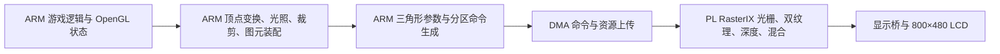

# ARM 几何前端主线恢复

> 本文记录初始 r1 恢复阶段。随后已完成实际 Tiny 的缓存／直通对照，采用直通开关并生成 r2；当前选择和最新板测见 [直通路径实测与主线采用](F:/1FPGA/Xilinxprj/prj2/rasterix-linux/docs/JAVA125_TINY_SEQUENTIAL_2026-10-30.md)。下文的关闭开关、r1 目录和“未测新 FPS”描述属于最初恢复阶段。

2026-10-30，按用户决定停止 Vortex 与完整 HLS 几何前端迁移，回到已有 ARM 前端方案。Vortex 源码、模型、综合报告和测试证据保留，不再作为下一步开发主线。

## 当前采用的链路



ARM 负责几何，像素渲染继续由 FPGA RasterIX 承担。当前 Java 基线为 400×240、双 TMU、完整 256×256 纹理。PS Mali 未作为这条主线的渲染器。

Vortex 和完整 HLS 前端此前均没有部署到正在运行的游戏，因此无需为本次路线回退重新刷卡。取消 Vortex 计划也不会自动改变板上资源占用：此前的 Vortex 面积只是独立核结果和名义相加预算。

## 固定基线与构建入口

主线选择记录：[config/java_arm_mainline.json](F:/1FPGA/Xilinxprj/prj2/rasterix-linux/config/java_arm_mainline.json)。

| 项目 | 选择 |
|---|---|
| ARM 前端库 | `sequential-batch/libGL-sequential.so.1`，保持原推荐版本 |
| 库 SHA-256 | `8e89c36f66e497f26044c779551e5703fbbb7a1a02ff938c76315d8c99d4a993` |
| 配套双 TMU 位流 | `dual-tmu/board/java256.bin` |
| 位流 SHA-256 | `14fd58da8a1a0348b0033f7efef35dc5498c2f4bd1f2a3c43b77404adc9cd961` |
| FPGA 几何开关 | `RIX_JAVA_FPGA_GEOMETRY=0` |
| 未推广的批次缓存旁路 | `RIX_JAVA_BATCH_CACHE_BYPASS=0` |
| 未推广的纹理等待后移 | `RIX_JAVA_DEFER_TEXTURE_WAIT=0` |

在项目根目录运行：

```powershell
.\build.ps1 -Action arm
```

入口使用现有 SDK，从原对象与固定核心归档重新链接 AArch64 库，检查其与已验收版本字节一致，并在新目录运行已有 CPU 几何宿主回归。没有重新生成旧底座，没有删除或覆盖实验成果。原 `check/board/classicube` 等入口保持原用途；Java 双 TMU 基线使用这个独立入口，不应拿最初单 TMU 的 Tux Racer 配置代替。

本地输出：[build/minecraft-java-125/arm-mainline-r1](F:/1FPGA/Xilinxprj/prj2/rasterix-linux/build/minecraft-java-125/arm-mainline-r1)。

- `lib/libGL.so.1` 和 `lib/libGL.so`：重新链接并核对的原推荐库。
- `hardware/java256.bin`：与库匹配的既有位流副本。
- `selection.json`：固定的软件、硬件及路线选择。
- `environment.sh`：选择包内库并关闭上述实验开关；不加载或验证硬件。
- `proof.json`：源与输出摘要、链接命令、回归结果和执行范围。

重复运行会检查已准备产物，不能覆盖失败或已有产物。若要创建另一个独立目录，可在 WSL 中给脚本传入新的 `--attempt r2` 等编号。

## 本轮核验结果

已重新链接的 AArch64 库与原推荐库 SHA-256 完全一致。原 CPU 几何参考和所选普通路径均运行于宿主，覆盖 **96 次绘制、11520 个顶点、11710 个三角形**；两份结果均为 **2,248,320 字节**，与冻结参考逐字节一致。

该检查证明本地选回的库身份和原几何算法没有被试验改写，不是新增板上测试。本轮没有打开串口、写 SD、重新编程 PL、改 `/opt` 启动入口或替换板上 RAM 库。

当前本地包供原有受保护的板级加载/验收流程使用，不是自动安装程序或新的整卡镜像。上板仍按既有锁、当前启动凭据、匹配位流和恢复流程操作；`environment.sh` 本身不代替这些检查。

## 帧率和后处理边界

ARM＋RasterIX 路线在正确 Tiny/Fast、400×240、完整 256 纹理、AO 和全部粒子的历史静止场景中有约 **25～26 FPS** 的板测记录，见 [Tiny 对照](F:/1FPGA/Xilinxprj/prj2/rasterix-linux/docs/JAVA125_PL_TINY_2026-10-28.md) 和 [纹理等待试验](F:/1FPGA/Xilinxprj/prj2/rasterix-linux/docs/JAVA125_TEXTURE_WAIT_OPTIMIZATION_2026-10-29.md)。这是先前数据，本轮没有测得新 FPS，也没有达到稳定 32/60 FPS 的新证据。

配套 Java 双 TMU 位流含完整 PL FSR，当前游戏基线采用最近邻呈现；CNN 在该配置中为占位。没有自动开启 FSR、神经风格迁移或改成 Mali。原 PL FSR 源码与校验归档完整保留。

后续工作围绕原 ARM 主线的真实 CPU 热点、顶点搬运/批处理、命令提交与 PL 反压测量推进。Vortex 的设备程序优化、完整 HLS 几何迁移及其板级后端不再自动继续。
