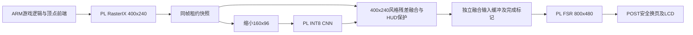

# AMD 初级组：14天加急交付与优化扩展方案

日期：2026-10-26。依据：用户提供的 `F:/1FPGA/AMD.pdf`，以及本项目截至v27的源码、验收与优化记录。用户已确认报名自主选题初级组、队员均为大三及以下。本方案按理想条件下的工程依赖安排，不假设人数或每日工时。

**建议立即转入参赛交付阶段：保留现有渲染内核与400×240→800×480主配置，以“资源受限SoC FPGA上的可配置图形增强系统”为主线，先完成独立冷启动、交互演示、可信对照和复现，再冲刺低分辨率风格增强接FPGA FSR。**

赛题没有要求60 FPS。两周必须交付的底线与理想冲刺目标应分开；完整组合链路、稳定60 FPS都不能成为提交成功的前置条件。

## 1. 赛题核对：哪些适用，哪些不适用

以下页码先列PDF物理页码，括号内为正文页码。原文件28页，SHA256为 `c6ad82acd4f7bdcd13bd412e232ed85d05f2a87dd5e2cdd04f9d219f88b569fc`。

| 项目 | 指南口径 | 对本项目的判断与行动 |
|---|---|---|
| 所属赛道 | 第22页（19），3.3自主选题，分初级/高级 | 当前路线适配；不用改成智能体评测系统或具身智能系统 |
| 资格 | 初级为大一至大三本科；按队员最高年级/学历归组 | 用户已确认符合；提交前保留报名审核信息 |
| 器件 | 初级允许UltraScale+等系列 | AXU3EG / `xczu3eg-sfvc784-1-i`可按此器件范围申报；填写实际板卡和完整料号 |
| 实现 | RTL、HLS、PS软件及组合均可 | ARM游戏逻辑/顶点前端加PL像素渲染、CNN和FSR均可；不要求所有步骤移入PL |
| PYNQ | 第22–24页，推荐；通用PYNQ Skill另有加分 | 不是参赛门槛。保留现有Linux栈，避免两周内整体迁移PYNQ |
| 工具 | 第23页（20），推荐2026.1或2025.2；其他版本需解释并可复现 | Vivado/Vitis 2026.1匹配。另把Linux 5.4、2020.1 BSP/SDK作为依赖如实列出，不临时全栈升级 |
| 板测 | 第23–24页，须板上跑通、提供实测输出及参考比对 | 已有大量RAM板测，但最终版本还必须完成独立冷启动和人工交互 |
| 性能 | 有可测结果和基线；避免以明显资源代价换小收益 | 没有指定60 FPS、1080p或大型网络。应同时报告吞吐、长间隔、资源和画质边界 |
| 工程包 | 第24页（21），源码、验证、综合实现、上板、可复现脚本 | 需要发行包整理；不能把当前实验目录直接整包提交 |
| AI协作记录 | 第23–24页，提示词、回答、自我纠错过程 | 本项目实际有大量协作材料，应提炼典型案例，不能只写“使用AI辅助” |
| Skill | 第24页，`skill/`及README，说明适用范围、使用方法、失效条件与已验证效果 | 当前顶层未发现`skill/`，这是明确的交付缺口，优先级高于再加游戏 |
| 开源 | 第23页措辞为“强烈要求”，推荐MIT/Apache-2.0 | 按开源交付准备；保留第三方许可，不能把含GPL代码的整包直接统一标MIT |
| 文件命名 | 第24页要求英文目录/文件名，正文可以中文 | 提交副本清除中文名与空格，原创文件尽量小写；不直接改坏现有证据路径 |
| 目录结构 | 第25页明确推荐结构非强制，可在README作映射 | 不必为改目录破坏全部构建；发行包提供清晰映射即可 |
| 决赛海报 | 第28页（25），入围自主选题队按AMD模板做一页英文PPT，A4彩印且不含队伍信息 | 预留英文一页稿；模板和最终细则须以官方附件为准 |

**不要误用3.1赛道要求：** 单张32 GB显卡、本地开源模型、容器、VerilogEval/HLS-Eval、固定`xczu3eg-sbva484-1-e`和5 ns约束，属于RTL/HLS本地智能体设计赛道，不是本项目3.3初级组的统一门槛。无需更换现有器件封装或为了报名训练本地大模型。

文件命名条款使用“小写”等措辞，但指南自身保留`README.md`等标准名。建议D1就确认标准文件名/第三方原始名的处理口径；自有提交路径先满足ASCII、无空格，标准工具文件和上游路径不做无依据的全量改名。

指南没有给AMD本赛道的具体截止日，明确以官网及评分细则为准。本次联网核查未取得可独立确认的AMD最新提交日期；不把其他赞助商或往年日期套用过来。下文按剩余14天的D1–D14安排，不将D14当作官方截止日。

## 2. 按评分看，当前应该把精力放在哪里

第25页（22）的两组权重相同：

| 评分项 | 权重 | 当前优势 | 两周最有价值的补强 |
|---|---:|---|---|
| 创新性与应用价值 | 30 | 小器件上有真实3D渲染、硬件增强和多应用验证 | 把“移植游戏”组织成可配置图形增强平台；突出自己的缓存、所有权、接口和端到端取舍 |
| 性能与资源优化效果 | 20 | FSR/CNN已有数值、板测、面积与优化前后记录 | 汇成少量同口径对照；选择一个搬运瓶颈做新改进，不再堆无收益参数 |
| 功能正确性与完整性 | 20 | 有仿真、整数金值、LCD回读和退出检查 | 独立冷启动、实体键鼠、模式选择、长时间运行和明确回退 |
| 大模型协作与技能包 | 15 | 有真实纠错及失败实验 | 实际协作记录加可直接运行的通用Skill，含负例与边界 |
| 文档质量与可复现性 | 15 | 日志丰富，版本和SHA较完整 | 统一发行版本、脱离原路径的重建、依赖清单、操作指南和演示视频 |

这不是“软件文档凑分”。正确性、协作技能包和文档本身占50%，创新与应用价值另占30%；继续只为57→60 FPS投入全部时间，会留下更大的交付缺口。这也不表示这些分数可以自动获得，评委还会判断实际效果和贡献。

## 3. 当前真实状态：已实现与还没形成提交闭环的部分

| 能力 | 现有证据 | 交付边界 |
|---|---|---|
| ClassiCube | 64³世界、视距32、400×240源画面，移动/挖放/菜单/保存等已有自动验证 | 是Classic类方块游戏，不是Minecraft Java生存版；实体USB操控仍需人工验收 |
| RasterIX | PL光栅、纹理、深度、混合；ARM逻辑、顶点变换、裁剪等 | 复用开源RasterIX，不能宣传为全部原创GPU，也不能说所有渲染步骤均在PL |
| 完整PL FSR | v23，EASU12+RCAS5，视距32两轮120秒约57.09个新输出帧/秒 | 严格稳定60未达到；最新位流/独立入口仍依赖RAM部署 |
| 向量候选v26 | 同组长测56.83→58.19 FPS，约+2.39% | p99变差；不应仅为较高均值替换推荐入口 |
| CPU分核v27 | 同一向量版58.21→57.62 FPS | 吞吐和尾部均回退，不采用该掩码组合 |
| 真神经风格迁移 | 三层INT8 3→8→8→3、3×3卷积，160×96，CNN在PL；MC风格约25–26 FPS | 目前只是轻量学生网络，7×7感受野；不是完整CycleGAN/AnimeGAN生成器 |
| 动漫模型v5 | 修复零通道、QAT、边缘/运动约束；新留出8帧教师融合MAE下降约42.57% | 教师模仿指标不等于审美质量；样本少，时间一致性尚未人工验收 |
| CNN+FSR同帧组合 | v23构建脚本沿用atomic-CNN拓扑，硬件模块共存 | 模块共存不等于已串接。还没有实时组合链路的帧率与画质结论 |
| 触摸/DP | GT911识别和软件接入已有记录；DP输出后端未完成 | 本轮以键鼠和现有800×480 LCD为主，不把触摸和MiniDP设为主线必需项 |
| 发行与复现 | 已有多套脚本、报告和启动修复经验 | 顶层未发现发行许可证清单/Skill目录；部分脚本依赖`/var/tmp/rix-game-ports`和实验生成目录，仍需干净环境复现 |

v23整机实际实现资源：LUT 64,901/70,560（91.98%）、BRAM 216/216（100%）、DSP 325/360（90.28%），WNS +0.306 ns、WHS +0.010 ns。**有剩余DSP不代表还能直接放入更大的网络；BRAM已经没有余量，布线也须重验。**

推荐频率的名义配置为GPU/PS AXI 100 MHz、FSR 200 MHz。只读核查又发现CPU OPP表与实际1.066 GHz、CCF缓存时钟树之间存在需核对之处。不要临近提交直接改PLL或用名义频率推算新实测结果。

## 4. 项目定位：路线微调，不推倒重来

建议题目：**《基于Zynq UltraScale+的可配置轻量图形渲染与视觉增强系统》**。

具体问题：在资源有限的平台上，低分辨率渲染容易出现锯齿、细节和风格表现受限；把所有步骤放在CPU或盲目增大网络又会受搬运、时延和资源限制。作品展示在已有渲染器之上如何设计可验证的图形增强链路。

建议只强调三个有证据支撑的贡献：

1. 帧/缓冲所有权及AXI完成语义：正确快照、安全换页、退出排空、错误阻止提交。
2. 资源受限的硬件实现和接口优化：FSR行/窗口缓存、突发释放、CNN原子输出、与源渲染的调度重叠。
3. 可信端到端评估：区分源帧率、增强完成帧率和LCD扫描；同时保留黄金图、面积时序、失败候选和复现流程。

展示场景以ClassiCube为主，Tux Racer或Neverball留一个作兼容性/回退展示。不要再把游戏数量作为主要扩展指标。经典游戏是实际负载；“教育/交互图形平台”等可作为应用方向，不冒充已经部署的工业产品。

保持现有Linux和驱动栈。PYNQ推荐项可以通过独立通用Skill探索，但不为此重做系统。开源核心与已有模型明确署名，原创边界画在架构图中。

## 5. 两周的交付层级

以下是目标，不是新增实测结果，也不是获奖或帧率承诺。

| 层级 | 两周完成形态 | 建议性能口径 |
|---|---|---|
| 必须交付 | 无PC/JTAG手工补载的冷启动；实体键鼠；原画/FSR/神经风格选择；报告/源码/Skill/录像/回退 | 视距32沿用已验证约57 FPS的FSR路径；神经风格按新发行版重测约25–26 FPS的现有能力 |
| 理想交付 | 改善快照/CNN数据通路，同一源帧低分辨率风格增强后接PL FSR，形成可选组合模式 | 组合模式以端到端30 FPS为工程冲刺目标；若能达到更高帧率，必须另行长测，不能预先承诺 |
| 额外冲刺 | 源渲染实际提速并改善帧节奏、模型在更多世界中的一致性提高 | 视距32完整FSR争取接近/达到60个新帧/秒，但不是提交门槛；组合30 FPS也不代表组合60 FPS |
| 本轮不承诺 | 大型CycleGAN全硬件化、1080p/120 Hz、全部顶点前端搬入PL、完整Minecraft Java、大量新游戏 | 不列为两周承诺或作品核心卖点 |

新增“性能预设”可以保留视距16，但必须在UI和结果中标出；它不能替代32格主配置的对照。LCD约60 Hz扫描也不能冒充每秒60个新游戏帧。

## 6. 最值得冲刺的一条技术主线

### 6.1 先统一现有能力，优先得到可提交版本

基础版用同一发行位流提供互斥模式：原画、FSR、轻量CNN风格。统一启动器负责检查型号/能力/ABI、选择模型和场景、展示状态与返回菜单。切换时先正常结束并排空旧客户端，再进入新模式。

第一版允许“返回菜单后重启相同世界”切换，不必追求无中断热切换。不要同时启动旧CNN会话和FSR会话争用POST/快照槽；不要通过强杀活动AXI主设备实现退出。优先复用已有会话锁、恢复守卫、黄金图和排空逻辑。

新增一个原创方块测试场景：斜边/栅栏、近远纹理、文字/快捷栏、水面或运动区，配固定路线。它比再移植一款游戏更容易展示算法差异、复用能力和设计贡献。

建议配一个简单“配置与对照面板”：显示当前模式、源/输出尺寸、视距、模型/强度、版本，以及来源明确的性能数据。先做启动菜单和串口/日志面板，画面内叠加属于可选项；不要把源计数直接贴成“最终FPS”。截图比较用同一冻结源帧，连续游玩比较用同一路线；左右两幅来自不同时刻时应明确标注。

### 6.2 优化顺序：快照和PIO优先，网络规模不变

当前MC神经链路的核心仅约4.15 ms；此前实测完整快照读取约28–30 ms、atomic推理约12.4 ms（含PIO）、融合约8.9 ms、显示写回约8.4 ms。这些阶段有重叠，不能全部相加。瓶颈不等于卷积算力不足。

建议先做**租约保护的packed RGB565快照候选**：源400×240读取数据由384,000 B降为192,000 B，保持同一源帧、完整完成屏障及旧格式兼容。它有望减少回读/转换开销，但字节减半不等于整体帧率翻倍。

协议必须带格式、stride、字节数、frame_id和token；不能全局悄悄把旧SNP1的32位格式换成16位。FSR旧路径继续按原格式运行；新CNN客户端只有在能力匹配时才申请packed格式。缓冲地址来自生成的内存布局，不随手指定物理地址。

第二选择是复用现有CNN引擎`s_valid/s_ready`、`m_valid/m_ready`接口，给低分辨率输入/输出增加突发或流式搬运。控制寄存器与模型装载仍可走AXI-Lite，像素不再逐个PIO。不能把GPU命令DMA当作任意CNN像素通道直接复用，必须有独立协议与仲裁。

两项按门槛择优推进：先以仿真、面积估计和实际关键路径判断，保留一个主硬件候选，避免最后同时维护多个半成品。packed快照收益足够时，DMA扩展可留作下一阶段。

### 6.3 理想组合：先在低分辨率融合风格，再做FSR



建议保留400×240底图细节，把160×96神经残差融合回400×240，再交给FSR。不要直接用160×96风格图取代全部源细节后硬放大。最先验证可采用ARM低分辨率融合，卷积和FSR仍在PL；完整融合下沉PL属于进一步扩展，不作为首版前提。

融合像素数从800×480降到400×240，输出到后处理输入的XRGB数据从1,536,000 B降到384,000 B；这是阶段数据量的4倍差异，不是4倍帧率。它会改变当前融合/放大的计算顺序，须定义新的参考算法，不能宣称与原800×480融合逐像素等价。

保护矩形首先防止CNN修改相应区域；后续FSR仍可能改变字形边缘，必须检查最终HUD可读性，不能把它写成已经实现了真正独立的UI合成层。对MC像素纹理，最近邻有时更符合原作风格，FSR也不是每个场景都必然更好，保留用户选择和明确对照。

**真正的集成难点是输入契约：** 现有FSR live入口消费受保护快照；新路径需要独立融合输入缓冲、格式/大小校验、帧号配对、写完成、交接与释放，不能覆盖GPU仍持有的源槽或伪造SNP租约。原底图、CNN结果及融合结果必须对应同一源帧，避免跨帧混合造成拖影。

先用冻结帧完成“CNN→融合→FSR→LCD”参考比对，再接实时调度。不能用文件静态演示宣称实时组合已完成。

在名义配置下，仅CNN核心约4.15 ms和FSR计算约8.2 ms，顺序合计已约12.35 ms，尚未计入传输、融合、换页和源帧等待。因此把组合30 FPS作为冲刺目标较合理；60 FPS需要额外流水重叠和源渲染改善，不能靠核心周期相除作保证。

### 6.4 资源不够时的调整

优先复用已有行缓存/FIFO/暂存，少量控制和小FIFO评估LUTRAM；不能假定分布式RAM不花LUT和布线。任何新增存储都必须看整机实现，而非只看OOC。

若新增数据通路无法在v23整机收敛，**保留现有单个位流的互斥模式作为正式版**，组合分支停止合入。需要专用FSR-only/CNN-only配置时，可作为独立启动配置研究；两位流切换会涉及驱动、DDR、GPIO和身份管理，不应临时包装成已经完成的动态部分重配置。

### 6.5 源渲染与CPU频点：只保留一个早期验证窗口

源码热点值得继续查重复顶点/投影/几何组装，但矩阵变换已自动使用四路NEON；不要把再手写SIMD当成确定收益。保留一个有界候选，按同世界、同视距、同图像语义验证，平均收益与p99同时检查，不再进行大量微小开关排列。

CPU实际约1.066 GHz、频点表上限约1.2 GHz是一个需要核对的线索。只有确认PS初始化、Linux时钟树、合法频点、可精确恢复接口及其他时钟不受影响后，才在D4前考虑有界对照；无法核清就不改频率。不能直接据12.5%的名义频率差预测游戏帧率，更不把临近提交手调PLL作为主线。

## 7. MC风格化的路线微调

坚持小型真CNN，但把目标写成“纹理与结构保留的轻量神经风格增强”。3层7×7感受野适合局部配色、边缘和纹理响应，不能期待获得完整GAN的全局笔触或语义重构。

优先做以下改进，网络形状暂不变：

- 使用已验证的v5动漫模型作为候选，油画保持原有较稳版本；别因颜色变化更强就自动判为更好。
- 训练/开发/最终测试按世界种子和路线隔离；新增建筑、草木、水面、弱光、快速转向与菜单，避免只看平地八帧。
- 在同一融合顺序下比较量化误差、块边界保留、HUD可读性和真实运动观感；已有500 ms采样代理不能代替运动视频验收。
- 强度0应保持定义中的原图；默认强度保守，提供明确的风格/强度选择。若无法从引擎分离HUD，继续如实说明保护矩形会同时保护部分世界画面。
- 不在两周内改成多倍通道或更深网络。优先改善数据和目标，给已有8个活动隐藏通道更合适的训练内容。

## 8. D1–D14执行顺序与退出门槛

并行表示依赖允许，不绑定团队人数。P0发行主线持续保持可运行，新增硬件在隔离分支进行。

| 天数 | 必须推进的主线 | 理想优化/扩展 | 当天验收或退出门槛 |
|---|---|---|---|
| D1 | 冻结赛题范围、最终主配置、依赖/模型/位流清单；备份当前可运行版本 | 重新整理阶段耗时与原始贡献，确认packed/PIO优先顺序 | 有可回退的发行候选和一份缺口清单；确认官方截止/上传限制 |
| D2 | 生成匹配v23的BOOT/DTB/模块/运行包；处理SD空间与安装布局 | 新数据通路协议、内存布局、参考算法及小规模仿真 | 不靠旧boot_id或手写伪造回执；BOOT中控制DTB/PL负载和PS配置匹配 |
| D3 | 断电冷启动、实体键鼠、显示比例、保存/退出人工验收 | packed快照格式兼容和负例仿真 | 已有可独立演示的基本版；新格式没有破坏旧客户端 |
| D4 | 三模式选择、世界/路线选择、状态和返回菜单 | packed/流式候选综合与资源/时序检查 | 模式切换排空安全；无新增BRAM余量时不能直接扩大缓存 |
| D5 | 原画/FSR/CNN同口径数据与图像采集，设计报告骨架 | 数据通路整机实现；模型数据/权重改进可独立并行 | 候选未通过数值与协议就不进入上板；源/增强/扫描FPS分别记录 |
| D6 | 保持基础版发行可用；整理可复现构建依赖 | 新硬件RAM上板、黄金图、实际吞吐与尾部对照 | 无整机时序/板测闭环则回原版，禁止为展示直接替换 |
| D7 | 形成第一份完整可提交包：基础模式、证据、源码映射、演示初稿 | 只保留有实际收益且无正确性退步的数据通路 | 如果此时不能独立冷启动，立即暂停全部可选扩展 |
| D8 | 基础版进入回归 | 组合链路冻结帧：CNN→400×240融合→FSR，核对所有权/帧号/参考 | 静态链路不通或接口不安全，就把组合降为原理分析，不阻塞交付 |
| D9 | 固定默认模型/强度/主场景 | 静态通过后接实时组合；以30 FPS为冲刺目标，实际测得多少写多少 | 没有真实运动与完整输出证据，不把组合写成已完成 |
| D10 | 最终功能冻结、最终位流/启动盘/模型版本固定 | 仅允许已通过全部门槛的候选合入 | 从此不换PLL、不扩网络、不扩分辨率、不加游戏 |
| D11 | 长时间运行、退出/恢复、冷启动重复、不同目录重建 | 修复可复现的缺陷 | 基础版必须通过；组合若影响稳定性从正式入口移出 |
| D12 | 完成设计报告、Skill、AI协作记录、视频；按官方模板准备英文一页稿 | 表格/图像/演示叙事打磨 | 尽早上传第一份完整材料，目标留出约48小时余量 |
| D13 | 全包SHA、路径/许可证/来源/引用核对，另目录复现和答辩彩排 | 只修复提交阻断问题 | 构建、视频、报告、实测所指向的版本一致，确认上传可下载/打开 |
| D14 | 上传/回执确认、备份、备用卡/演示脚本及已知问题清单 | 只做交付缓冲 | 不在最后一天引入算法或硬件功能 |

### 建议停止条件

- **D3关口：** 冷启动和输入仍不可靠，全部算法优化暂停。
- **D6关口：** 新硬件不能收敛或无实板收益，保留基础版；不得为“做了新东西”合入。
- **D9关口：** 组合链路无端到端证据，正式版保留独立模式并如实写后续工作。
- **D10以后：** 只修缺陷、补证据和交付，不以最后一次大综合赌提交。

若真实剩余时间少于14天，按依赖压缩：先完成D1–D4、D7、D11–D14；删去组合和新数据通路，不删冷启动、实测、Skill和复现。不要用其他赛道的截止日期替代报名后台确认。

## 9. 正式版验收定义

以下为拟定目标，完成前不写成已通过。

| 类别 | 建议验收 |
|---|---|
| 独立启动 | 10次真实断电冷启动，进入同一发行版；不依赖PC/JTAG补载；记录每次启动身份与结果 |
| 交互 | 实体USB键鼠移动、转向、挖放、菜单、存档/重载；截图或外部录像结合日志；自动XTEST另列 |
| 生命周期 | 正常退出、SIGTERM、重复启动和模式往返；未完成事务不得强杀；配置/租约/POST恢复 |
| 长测 | 建议主游戏/FSR至少连续60分钟，风格/组合至少30分钟，资源/温度/错误/日志增长纳入记录 |
| 数值 | CNN整数参考、FSR参考、同帧输入配对、完整输出摘要和LCD抽样；边界/饱和/反压/错误负例 |
| 性能 | 固定世界、种子、视距、分辨率、模型/强度、运行时SHA；预热后四轮ABBA，每轮120秒，记录均值及p99/最长间隔 |
| 资源时序 | 用最终整机实现报告；建立/保持违例为零，无阻断CDC/未约束关键路径；面积与频率标明版本 |
| 复现 | 不访问旧`/var/tmp`缓存或原F盘目录，在新目录依说明构建并运行；源代码与依赖版本可取得 |
| 发行 | BOOT/DTB/模块/程序/模型/位流/报告同一manifest，空间足够、安装可回退；发布包hash验证 |

图像正确性与视觉质量分开：黄金参考零差异证明实现符合定义，不自动证明FSR比插值漂亮或模型有更强画风。真实游戏缺少严格配准高分辨率真值时，不随意报PSNR/SSIM；可单独用原创高分辨率合成图降采样建立算子对照，说明它与游戏场景的区别。

建议至少补齐一项同算法的板上基线，例如已有`cpu-int8`与`pl-int8`后端使用同输入、同权重、同输出定义，并同时记录纯核与含传输的端到端成本。PC参考生成的耗时不能当成A53软件基线；最近邻/双线性与FSR的对照主要反映算法质量/成本取舍，不能直接称为相同算法硬件加速比。

性能计时不同时抓大图、传素材或做CPU诊断。运动观感可用外部相机录屏，避免抓帧代码改变被测负载。功耗没有板级电流/功率测量就不报“降低了多少功耗”，资源利用率和片上温度不是整板功耗。

## 10. 提交包与Skill应长什么样

建议独立生成英文命名的提交副本，保留原始实验目录。以下是目标结构，不表示现在已经生成：

```text
rix_visual_pipeline/
  README.md
  src/                 # 原创RTL/HLS/PS与上游接入边界
  patches/             # 固定上游版本上的修改
  sim/                 # 功能、协议、错误和背压验证
  scripts/             # prepare/build/package/verify/benchmark
  board/               # 配置、内存布局、发行manifest、上板和恢复说明
  data/                # 小型测试集、原创场景、黄金结果、模型来源
  report/              # 设计报告、原始实测索引、资源时序、图表
  skill/               # 通用经验与可执行工具
  ai_records/          # 真实协作片段和决策链
  third_party/         # 上游版本、许可证、NOTICE、获取方式
```

不能只保留一个`.xpr`；也不必把整个工具安装目录、SDK、`.Xil`、崩溃转储和全部历史中间文件打进源码包。选定的第三方HLS导出IP/RTL与依赖必须能从固定源重建，不能因它们在`build/`下就全部忽略。

根目录说明清楚哪些原创、哪些来自RasterIX、ClassiCube、FSR1、模型教师与BSP。RasterIX实际许可证是GPLv3，FSR1有AMD许可；推荐MIT/Apache不等于可以覆盖上游条款。修改版二进制要配套对应源码/构建材料，参考[GNU关于对应源码的说明](https://www.gnu.org/licenses/gpl-faq.en.html#DistributeExtendedBinary)。不直接公开整个厂商SDK或无法确认许可的数据集。

### 三个最值得提炼的通用Skill

| Skill | 可复用内容 | 本项目已有的真实失败/观察来源 |
|---|---|---|
| `axi_frame_lifecycle` | WLAST/B响应完成、缓冲所有权、快照租约、缓存一致性、退出排空；参考断言和错误负例 | 提前换页、背压占住DDR、快照/输入归属及活动AXI主设备退出风险 |
| `fair_fpga_benchmark` | 帧/窗口加权、ABBA、源/输出/扫描区分、p99、完整证据和SHA核验 | 核心加速不等于端到端、短窗增益长窗失效、v26均值与尾部相反、v27固定核心退步 |
| `reproducible_board_release` | BOOT控制DTB检查、版本依赖、源码manifest、干净目录构建、上板日志与回退 | BL31后停住、控制树遗漏、临时路径/缓存依赖、只在RAM生效 |

每个Skill应含适用场景、输入输出、执行命令、一个正例、一个会失败的负例、失效条件、已验证效果和真实协作片段索引。先把不依赖游戏名字的通用工具跑通；不能只把聊天记录拷成README。

PYNQ专用Skill仅在确实有PYNQ接口和可运行验证时申报额外加分。普通Python脚本不自动成为PYNQ Skill，未在第二块板上验证就不声称跨板验证。没有这项加分也应先完整交付上述基础Skill。

### AI协作记录的组织

优先选5–8个可追溯案例：U-Boot控制DTB、DMA槽数、DDR背压缓存、CNN零通道、FSR缓存/调度、v26均值提高而尾部变差、v27亲和性回退。每个按“问题→当时提示词→关键回答→实际工具/日志→哪里错了→修正→保留/放弃决策→可复用规则”整理。

使用真实记录，删去账号、密钥和无关私人信息；不能根据最终结果倒写一份看似从未出错的聊天历史。完整记录可归档，报告展示精炼片段及索引。

## 11. 演示与答辩如何组织

建议主视频约3–5分钟，具体格式以实际上传说明为准：

1. 从断电状态启动，标明板型、发行版本与本地运行，避免只录已经准备好的桌面。
2. 实体键鼠进入原创测试世界，说明ARM/PL划分与上游复用。
3. 同源图展示原画/插值/FSR差异，连续路线展示实测FPS口径。
4. 展示真CNN动漫增强、强度/HUD保护；组合链路只有实际通过才加入，并单独标出帧率。
5. 展示安全退出/返回、资源与优化对照、二维码或仓库复现入口、Skill案例。

必须能回答：为什么不是Mali渲染？哪些步骤还在ARM？为什么网络小？为什么选择400×240？为什么不是只看60 Hz或核心4.15 ms？哪些优化失败？断电后如何复现？自己贡献与RasterIX/FSR/模型教师边界在哪里？

## 12. 我的推荐决定

**保留游戏逻辑和渲染核心，固定MC主场景与现有LCD；先把版本和演示闭环锁定，再把唯一重型扩展放在“搬运减负→低分辨率风格→FSR组合”上。**

两周的理想上限是一套可独立冷启动、可操控、可复现、能清楚展示取舍的图形增强平台，并有一条经过实测的风格+FSR组合支路。组合约30 FPS值得争取；完整FSR视距32的稳定60作为额外性能结果，不作交付承诺。

即使组合没有赶上，拥有可靠的约57 FPS完整FSR模式、约25–26 FPS真CNN风格模式、扎实的协议/数值证据、原创演示场景和通用Skill，也比多个未打包的高风险扩展更符合本赛道完整性与复现要求。

## 13. 本次审阅的证据入口

下列是本地已存在资料，并非本方案宣称新增的测试结果：

- [整体优化过程与证据索引](AXU3EG_RasterIX_整体优化过程总结_2026-10-25.md)
- [v23整机、FSR与当前入口](FSR1_PL_200MHZ_OPTIMIZATION_2026-10-25.md)
- [v23实际ahead长测验收](../report/fsr-pl/fixed-v23-bufferedread/ahead-11f7-acceptance.json)
- [v26向量候选与尾部取舍](CLASSICUBE_TRIVIAL_VEC_2026-10-25.md)
- [v27亲和性与只读时钟线索](CLASSICUBE_CPU_AFFINITY_2026-10-26.md)
- [CNN atomic接口与持久化边界](CLASSICUBE_STYLE_EXPLORATION_V4_2026-10-22.md)
- [MC模型质量v5](CLASSICUBE_MODEL_QUALITY_V5_2026-10-23.md)
- [模型v5工程验收](../report/classicube-style/quality-v5/acceptance.json)
- [神经数据通路审计](../report/classicube-style/exploration-v4/hardware-audit.md)
- [实体键鼠与自动验证的边界](CLASSICUBE_KEYBOARD_2026-10-21.md)
- [v23构建沿用atomic-CNN拓扑](../scripts/create_fsr_v23_board.tcl)
- [CNN现有流式引擎接口](../src/rtl/neural/rix_cnn_axi.sv)
- [当前板卡与固定上游配置](../config/rasterix_axu3eg.json)
- [有临时路径依赖的候选构建实例](../scripts/build_classicube_vec_v26.sh)

本次只做赛题核对、项目审阅和路线规划，没有调频、改位流、烧SD或发布外部仓库。
