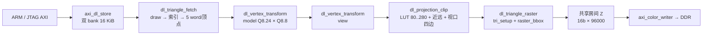

# AXU3EG 渲染架构全景：PL 前端 × ARM 前端 × 当前架构

日期：2026-10-30　平台：ALINX AXU3EG / `xczu3eg-sfvc784-1-i` / AN970 800×480 @ J16


> 两份图由 `scripts/plot_frontend_architecture_20261030.py` 生成，输出目录
> `report/architecture-panorama-2026-10-30/`。图是架构示意，不是版图；
> 图内每个数字都来自本文引用的已记录实测值或已标注来源的 HLS 估计值。

---

## 0. 一句话结论

**当前板上真正跑的架构是「ARM 出整数三角形描述符 + PL 只做像素」，几何的 12 个阶段 100% 在 A53 上，PL 里没有任何几何硬件。**

这不是推测，有 5 条互相独立的自述证据：

| 证据 | 内容 | 位置 |
|---|---|---|
| 布线报告能力位 | `"geometry_frontend_present": false` | `rasterix-linux/report/minecraft-java-125/no-fsr-base-r1/resource-routed.json:145` |
| 构建清单能力位 | `geometry_frontend_present false`、`geometry_capability_bits 0` | `rasterix-linux/build/minecraft-java-125/no-fsr-base-r1/generation.json:5-6` |
| 硬件寄存器自述 | `8'hbc: s_axi_rdata<=32'd0; // Geometry frontend not yet integrated` | `rasterix-linux/build/minecraft-java-125/no-fsr-base-r1/rtl/rix_control.v:110` |
| 顶层端口表 | `rasterix_linux_top` 的 6 组端口是 `S_CMD_AXIS`（32 位命令）/ `M_RESP_AXIS` / `M_GPU_AXI` / `M_PS_AXI` / `M_PL_WRITE_AXI` / `M_SCAN_AXI` / `S_CONTROL_AXI` + LCD，**无任何顶点或索引上传端口** | `rasterix-linux/src/rtl/top/rasterix_linux_top.v:4-108` |
| 架构文档 | 「RasterIX 像素后端与硬件后处理已实现，**几何前端仍在 A53**，而且未利用 PS Mali」 | `rasterix-linux/docs/ARCHITECTURE_MALI_PL_GEOMETRY_2026-10-28.md:5` |

「几何搬进 PL」这件事在 2026-10-30 仍停在 HLS 面积评审阶段。最好的候选 R32 估计
**139,017 LUT**，而 no-FSR 基座只剩 **32,510 LUT** 可用（`_gh32/solution1/syn/report/rix_geometry_hls_csynth.rpt`；
可用量见 `rasterix-linux/docs/JavaMC_完整几何前端_硬件接入进度_20261030.md:42`）。
即使 R27→R32 已经砍掉 54.8% 的面积，仍是可用量的 **4.3 倍**，
所以**任何「几何已在 PL」的说法目前都不成立**。

---

## 1. 全景：三段式 + 一条分界线

```mermaid
flowchart LR
    subgraph ARM["①ARM A53 / Linux · 100 MHz 控制域"]
        A1["游戏 MC Java 1.2.5 + LWJGL"] --> A2["私有 libGL / GLX<br/>24 个 glX* 入口"]
        A2 --> A3["RasterIX C++ 前端<br/>12 阶段几何全在此"]
        A3 --> A4["DeviceDataUploader<br/>8 槽 × 1 MiB mmap"]
    end
    subgraph BND["②分界：唯一交接物 = 整数化三角形描述符"]
        B1["TriangleDesc 192 B（双 TMU）<br/>命令头 0x300000c0"]
    end
    subgraph PL["③PL · 100 MHz GPU 域 + 200 MHz MIG + 33.3 MHz 像素"]
        C1["CommandParser"] --> C2["Rasterizer 边漫游"]
        C2 --> C3["属性插值 + F2X"]
        C3 --> C4["PixelPipeline<br/>TMU0/TMU1 + Fog"]
        C4 --> C5["PerFragmentPipeline<br/>depth/alpha/stencil/blend"]
        C5 --> C6["内部条带 FB 3×32768 px"]
        C6 --> C7["RGB565 流出"]
        C7 --> C8["rix_swap_fence"]
        C8 --> C9["帧桥 RGB565→XRGB8888"]
        C9 --> C10["PL DDR 双 slot"]
        C10 --> C11["reader → scaler → timing"]
        C11 --> C12["LCD 800×480"]
    end
    A4 -->|AXI DMA MM2S| B1
    B1 --> C1
```



关键之处是**分界线上流动的东西不是顶点**。ARM 交出的最后一样东西是
「已经算好边函数、包围盒、w 梯度、颜色梯度、深度梯度、双 TMU 纹理梯度的定点三角形参数包」，
PL 拿到它之后只做边缘漫游与增量插值，不做任何顶点变换、裁剪、透视除法。

---

## 2. ARM 前端：12 个阶段逐条核对

全部在 `ThreadedVertexTransformer` 的工作线程里执行，由 `0xA0000000`/`0xD0000000`/`0xE0000000`/`0xF0000000`
四类私有命令驱动（`rasterix-linux/external/RasterIX/lib/gl/renderer/threadedvertextransformer/ThreadedVertexTransformer.hpp:420-423`、`:431-447`）。

| # | 阶段 | 实现位置 | R85 样本份额 |
|---|---|---|---|
| 1 | 顶点读取 / 解包 / 类型与 stride 分派 | `external/RasterIX/lib/gl/vertexpipeline/VertexPipeline.cpp:43-57`，循环 `:102-106`；Java 快路径 `ports/java_prepared_arrays.hpp:44-52` | 7.63%（`prepared::View::at`） |
| 2 | 模型视图 + 投影变换 | `transform/VertexTransformer.hpp:268`、`:300`、`:166`；matmul `math/Mat44.hpp:140-158` | **12.04%**（`Mat44::transform`） |
| 3 | 纹理坐标矩阵（每 TMU 独立） | `VertexTransformer.hpp:247-266`，启用判定 `:151-160`；数据 `transform/MatrixStore.hpp:30-46` | 无独立符号 |
| 4 | 光照 + 法线矩阵 | `VertexTransformer.hpp:273-293`（双面 `:281-288`）、`:133-149`；`transform/Lighting.hpp:71-85` | 1.68%（多数批次关闭） |
| 5 | 用户裁剪面 + 视锥裁剪 + 插值 + 扇形化 | 视锥 `VertexTransformer.hpp:429-446`、`Clipper.hpp:44-62,81-97`；用户面 `:170-201` + `ports/compat/PlaneClipper.cpp:7-49` | 1.86%（`OutCode\|=`） |
| 6 | 透视除法 `1/w` | `VertexTransformer.hpp:375-377`、`:311`；`math/Vec.hpp:105` | 含在 4.89% `transform()` |
| 7 | 视口变换 + 深度范围缩放 | `VertexTransformer.hpp:380-382`、`:312`；`ViewPort.hpp:45-53` | 4.72% |
| 8 | 背面剔除 | `VertexTransformer.hpp:384-387`、`:320`；`Culling.cpp:58-78` | 无独立符号 |
| 9 | 图元装配（三角/线/点，扇形化） | `PrimitiveAssembler.hpp:40-77`；调用 `VertexTransformer.hpp:107-119`、`:462-471` | 4.27% + 1.89% + 1.14% |
| 10 | 三角形 setup：边函数、bbox、`1/area`、颜色/深度/纹理梯度、5-bit 定点 | `renderer/Rasterizer.cpp:88-95`、`:103-117`、`:150-171`、`:173-180`、`:190-285` | 2.43% |
| 11 | 条带分配 + 逐带 Y 重定基（3 × 80 行） | `Rasterizer.hpp:60-67`；`Rasterizer.cpp:26-74`；调度 `ThreadedVertexTransformer.hpp:258-272` | 无独立符号；R103 实测 594 次溢出 |
| 12 | 命令打包（4 B 头 + 192 B 负载） | `commands/TriangleStreamCmd.hpp:46-50,59-69,74`；`DisplayListAssembler.hpp:76-83` → `RIXDisplayListAssembler.hpp:47-79` | 无独立符号 |

### 2.1 入口：`glXSwapBuffers` 是整条 ARM 前端的唯一触发点

```cpp
void render() { rr::RIXGL::getInstance().swapDisplayList(); }   // external/RasterIX/lib/glx/glx.cpp:155-158
```

`GLInitGuard` 在启动时把这 24 个 `glX*` 符号注册进私有 GL 分派表
（`external/RasterIX/lib/glx/glx.cpp:119-142`：`glXChooseVisual`、`glXCreateContext`、`glXMakeCurrent`、
`glXSwapBuffers`、`glXChooseFBConfig`、`glXCreateContextAttribsARB` 等）。
游戏侧看到的仍是标准 GLX，替换点只在这一个 `.so`。

### 2.2 这张表的正确读法

- 12 个阶段**全部在 ARM**，PL 一个都不做。这是本文最重要的一条。
- R85 的百分比是**含内联的用户态 CPU 采样份额**，不是互相独立的墙钟阶段，也不是「可交给 FPGA 的时间」。
  把 12.04% + 11.39% + 7.63% 直接加出 31% 再换算 FPS 是错的
  （`rasterix-linux/report/minecraft-java-125/swap-fence/r85-cpu/analysis.json:191-196`）。
- 采样口径：最忙原生线程 6,346 的 5,599 个样本中 5,293 个（94.53%）落在 GL 库
  （`rasterix-linux/docs/JAVA125_COMMAND_STAGING_2026-10-28.md:52-56`）。Linux 线程名也叫
  `Minecraft main`，不能靠名字区分「游戏逻辑」与「几何工作线程」。

### 2.3 变换类为什么是最大单一热点

`Mat44::transform` 12.04% + `Vec4` 复制赋值 11.39% + `Vec4` move 赋值 4.89% + 复制构造 2.80%
≈ 31%，这是「把 84 字节的 `TransformingVertexParameter` 在函数间搬来搬去」与「做 4×4 矩阵乘」的合计。
但请注意：**同一份数学若搬到 PL，代价是 30–37 万 LUT**（见 §6），
所以「热点最大」不等于「应该最先搬」。

---

## 3. 分界 ABI：唯一的交接物

### 3.1 结构体与命令字

| 项 | 值 | 出处 |
|---|---|---|
| 分界结构体 | `rr::TriangleStreamTypes::TriangleDesc` | `external/RasterIX/lib/gl/renderer/commands/TriangleStreamTypes.hpp:112-118` |
| 组成 | `StaticParams` 120 B + `Texture[TMU_COUNT]` × 36 B | 同上 `:45-61`、`:38-43` |
| 双 TMU 尺寸 | **192 B**（单 TMU 156 B） | `build/minecraft-java-125/geometry-feasibility-r1/layout.json:2-23`（AArch64 宏探针实测） |
| 命令头 | `op::TRIANGLE_STREAM \| sizeOf<TriangleDesc>()` = **`0x300000c0`** | `commands/TriangleStreamCmd.hpp:74`；op 表 `commands/Op.hpp:24-37` |
| 每三角形线上字节 | 4 B 头 + 192 B 负载 = **196 B** | — |
| 描述符字布局 | 48 × 32 位字：bbox / w0-w2 与增量 / 颜色 RGBA 与增量 / `z/w` 与增量 / TEX0、TEX1 的 `s,t,q` 与增量 | `external/RasterIX/rtl/RasterIX/RegisterAndDescriptorDefines.vh:409-461` |

op 编码全表（`commands/Op.hpp:24-37`，硬件只认前 6 个）：

| op | 值 | 硬件消费方 |
|---|---|---|
| `NOP` | `0x00000000` | — |
| `RENDER_CONFIG` | `0x10000000` | 19 个配置寄存器槽 |
| `FRAMEBUFFER` | `0x20000000` | 提交 / 清屏 / 换页 / 读回 / 等 vsync |
| `TRIANGLE_STREAM` | `0x30000000` | `Rasterizer` |
| `FOG_LUT_STREAM` | `0x40000000` | 雾 LUT |
| `TEXTURE_STREAM` | `0x50000000` | TMU0 / TMU1（按立即数选路） |
| `0xB`–`0xF` | 虚命令 | 只被 `ThreadedVertexTransformer` 消费，**永不到达 PL** |

### 3.2 搬运通路：8 槽 mmap + AXI DMA，不是描述符环

```
DisplayListAssembler（每带一份）
 → Renderer::uploadDisplayList()                    renderer/Renderer.cpp:217-222
 → ThreadedVertexTransformer::uploadDisplayList()   ThreadedVertexTransformer.hpp:159-182
       逐带过滤 size>0，每带先 blockUntilDeviceIsIdle
 → DeviceDataUploader::streamDisplayList()          devicedatauploader/DeviceDataUploader.cpp:25-31
       writeData(index, size + 命令头 OP_STREAM 0x90000000)
 → DMAProxyBusConnector::writeData()                rasterix-linux/src/ps/DMAProxyBusConnector.cpp:49-57
       mmap 槽写 length → release fence → ioctl START_XFER
 → axi_dma MM2S → gpu/S_CMD_AXIS                    scripts/create_java256_no_fsr_base_r1.tcl:60-74
```

- 8 个 `channel_buffer` 固定槽、每槽 1 MiB、1024 B 对齐（`config/rasterix_axu3eg.json:62-67`，ABI 2）；
  实际只用 6 槽，因为 `getDisplayListBufferCount() = writeBuffers-1` 且要求 `>= 2*getDisplayLines()`
  （`DeviceDataUploader.hpp:53-56`、`ThreadedVertexTransformer.hpp:144-157`）。
- 无 SG、无 DRE、`c_m_axi_mm2s_data_width 64`、`c_m_axis_mm2s_tdata_width 32`
  （`scripts/create_java256_no_fsr_base_r1.tcl:60-63`）。
- **带宽不是瓶颈**：CPU 对空闲 DMA 槽的连续写入可达约 **3.3 GiB/s**，
  而游戏实际提交约 **32 MiB/s**，差两个数量级
  （`docs/JAVA125_GEOMETRY_OFFLOAD_STUDY_2026-10-29.md:53`）。
  所以「196 B/三角形太大」不是当前问题；问题在每条三角形都是 CPU 现场算出来的。

### 3.3 为什么是 3 条带 × 80 行

| 步骤 | 计算 | 出处 |
|---|---|---|
| 内部条带 SRAM | `FRAMEBUFFER_SIZE_IN_PIXEL_LG = 15` → 32768 像素 | `src/rtl/top/rasterix_linux_top.v:173` |
| 需要几条带 | `ceil(400*240 / 32768) = 3` | `external/RasterIX/lib/gl/RenderConfigs.hpp:55-63` |
| 每带行数 | `240 / 3 = 80` | `renderer/displaylist/DisplayListDispatcher.hpp:97-112` |
| 带序 | **反转**（否则 AXIS 显示顺序错） | 同上 `:143-149` |
| 带内 Y 偏移 | `yOffset = i * resY`，写 `Y_OFFSET` 寄存器 | `ThreadedVertexTransformer.hpp:562-570` |
| 跨带重定基 | `Rasterizer::increment()` 把 w/depth/color/texStq 沿 Y 平移 | `renderer/Rasterizer.cpp:26-74` |
| 带内判定 | `bbEndY >= lineStart && bbStartY < lineEnd` | `renderer/Rasterizer.hpp:60-67` |

**这条约定对几何硬化极其关键**：PL 侧根本不知道「现在是第几条带」，
它只有 `Y_OFFSET`（`RegisterAndDescriptorDefines.vh:62`）和 `RENDER_RESOLUTION`（`:63`）两个寄存器。
任何要搬进 PL 的几何核，**必须在硬件里复现 `increment()` 的逐带 Y 重定基**，
否则画面会错位。R103 实测 594 次带溢出（`docs/JAVA125_TEXTURE_WAIT_OPTIMIZATION_2026-10-29.md:30`），
说明这条路径在真实游戏里是高频走的，不是边角情况。

---

## 4. PL 像素后端：21 个环节

### 4.1 层次与规模

```
axu3eg_rasterix_top                    src/board/axu3eg_rasterix_top.v:2      (25 行)
└─ rasterix_system_wrapper            :13（BD 生成）
   └─ gpu : rasterix_linux_top        src/rtl/top/rasterix_linux_top.v:3    (255 行)
      ├─ RasterIX (VARIANT="if")      :171
      │  └─ RasterIX_IF               external/RasterIX/rtl/RasterIX/RasterIX_IF.v:18   (806 行)
      │     ├─ axi_crossbar mainXBar  :198   (4 从 → 1 主)
      │     ├─ FrameStreamingCore     :455   (命令搬运 + 资源/纹理 STORE/LOAD)
      │     ├─ AxisToAxiCrossbar      :575   (3 条帧缓冲流 → AXI)
      │     └─ RasterIXCoreIF         :644
      │        ├─ InternalFramebuffer depthBuffer    RasterIXCoreIF.v:311
      │        ├─ InternalFramebuffer colorBuffer    :395
      │        ├─ InternalFramebuffer stencilBuffer  :502
      │        └─ RasterIXRenderCore                 :583   (1813 行，8 个 STEP)
      ├─ rix_frame_snapshot           rasterix_linux_top.v:138
      ├─ rix_swap_fence               :170
      ├─ rix_frame_bridge             :191
      ├─ rix_presenter                :199
      ├─ video_timing                 :203
      ├─ rix_frame_reader_dynamic     :216
      ├─ rix_scaler                   :222
      ├─ rix_style_pixel              :225
      └─ rix_control                  :248
```

GPU RTL 库 `external/RasterIX/rtl/RasterIX/` 共 72 个文件（68 个 `.v` + 4 个 `.vh`），
最大单文件 `RasterIXRenderCore.v` 1813 行；板级自研 RTL 共 22 个文件
（`src/rtl/**` 20 个 + `src/board/` 2 个），最大 `rasterix_linux_top.v` 255 行。
其中 `src/rtl/reuse/` 的 3 个文件（`axi_frame_reader.v` / `video_timing.v` / `mmcm_pixel_clk.v`）
是从 linestream-rs 复制过来的，由 `scripts/generate_top.py:8-15` 生成并记录 SHA。

### 4.2 环节清单

| # | 环节 | 模块 | 关键事实 |
|---|---|---|---|
| 8 | 命令解析 | `CommandParser.v`（354 行） | 三状态机 `WAIT_FOR_IDLE / COMMAND_IN / EXEC_STREAM`（`:82-84`）；4 位 op + 28 位立即数（`RegisterAndDescriptorDefines.vh:33-36`）；6 类流分派（`:207-282`）；`TRIANGLE_STREAM` 在 `:181`、`:208-214` |
| 9 | 边漫游光栅 | `Rasterizer.v`（450 行） | 不走完整边函数遍历，而是「找左边界 push → 走到右边界 → pop 回起点 → y 增量」的增量算法（`:18-30`）；输出是「像素 + 命令」混合流，`tcmd` 给下游增量插值器发 `X_INC/X_DEC/Y_INC/PUSH/POP`（`:71-78`，常量表 `RasterizerCommands.vh:18-25`）；条带只体现为 `yOffset`（`:101`、`:202`、`:230-246`） |
| 10 | 属性插值 + 浮点转定点 | `AttributeInterpolatorX` / `AttributeInterpolator` / `AttributeF2XConverter` | `RasterIXRenderCore.v:1214`、`:1319`、`:1400`；定点精度 `RASTERIZER_FIXPOINT_PRECISION(25)`、`SUB_PIXEL_CALC_PRECISION(8)`（`rasterix_linux_top.v:183-185`） |
| 11 | 纹理管线 | `PixelPipeline.v`（429 行，28 拍，`:25`） | `TMU0`（`:164`）+ `TMU1`（`:255`，`generate ENABLE_SECOND_TMU :253`）+ `Fog`（`:357`） |
| 11a | 单个 TMU | `TextureMappingUnit.v`（482 行，13 拍，`:22`） | `LodCalculator`（`:100`）→ `TextureSampler`（`:166`）→ `TextureFilter`（`:395`）→ `TexEnv`（`:439`）；四 texel 双线性接口 `m_tr_addr_00/01/10/11`（`:51-62`）；`ADDR_WIDTH=17` 对应最大 256×256 + mipmap（`:35`） |
| 11b | 纹理存储 | `TextureReader` + `PagedMemoryReader` + `TextureBuffer` + `TextureCacheDirectMapped` | `RasterIXRenderCore.v:615/667/702`（TMU0）、`:761/816/851`（TMU1）；页大小 `TEXTURE_PAGE_SIZE`（`:700`） |
| 12 | 逐片元 | `PerFragmentPipeline.v`（351 行，4 拍，`:22`） | `ColorBlender`（`:169`）+ `LogicOp`（`:188`）+ alpha `TestFunc`（`:218`）+ depth `TestFunc`（`:231`）+ stencil `TestFunc`（`:258`）+ `StencilOp`（`:274`）；深度 16 位（`:29`），写回使能是三测试相与后延迟 2 拍（`:312-320`） |
| 13 | 内部条带帧缓冲 | `InternalFramebuffer.v`（309 行，1 px/cycle，`:34-35`） | 32768 像素 × 3 子像素 × 5 bit，无 alpha（`rasterix_linux_top.v:173-175`） |
| 14 | 颜色流出 | `RasterixCoreIF.v:465-488` + `PixelUtil.vh:208-218` | **RGB565** 16 bit/像素；三条流（color/depth/stencil）各一条 AXIS，`PIXEL_PER_BEAT = DATA_WIDTH/16 = 4`（`:213-214`） |
| 15 | 换页栅栏 | `rix_swap_fence.v`（20 行） | RasterIX 的 apply 是脉冲，撤销不等于显示完成；`IDLE/WAIT_DONE/WAIT_RELEASE` 保持未完成态直到真实 `bridge_swapped`（`:2-19`）。旧的 `assign gpu_fb_swapped=!swap_fb\|\|bridge_swapped` 被判过早完成 |
| 16 | 帧桥 | `rix_frame_bridge.v`（198 行） | 一次有界突发在飞；缓存 PS 像素后展开成 scanout 与（租赁时）快照；`SLOT0=0x0`/`SLOT1=0x00100000`（`:8`）、`SNAPSHOT_BASE=0x21400000`（`:10`）、`BURST_BEATS=16`（`:11`）；RGB565 → XRGB8888 位复制扩展（`:102-106`）；源地址白名单 `PS_GFX_BASE + {0, 0x100000, 0x200000}` |
| 17 | PL DDR 呈现 | 双 slot ping-pong | `present_slot <= !front_slot`（`:137-139`）；错误码 1=参数 2=读 3=写 4=超时 5=present 不匹配 |
| 18 | 扫描读出 | `rix_frame_reader_dynamic.v`（109 行） | XRGB8888 → 128 位 beat，单笔 AXI4 读、`arsize=4`；神经模式先把整笔突发收进 256×128 位 BRAM（`:4-6,27-56`） |
| 19 | 缩放 / 风格 | `rix_scaler.v`（82 行）+ `rix_style_pixel.v` | 4 档：LR 2×、native HR、bilinear、neural 160×96→800×480 五倍（`rix_scaler.v:2-3,15-22`）；行窗口 `ram_style="distributed"`；带欠流计数（`:63`） |
| 20 | 视频时序 | `video_timing.v`（65 行） | H 总 1056（800+40+48+168）、V 总 525（480+13+3+29），DCLK = 33.264 MHz（`:1-4`、`:25-26`） |
| 21 | LCD 输出 | 板级顶层 | 24 位 RGB 直连（`src/board/axu3eg_rasterix_top.v:21`），`ODDRE1` 产出 `lcd_dclk`（`:22-23`） |

### 4.3 三个时钟域

| 域 | 频率 | 来源 |
|---|---|---|
| GPU / 控制 / 通用 AXI | 100 MHz | `ps/pl_clk0`，`PSU__CRL_APB__PL0_REF_CTRL__FREQMHZ 100`（`scripts/create_java256_no_fsr_base_r1.tcl:56`） |
| PL DDR4（MIG） | 200 MHz | `CONFIG.FREQ_HZ 200000000`（`:112`）；`FREQ_HZ 200000000`（`src/rtl/common/rix_pixel_clock.v:4`） |
| 像素时钟 | 33.333 MHz | `FREQ_HZ 33333333, CLK_DOMAIN rasterix_pixel`（`rix_pixel_clock.v:6`），MMCM 200/6（`src/rtl/reuse/mmcm_pixel_clk.v:17-25`） |

`pl_memory` SmartConnect 因此需要 3 个时钟（`NUM_CLKS 3`，`:118`、`:125`、`:130`、`:132`）。
跨域约束：`config/rasterix_cdc.xdc:3-10`（`set_max_delay -datapath_only 20`、`set_bus_skew 10`）。

物理刷新率 = 1056 × 525 × 60.125 Hz ≈ 33.3 MHz，这是 LCD 的扫描节拍。
**60 Hz 扫描 ≠ 游戏每秒生成 60 个新帧**，两者必须分开记。

### 4.4 三个格式层不要混

| 层 | 格式 | 证据 |
|---|---|---|
| 内部条带 SRAM | 3 子像素 × 5 bit，**无 alpha** | `rasterix_linux_top.v:174-175`（`FRAMEBUFFER_SUB_PIXEL_WIDTH(5)`、`FRAMEBUFFER_ENABLE_ALPHA_CHANNEL(0)`） |
| 流出 AXIS | **RGB565**（16 bit/像素），400 宽一行 800 B | `RasterixCoreIF.v:465-488`；`config/rasterix_axu3eg.json:15-16` |
| 显示缓冲 | **XRGB8888**（32 bit/像素），stride 1600 | `rix_frame_bridge.v:102-106`；`config/rasterix_axu3eg.json:21-22` |

### 4.5 保护链：四层，缺一层就会出现「画面撕裂但计数正常」

1. **AXI 写完成栅栏（GPU 内）**：4 条主口的 pending 写计数全 0 且帧缓冲通路 idle，才允许 `swap_fb` 出去；
   任一写响应非 0 或计数下溢 → `write_fault_reg` 锁死（`RasterIX_IF.v:524-556`）。
2. **`rix_swap_fence`**：把「脉冲」变成「完成态」，等真实 bridge ack（`src/rtl/gpu/rix_swap_fence.v:2-19`）。
3. **帧桥完成/错误码**：`fb_swapped / copy_done / present_valid / present_ack / presented_id`（`rix_frame_bridge.v:188-192`）。
4. **跨时钟发布**：`rix_presenter` 用 bundled-data toggle CDC，**只有 `safe_blank && scan_idle`** 才把新 slot 发布给像素域
   （`src/rtl/video/rix_presenter.v:39-42`）。

### 4.6 控制/状态 CSR

`rix_control.v`（115 行）暴露 8 位地址空间：

| 偏移 | 值 / 含义 | 行 |
|---|---|---|
| `0x00` | `0x52495801` 身份 | `:85` |
| `0x04` | enable | `:86` |
| `0x08` | live_status | `:87` |
| `0x0c` | `CONFIG_HASH` | `:88` |
| `0x44` | `PS_GFX_BASE` | `:89` |
| `0x50` | `0x50535431`（"PST1" POST） | `:91` |
| `0x74` | `0x534e5031`（"SNP1" 租约快照） | `:99` |
| `0x88` | `0xa1400000`（PS 视角的 PL `0x21400000`） | `:104` |
| `0x90` | `384000` = 400×240 XRGB8888 字节数 | `:106` |
| `0x94` | `2000` ms 租约看门狗 | `:107` |
| `0x10..0x3c` | 12 个计数器（command_beats、gpu_busy_cycles 等） | `:108-110` |

活动基座另加能力位：`0xb0=0x4a324e31`（J2N1）、`0xb4=2`（真实 TMU 数）、`0xb8=0`（无 FSR/CNN）、
`0xbc=0`（几何未接入）、`0xa8=0x53574631`（SWF1 换页栅栏）
（`build/minecraft-java-125/no-fsr-base-r1/rtl/rix_control.v:107-112`）。

> **`perfBusy` 的正确含义**：`assign perfBusy = state != COMMAND_IN`（`CommandParser.v:127`），
> 顶层只把它累加进 `gpu_busy_cycles`。它**不是**像素管线有效着色计数，
> 因此「非 COMMAND_IN 约 48.9–51.9%」不能读成「GPU 只用了一半，可以翻倍」
> （`docs/JAVA125_COMMAND_STAGING_2026-10-28.md:75`）。

---

## 5. 另一条线：linestream-rs 的 PL 几何前端

这是同一块板上的**第二套、互斥的架构**：几何与光栅都在 PL，ARM 只上传显示列表。

### 5.1 链路



| 级 | 文件 | 行数 | 定点 / 周期 |
|---|---|---:|---|
| AXI staging | `axi_dl_store.v` | 297 | 双 bank `0x4000`；bank 位 = `write_addr[14]`；写活动 bank → SLVERR |
| 取数 | `dl_triangle_fetch.v` | 306 | 每 draw 42 周期；每三角形 36 周期（3 索引读×2 + 15 顶点 word 读×2） |
| model / view | `dl_vertex_transform.sv` | 166 | Q8.24 列主序 × Q8.8；36 MAC/级/三角形；全阻塞无 skid，两级约 76 周期 |
| 投影 / 裁剪 | `dl_projection_clip.sv` | 334 | LUT 80..280（焦距 160 px）；近远 ≤5 顶点；视口四边 ≤7 顶点；扇形化最多 15 三角形 |
| 光栅 | `dl_triangle_raster.sv` | 106 | `tri_setup` 1 拍 + `raster_bbox` 准备约 195 拍 + 1 像素/周期 |
| 帧级 | `dl_display_list_renderer.sv` | 179 | 帧边界门控 `frame_boundary && !frame_active`（`:89`） |

### 5.2 Display List ABI（`linestream-rs/src/ps/game/dl_abi.h`）

| 区域 | 偏移 | 容量 |
|---|---|---|
| 顶点 | `0x0000` | 256 × 5 word（20 B） |
| 索引 | `0x2000` | 1024 × uint16（两枚打包 1 word） |
| draw | `0x2800` | 32 × 40 word（160 B） |
| 状态 | `0x8000` | magic `0x314C5344`（"DSL1"）、owner、capacity、format |

顶点 20 B = `{xy Q8.8, z Q8.8 | u Q8.8, v Q8.8 | nx Q1.14, ny|nz Q1.14, rgba8}`（`:40-46`）。
**RTL 只消费 xyz 与 R/G/B；UV、法线只透传，alpha 丢弃**。
draw 的 word 6–21 是列主序 Q8.24 model 矩阵，word 22–37 是 previous_model（**当前不取**，留给运动矢量）。

### 5.3 定点约定对照（两条线完全不同，不可混用）

| 量 | linestream-rs | rasterix-linux |
|---|---|---|
| 顶点 | Q8.8（z 相机空间 18 bit） | float32 / 25 位定点梯度 |
| 矩阵 | Q8.24 列主序 | float32 |
| 屏幕坐标 | Q12.6（内部 Q16.16） | 5 bit 子像素定点 |
| 深度 | UNORM16（`frag_z[15:0]`，小=近） | 16 位 depth buffer |
| 颜色 | RGB888，无 alpha | RGB565，无 alpha |
| 深度测试 | 固定 LESS | 可配 `TestFunc` |

### 5.4 上板状态

- OOC（`dl_display_list_renderer`）：11,587 LUT / 14,575 FF / 9 BRAM / **147 DSP**，WNS +18.226 ns @ 30 ns 约束
  （`linestream-rs/build/dl_display_list_renderer_ooc/utilization.rpt:36-122`）。
  **注意：AXI 与片元 I/O 是虚拟未约束端口，不是板级签核。**
- 整机 routed：34,155 LUT / 40,927 FF / 86 BRAM / 305 DSP，WNS +1.099 / WHS +0.014
  （`linestream-rs/build/p8_display_list_manifest.json:3-30`）。
- VIO 10.011 s：60.13 fps、写 59.83 MB/s、读 23.09 MB/s、drop/fault/underflow/read_error 全 0；
  2026-10-14 用户确认「立方体在房间内、遮挡正常且稳定」
  （`linestream-rs/docs/ddr_lcd_p8_display_list.md:137-145`）。
- **它是回退位流**，与 rasterix 线只共享 3 个源文件（`rasterix-linux/scripts/generate_top.py:8-15`），
  `dl_*` / `pipeline_cube` 完全不参与 rasterix 构建；其建议的 `0xA0000000` 在 rasterix 工程已被 AXI DMA 占用。

### 5.5 它证明了什么、没证明什么

**证明了**：PL 内生成本地做「取数 → 变换 → 投影 → 近远/视口裁剪 → 扇形化 → 边函数光栅 → 共享 Z → DDR 写回」
这一整套是可行的，且只需 34k LUT / 305 DSP。

**没证明**：纹理、光照/材质、alpha/blend、可配深度状态、cull/scissor、同帧多 batch（顶层 `draw_count` 硬编码）、
PS HPM/Linux 通路、可编程 VS/FS。**它的规格与 RasterIX 的 196 B 描述符不兼容**，
所以不能「把 linestream 的几何 RTL 直接接到 RasterIX 光栅前面」——格式、裁剪语义、属性集合都不同。

### 5.6 rasterix 线自己的几何前端：五件套齐了四件

这条线也在做几何硬化，只是**卡在面积上而不是卡在接口上**。已经存在的部件：

| 部件 | 位置 | 状态 |
|---|---|---|
| HLS 几何核 | `src/hls/geometry/r19/full.cpp`（R32 由 `scripts/synth_geometry_full_r32.tcl:2` 编译同一目录） | 有 RTL、HLS 综合通过、**面积 4.3× 超限** |
| 内核驱动 + 4 MiB coherent 池 | `linux/rix-geometry/rix_geometry.c`（129 行）、`linux/include/rix-geometry.h` | `MAGIC 0x47454f31`、`ABI 0x00010001`、`POOL_BYTES 4194304`（`.h:6-8`）；`GEO_*` 寄存器布局在 `geometry-csr-layout.h`（`:14`）|
| 用户态设备层 | `ports/java_geometry_device_r1.hpp` | 校验 `info.profile_magic != 0x4a324731` 直接抛异常（`:35`）；输出记录校验 `p[2]==0x300000c0`（`:83`）|
| 独立 BD 脚本 | `scripts/create_java_geometry_r1.tcl` | 挂 `xilinx.com:hls:rix_geometry_hls:1.0` 到 `control/M04_AXI`（`:74`、`:94`）；控制孔径断言 `0xA0040000`（`:243`）|
| 位流 | — | **不存在**（`hardware_built:false`）|

**最关键的一处耦合**：驱动的身份检查直接要求几何在位——
`readl(gpu)==0x52495801 && readl(gpu+0x0c)==0x9adb505e && readl(gpu+8)==3 &&
readl(gpu+0xb0)==0x4a324731 && readl(gpu+0xb4)==2 && readl(gpu+0xb8)==0 && readl(gpu+0xbc)==1`
（`linux/rix-geometry/rix_geometry.c:25-30`）。而活动基座的 `0xbc` 是 **0**
（`build/minecraft-java-125/no-fsr-base-r1/rtl/rix_control.v:110`，注释原文 `Geometry frontend not yet integrated`），
所以 `geometry_open()` 与每次 ioctl 都会先被
`if(!identity())return -ENODEV; /* Never probe A004 on an absent-IP image. */`（`:35`）拦掉。
**这不是 bug，是刻意的防误触**：它保证「几何没进位流」时绝不会去访问不存在的 A004 孔径。

同一文件还有一个安全阀：若 AXI job 未在 2 s 内完成（`readl_poll_timeout(...,10,2000000)`，`:44`），
驱动会把 DMA 池 pin 住并打印 `unfinished AXI job; DMA pool pinned, board power cycle required`（`:48`），
即**一次未完成的几何事务要求整板断电重启**，不允许重试。这个设计说明作者预期硬件会挂。

设备层往上送的顶点是**固定 80 字节 float32**（`ports/geometry_vertex_f32_r1.hpp:10-20`）：
`position[4]` @0、`color[4]` @16、`texture[2][4]` @32、`normal[3]` @64、`point_size` @76。
文件头明确写着「Proposed device-resident vertex storage, **not an enabled GPU command ABI**，
no process pointer/sourceIndex」（`:7-8`）——它与 RasterIX `VertexParameter` 的 88 字节不同，
所以几何核收到的是「已解码的原始顶点」，不是 GPU 命令里的索引。

**这条路径的设计意图很清楚**：ARM 保留游戏逻辑与方块网格生成，PL 接手「逐顶点变换 → 光照 → 裁剪 →
三角形参数准备」，输出仍是最既有的 196 B 描述符，直接喂给现有 Rasterix 光栅。
接口链路已经打通到可以单元测试，唯一没解决的是面积。

---

## 6. 资源：为什么「几何进 PL」卡住了

### 6.1 三个基座

| 配置 | LUT | FF | DSP | BRAM | WNS | 状态 |
|---|---:|---:|---:|---:|---:|---|
| v23（单 TMU + CNN + 完整 FSR） | 64,901 | 71,349 | 325 | **216 / 216（100%）** | +0.306 | **当前板上** |
| Java 双 TMU + FSR（无 CNN） | 65,624 | 74,028 | 330 | 149 | — | 已板测，非默认 |
| **无 FSR 双 TMU 基座** | **38,050** | 43,594 | **157** | 71 | **+1.252** | route 通过，**从未上板** |

来源：`report/architecture-audit-2026-10-28/resources.json:5-24,129-142`（routed checkpoint，非 HLS 估算）、
`report/minecraft-java-125/no-fsr-base-r1/resource-routed.json:5-28`。

无 FSR 基座的可用余量：**32,510 LUT / 97,526 FF / 203 DSP / 145 BRAM**
（`report/minecraft-java-125/no-fsr-base-r1/resource-routed.json:18-21`）。

### 6.2 层次分解：一个反直觉的事实

v23 的模块分解（`report/architecture-audit-2026-10-28/resources.json:25-120`）：

| 模块组 | LUT | FF | DSP | BRAM |
|---|---:|---:|---:|---:|
| FSR | 20,291 | 19,446 | 173 | 78 |
| **AXI 互联（control/pl_memory/ps_memory 三个 SmartConnect）** | **17,570** | 27,101 | 0 | 0 |
| RasterIX + display（GPU 本体 + 帧桥 + 扫描） | 12,938 | 10,601 | 84 | 54.5 |
| PL DDR4 控制器 | 7,640 | 8,960 | 3 | 25.5 |
| CNN | 4,466 | 2,075 | 65 | 55 |
| DMA | 1,545 | 2,240 | 0 | 3 |

**AXI 互联比 GPU 本体大 36%。** 这一条解释了为什么「互联精简」看起来是最划算的方向
（候选 −6,059 LUT / −8,975 FF），也解释了为什么它会让游戏 FPS 掉 13.5%：
省下来的 LUT 是拿带宽换的，而这条链路的瓶颈就在带宽（`docs/JAVA125_INTERCONNECT_REPLAY_2026-10-28.md:64-65`）。

无 FSR 基座的分解（`report/minecraft-java-125/no-fsr-base-r1/resource-routed.json:29-59`）：
`RasterIX_and_display` 17,951 LUT / 154 DSP / 42.5 BRAM、`AXI_interconnect` 9,302、
`PL_DDR4` 7,621、`DMA` 1,541、`other` 1,635。
注意 `RasterIX_and_display` 从 v23 的 12,938 涨到 17,951 —— 因为双 TMU + 256×256 纹理是更大的核，
而去掉 FSR 只是拿掉了 20,291 LUT 那一块。

### 6.3 几何核的七次面积尝试：一路降下来，仍然超限

| 版本 | LUT | FF | DSP | BRAM18K | 对可用 32,510 LUT | 判定 |
|---|---:|---:|---:|---:|---:|---|
| R19 共享运算单元 | 374,209 | 198,895 | 311 | 69 | 11.5× | 超限 |
| R25 裁剪暂存改字数组 | 323,705 | 163,040 | 262 | 115 | 10.0× | 超限 |
| R26 共享只读状态 | 348,584 | 162,517 | 226 | 115 | 10.7× | 超限 |
| R27 图元、线点暂存改造 | 307,644 | 171,848 | 226 | 129 | **9.5×** | 超限 |
| R30 统一顶点 RAM + 小视图 | 211,322 | 143,815 | 174 | 44 | 6.5× | LUT/FF 超限 |
| R31 434 配置字进 RAM | 161,666 | 125,000 | 156 | 17 | 5.0× | LUT/FF 超限 |
| **R32 顶点字段按需读 + 银行号交换** | **139,017** | **85,465** | 170 | 17 | **4.3×** | LUT 超限（FF 已达标） |

R19–R31 来源：`docs/JavaMC_完整几何前端_硬件接入进度_20261030.md:46-53`；
R32 来源：`_gh32/solution1/syn/report/rix_geometry_hls_csynth.rpt`（2026-10-30 02:05，`ap_clk` 估计 7.743 ns / 目标 10 ns，
Total 17 BRAM18K / 170 DSP / 85,465 FF / 139,017 LUT，利用率 3/47/60/**197** %）。

R32 是当前最好成绩，而且方向被证明是对的：**从 R27 到 R32 一共减掉 168,627 LUT（−54.8%）**，
FF 从 171,848 降到 85,465（−50.3%），BRAM 从 129 降到 17。但 LUT 仍是可用量的 4.3 倍，
并且 `drawPreClippedTriangle` 单个函数仍占 51,836 LUT / 103 DSP（同报告 `Instance` 明细）。

`_gh30` 的超限构成可以作为「为什么降不下去」的注解：`Expression` 65,588 LUT + `Multiplexer` 42,848 LUT +
`Register` 80,309 FF（`_gh30/.../rix_geometry_hls_csynth.rpt`），即大头是**组合逻辑与多路选择**，
不是存储。R31/R32 把状态搬进 RAM 之后，`Register` 从 80,309 降到 30,035，`Multiplexer` 从 42,848 降到 26,063，
但 `Expression` 仍有 26,789 —— 这部分是算法本身的并行度，不换算法口径降不下去。

**结论：R30–R32 证明了「换实现口径」能砍掉一半以上面积，但没有改变量级。**
如果要用 32.5k LUT 装下完整 12 阶段，需要的不是再一轮重构，而是**减少同时展开的阶段数**
（例如只硬化无裁剪无光照的批次，见 §8）或**换分工**（Mali 出几何）。
另外注意：R32 的 FF 85,465 已经低于可用的 97,526，DSP 170 也低于 203，
**现在唯一的硬瓶颈是 LUT**，这反而给「部分硬化」留出了明确空间。

### 6.4 最后三步到底改了什么

`docs/JavaMC_完整几何前端_硬件接入进度_20261030.md:57-64`：

1. **R30 固定片上顶点银行**：顶点列表只保留起始槽位与数量（视图从数百字节缩到 8 B），
   顶点统一放 32 位 RAM，避免列表值复制，同时进一步共享浮点运算单元。→ 211,322 LUT。
2. **R31 434 个配置字直接装 32 位 RAM**：各阶段按需读矩阵、材质、单个光源，配置访问对象不再保存完整状态。→ 161,666 LUT。
3. **R32 顶点字段按需读取 + 银行编号交换替代裁剪列表整块复制**。→ 139,017 LUT。

三步都已生成 RTL 与独立 IP，都已通过 C++ 软件回归
（35 类用例 / 8,024 任务 / 81 份逐字节一致参考 / 434 配置字 1,302 种校验），
但**三步的 HLS 估计都仍超限**，且都还没进整机。

它们共同的思路是**把「值」换成「下标」**：不再在流水线里传 84 字节的顶点视图、
120 字节的静态参数、整块裁剪列表，而只传一个银行号或字段索引，用的时候再去 RAM 取。
这是对的方向，也因为如此才砍掉了一半面积。但它同时暴露了天花板——
剩下的 139,017 LUT 里，算法本身的并行度（6 个裁剪面 × 2 套 TMU 梯度 × 任意图元模式）
无法靠「换成下标」消除。

---

## 7. 缺口清单（按「是否阻塞主线」排序）

### 7.1 阻塞

1. **几何核面积收敛**。R32 已到 139,017 LUT，仍是可用 32,510 的 4.3 倍；
   全功能核继续重构没有出路，必须减少同时展开的阶段数。不做则「ARM 只做游戏逻辑」的目标无法成立。
2. **几何核 RTL 级数值/协议仿真 + 整机布局布线**。目前只有 C++ 模型验证。
   注意 `build/minecraft-java-125/geometry-full-r1/hardware/generation.json:233-237` 里
   `geometry_present: true` 但 `hardware_built: false`、`board_verified: false` ——
   **「RTL 已生成」和「位流已存在」是两件事**，前者为真、后者为假。
3. **无 FSR 基座上板验收**：`"board_programmed": false`、`"game_FPS_measured": false`
   （`report/minecraft-java-125/no-fsr-base-r1/resource-routed.json:148-149`）。
   即布线通过、时序干净，但**从未上板，也没有任何游戏帧率数据**。
4. **设备驻留网格 + 句柄版本 + 释放 fence**：CPU 命令里存的是进程虚拟指针，
   不能直接发给 PL（`docs/JAVA125_NOFSR_GEOMETRY_MALI_PLAN_2026-10-29.md:38`）。
5. **三分片有序提交的最坏情况三遍吞吐**必须计入（`docs/JAVA125_GEOMETRY_OFFLOAD_STUDY_2026-10-29.md:124-132`）。
6. **冷启动验收 + 位流不落地**。两件事必须一起说：
   - `docs/contest_14_day_plan_2026-10-26.md:21` 的「板测」行写明「已有大量 RAM 板测，
     但最终版本还必须完成独立冷启动和人工交互」；自 2026-10-22 起全部记录都写「本轮没有进行冷启动验收」。
     唯一被记录的成功冷启动是 2026-10-16 那一版（`docs/BOOT_FIX_2026-10-16.md:13`，且是用户口头确认）。
   - **采用的位流不在 SD 里**。SD 上的 `BOOT.BIN` 仍是 2026-10-18 那版
     （sha `8f26ae5a…`，PL 分区是 `build/rasterix_linux.bit` = `fc3a6e37…`，单 TMU 128² 基线）；
     当前 ARM 主线用的双 TMU 位流 `14fd58da…` 与 v23 `035c3059…` **都只在 RAM**，
     由 FPGA manager 运行时加载（`report/minecraft-java-125/swap-fence/r131-board/result.json:249`
     的 `firmware_path=/tmp/rix-fpga-java256`）。断电即回到旧 BOOT.BIN。
   - 而且**没有任何脚本校验 BOOT.BIN 的 PL 分区等于哪一份位流**：`release_manifest.py:107-111`
     只比对 XSA 内嵌 bit 与 `build/rasterix_linux.bit`，不涉及 `14fd58da…`/`035c3059…`。
     这就是「断电回旧位流」没有任何检测的根本原因。

### 7.2 可选 / 已被证伪（不要重复包装）

| 实验 | 结果 | 出处 |
|---|---|---|
| 命令暂存 | +2.73%，四轮 ABBA 落在噪声内 | `docs/JAVA125_COMMAND_STAGING_2026-10-28.md:31-38` |
| 预处理数组快路径 | CPU −12.17%，FPS 5.000 → 5.031 | `rasterix-linux/README.md:42` |
| 位置缓存 | 70.18% 命中但 FPS **−2.99%** | `docs/JAVA125_BUFFER_POSITION_OPTIMIZATION_2026-10-28.md:33-42` |
| 纹理等待后移 | 观测 +3.06%，方向不稳 | `docs/JAVA125_TEXTURE_WAIT_OPTIMIZATION_2026-10-29.md:34-38` |
| 互联精简候选 | 资源省 6,059 LUT，游戏 FPS **−13.5%** | `docs/JAVA125_INTERCONNECT_REPLAY_2026-10-28.md:64-65` |

### 7.3 性能锚点（读的时候必须带口径）

| 数值 | 含义 | 出处 |
|---|---|---|
| **24.9–25.7 FPS** | 同一配置（400×240 / 双 TMU / 全 256 纹理 / 实际 Tiny / 顶点直通 / 原画质）三次独立 session 的加权区间 | 见下表 |
| 25.72 FPS | R79/R80 加权（该 session 单点） | `docs/JAVA125_PL_TINY_2026-10-28.md:29` |
| 25.38 FPS | R123/R124 加权（直通 ON） | `docs/JAVA125_TINY_SEQUENTIAL_2026-10-30.md:28` |
| 24.94 FPS | R128+R131 加权（原画质对照） | `docs/JAVA125_LOWQ_SEQUENTIAL_2026-10-30.md:30` |
| 26.12 / 25.34 FPS | R100–R106 纹理等待 ON/OFF，含诊断开销，不构成因果 | `docs/JAVA125_TEXTURE_WAIT_OPTIMIZATION_2026-10-29.md:25-38` |
| **44.35 FPS** | 命令重放**上限**（驻留资源、3 帧、无游戏逻辑） | `docs/JAVA125_INTERCONNECT_REPLAY_2026-10-28.md:47` |
| 40.76 FPS | Mali Tiny 对照，**PBuffer/X11 回读，不是 LCD 通路** | `rasterix-linux/README.md:36` |
| 57.09 FPS | v23 FSR 视距 32 长测（MC Classic 路线，非 Java） | `docs/FSR1_PL_200MHZ_OPTIMIZATION_2026-10-25.md:3` |

**三条读法**：

1. **不要引用单点 25.72 或单轮 26.35 当作"基准"**。session 间波动（24.94–25.72，约 3%）
   大于所有已测"优化"的组间差，所以正确写法是给区间并标注是哪个 session。
2. **不要把 44.35 当游戏帧率，不要把 40.76 当本路线成绩，不要承诺稳定 60。**
   60.125 Hz 是 LCD 扫描节拍，不是新帧率。
3. **唯一站得住的增益是顶点直通 +7.55%**（缓存 23.59 → 直通 25.38，同 session 四轮 ABBA，
   两轮直通均高于两轮缓存，`docs/JAVA125_TINY_SEQUENTIAL_2026-10-30.md:5,28`）。
   其余全部落在噪声内或为负。

---

## 8. 如果要把几何搬进 PL，最小可行路径

基于上面的事实，我的判断（不是文档已有结论）：

1. **先做「驻留网格」而不是「搬 12 个阶段」**。7.63% 的 `View::at` 与 11.39% 的 `Vec4` 复制
   都来自「每次访问都重新解码顶点数组」。把区块网格在方块变更时上传一次、每帧只传句柄 + 矩阵 + 状态，
   是不需要任何新几何硬件就能拿到的收益，且与 PL 无关。
2. **只硬化「无裁剪 + 无光照 + 单位纹理矩阵」的批次**。这类批次覆盖绝大多数地形三角形，
   不需要 6 个用户裁剪面、不需要光照、不需要可变长裁剪输出 —— 而这三项正是 HLS 面积爆炸的主因
   （R32 的 `grp_drawPreClippedTriangle` 一个函数仍占 51,836 LUT / 103 DSP，
   `_gh32/.../rix_geometry_hls_csynth.rpt`）。
3. **其余批次回退到现有 A53 路径**，并把「本条走硬件 / 回退」做成可观测计数，
   否则无法证明收益来自哪一段。
4. **条带语义必须与 `increment()` 逐位对齐**。PL 只认 `Y_OFFSET`，
   所以在硬件里要么复现 Y 重定基，要么让硬件只输出「整幅三角形」、由 CPU 完成三次重放出命令。
   后者省硬件但把 3 倍命令量推回 CPU，需要实测。
5. **新增三个计数器再谈收益**：命令输入空泡、光栅反压、有效片元数。
   现在这三个都还不是独立 CSR（`docs/JAVA125_COMMAND_STAGING_2026-10-28.md:79`），
   没有它们任何「加速了」的说法都无法归因。

---

## 9. 口径与易错点（对外表述必须遵守）

1. **不要说「全部渲染在 PL」**。几何 12 阶段在 ARM，PL 只做像素与显示。
2. **不要说「完整几何前端已上板」**。`0xbc=0`，`hardware_built=false`，位流不存在。
3. **不要把 HLS 估计当作布线结果**。R19–R32 的 13.9 万–37.4 万 LUT 全是 HLS 独立 IP 估计，
   从未进过整机布局布线，也从未上板。
4. **不要把 OOC 当作板级签核**。linestream 的 11,587 LUT / WNS +18.226 ns 是在 30 ns 虚拟约束下、I/O 未约束的结果。
5. **软件关掉 FSR/CNN 不释放任何资源**。它们是综合进去的逻辑，运行时开关只改寄存器。
   真正腾出资源的是「不综合 FSR」，那是另一份位流。两个口径要分开：
   - 按层次分解，FSR 模块本身 = **20,291 LUT / 19,446 FF / 173 DSP / 78 BRAM**
     （`report/architecture-audit-2026-10-28/resources.json:26-38`）；CNN = 4,466 LUT / 65 DSP / 55 BRAM（`:52-64`）。
   - 按整机总量，v23 64,901 LUT / 325 DSP / 216 BRAM → 无 FSR 基座 38,050 LUT / 157 DSP / 71 BRAM，
     净差 26,851 LUT / 168 DSP / 145 BRAM。这**不等于**「FSR 值 26,851 LUT」，
     因为无 FSR 基座同时把 GPU 从单 TMU 128² 换成双 TMU 256²
     （`RasterIX_and_display` 12,938 → 17,951 LUT，`resources.json:39-51` vs `resource-routed.json:31`）。
   - 「还剩下多少」才是可用预算：**32,510 LUT / 203 DSP / 145 BRAM**。
   文档里 25,253 / 31,267 LUT 是早先按两种互联口径的估算，不是实测。
6. **三个 SHA 不可混用**：`035c3059…` = v23 位流/配置；`be0b3db6…` = v23 routed checkpoint（dcp）；
   `0009bffd…` = preserved 归档 tar。
7. **R75–R78 的「Tiny」标注已作废**（实际是 Far）。正确 Tiny 的正确读法是
   **24.9–25.7 FPS 的 session 加权区间**，不是单点 25.72（见 §7.3 三条读法）。
8. **`JAVA125_GEOMETRY_OFFLOAD_STUDY` 的 8,000 LUT 门槛已作废**，现行预算是 no-FSR 的
   20,000 LUT / 30,000 FF / 120 DSP / 48 BRAM（`docs/JAVA125_NOFSR_GEOMETRY_MALI_PLAN_2026-10-29.md:46`）。
9. **`perfBusy` 不是像素管线利用率**，48.9–51.9% 不能读成「GPU 只用了一半」。
10. **60 Hz 扫描 ≠ 60 FPS 游戏**。LCD 是 33.264 MHz / 1056 / 525 ≈ 60.125 Hz 的固定节拍。

---

## 10. 复现

```powershell
# 重新生成两张架构图（Python 3.12 + Pillow 12.3；无需 matplotlib/graphviz）
& '<python>' rasterix-linux/scripts/plot_frontend_architecture_20261030.py
# 输出：rasterix-linux/report/architecture-panorama-2026-10-30/
#   architecture-panorama.png  2600×1552
#   dual-lane-budget.png       2600×1500
```

图的布局常量（`panorama()` / `dual_lane()` 内的坐标）与本文表格一一对应；
改图时请同步改本文，避免图文不一致。

---

## 附：本文引用的关键证据文件

| 主题 | 文件 |
|---|---|
| ARM 前端阶段 | `external/RasterIX/lib/gl/transform/VertexTransformer.hpp`、`renderer/Rasterizer.cpp`、`vertexpipeline/VertexPipeline.cpp` |
| 分界 ABI | `external/RasterIX/lib/gl/renderer/commands/TriangleStreamTypes.hpp`、`TriangleStreamCmd.hpp`、`Op.hpp`、`rtl/RasterIX/RegisterAndDescriptorDefines.vh` |
| PL 像素后端 | `external/RasterIX/rtl/RasterIX/RasterIXRenderCore.v`、`PixelPipeline.v`、`TextureMappingUnit.v`、`PerFragmentPipeline.v`、`CommandParser.v`、`Rasterizer.v` |
| 板级自研 | `src/rtl/top/rasterix_linux_top.v`、`src/rtl/gpu/rix_frame_bridge.v`、`rix_control.v`、`rix_swap_fence.v`、`src/rtl/video/*` |
| 资源与时序 | `report/architecture-audit-2026-10-28/resources.json`、`report/minecraft-java-125/no-fsr-base-r1/resource-routed.json`、`docs/FSR1_PL_200MHZ_OPTIMIZATION_2026-10-25.md` |
| 几何 HLS | `src/hls/geometry/r19/full.cpp`、`protocol.hpp`、`uniforms.hpp`、`flat_vertices.hpp`、`docs/JavaMC_完整几何前端_硬件接入进度_20261030.md`、`_gh32/solution1/syn/report/rix_geometry_hls_csynth.rpt` |
| 几何接口 | `linux/include/rix-geometry.h`、`ports/java_geometry_device_r1.hpp`、`ports/geometry_vertex_f32_r1.hpp`、`scripts/create_java_geometry_r1.tcl` |
| linestream-rs | `linestream-rs/src/rtl/render/*`、`linestream-rs/src/ps/game/dl_abi.h`、`linestream-rs/docs/ddr_lcd_p8_display_list.md`、`linestream-rs/build/p8_display_list_manifest.json` |
