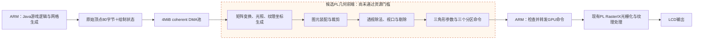

# Java Minecraft 完整几何前端：硬件接入进度

更新日期：2026-10-30。最新 R45 已完成 Vivado 独立实际综合及代表性 RTL 校验：91,645 LUT，比旧实际基准减少约 14.1%，仍超预算，尚未完成硬件接入及上板验收。

本文大写 R45 表示综合批次，小写 r32 表示该批次对应的私有源码目录；两套编号不同。

**后续可行性口径已修正：**不能把仍有优化设想当作完整前端一定能装入的依据。容量、控制开销和 AXI 吞吐复核见 [容量与吞吐可行性复核](JavaMC_完整几何前端_容量与吞吐可行性复核_20261030.md)。当前实现不适合集成；新共享执行架构的完整资源及 60 FPS 均未获证，先验证小规模资源/吞吐原型再决定是否继续全量迁移。

25K LUT 只是从底座余量反算的新增硬件预算目标，未经完整功能网表证明，不代表够部署。现有 PL 无新增几何前端：RasterIX 核心12,891 LUT，GPU扫描/缩放等包装5,060，其余基础设施20,099，合计38,050。原软件几何在 ARM 执行，不存在移除现有PL几何前端来抵扣候选面积的步骤。

## 目标与当前边界

ARM 保留 Java 游戏逻辑、方块网格生成、OpenGL 状态管理和原始顶点打包；PL 承担原 RasterIX CPU 前端的逐顶点变换、光照、裁剪、三角形参数准备，再接入现有 RasterIX 光栅化和 LCD 输出。

下图是本轮接入目标。虚线框内为尚未装入整机的候选几何 IP，不能据此认定板上已经采用该链路。

本轮以移走上述 CPU 运算为目标。实际帧率收益需要在新硬件通过验收后测量；软件模型通过和 HLS 生成 RTL 都不能证明已经提速。

FSR 已按要求保留，几何候选使用独立的无 FSR 底座。保留归档位于 `preserved/pl-fsr-v23-20261029/snapshot.tar.gz`，本轮未改动原 FSR 工程，也未给 SD 或 FPGA 写入候选版本。

## 功能范围

沿用已冻结的 RasterIX 前端算法，覆盖：

- 模型视图、投影、颜色和双纹理矩阵，纹理坐标生成。
- 原有固定功能光照、八光源、材质和双面光照。
- 三角形、条带、扇形、四边形、线和点的图元装配，跨任务连续状态。
- 六个用户裁剪平面、视锥裁剪、剔除、透视除法、视口和多边形偏移。
- 原有三角形参数及属性梯度生成，双 TMU、双面模板状态和三个显示分区的命令输出。

这是现有 RasterIX 前端的功能范围；Java 生成方块网格的工作仍由 ARM 完成。

## 已完成的接口和验证

原始顶点采用固定 80 字节格式，通过独立的 4 MiB coherent DMA 池传给 PL，不向 PL 传用户进程地址。输出为既有 GPU 命令和三角形描述符，ARM 转发给对应显示分区。

Linux 驱动、Java 渲染适配层、原生校验程序及受保护加载流程已准备。开启 `RIX_JAVA_FPGA_GEOMETRY=1` 后要求真实几何设备和匹配的硬件身份，失败直接报告；最终还需用板上计数确认逐顶点 CPU 几何路径为零。

最新软件验证通过：

- 最新源码 r30：45 类用例、8,107 个任务，包括跨块连续装配、用户/视锥裁剪、光照、双 TMU，以及裁剪与偏移、双面光照和模板的组合。驱动桥接故障检查仍保留。
- 81 份不可变原始参考二进制逐字节一致。
- 每个直接内核任务前将顶点暂存填为 NaN，检查代码不依赖前一次任务的残留 RAM。
- 对全部 434 个配置字做 1,302 种校验对照，并使用不同字段值做完整回读，核对新的硬件配置访问器与原序列化器一致。

上述回归为 C++ 模型验证。R33 已额外通过代表性 RTL 数值及 NoDDR 检查，具体覆盖见下节；最新源码 r30 尚未通过 RTL 验证，整机布局布线、真实设备及 Java 性能测量仍需完成。

## 综合结果与结构调整

无 FSR 底座布局布线后的占用为 38,050 LUT、43,594 FF、157 DSP、71 BRAM36。几何及其集成逻辑可用余量约为 32,510 LUT、97,526 FF、203 DSP、145 BRAM36。

下表均为独立几何 IP 的 HLS 估计，尚非整机实际占用：

| 版本 | LUT | FF | DSP | BRAM18 | 判定 |
|---|---:|---:|---:|---:|---|
| R19：共享运算单元 | 374,209 | 198,895 | 311 | 69 | 超限 |
| R25：裁剪暂存改为字数组 | 323,705 | 163,040 | 262 | 115 | 超限 |
| R26：共享只读状态 | 348,584 | 162,517 | 226 | 115 | 超限 |
| R27：图元、线点暂存改造 | 307,644 | 171,848 | 226 | 129 | 超限 |
| R30：统一顶点RAM与小视图 | 211,322 | 143,815 | 174 | 44 | LUT、FF超限 |
| R31：按需配置RAM | 161,666 | 125,000 | 156 | 17 | LUT、FF超限 |
| R32：顶点字段视图 | 139,017 | 85,465 | 170 | 17 | LUT超限 |
| R33：描述符字RAM实验 | 141,216 | 86,469 | 155 | 18 | LUT超限；未优于R32的LUT |
| R34：内部索引32位 | 138,836 | 84,941 | 160 | 17 | LUT只比R32少181 |
| R35：独立纹理循环局部复用 | 132,587 | 82,432 | 120 | 17 | DSP减少40，LUT仍超限 |
| R36：共享三角形准备函数 | 138,463 | 86,891 | 121 | 17 | 相比R35面积回退，保留对照 |
| R37：分离部分工作状态 | 141,848 | 87,526 | 121 | 17 | 未改善面积 |
| R39：空对象＋恢复内联准备 | 132,928 | 81,354 | 120 | 17 | 面积接近R35，仍超限 |
| R40：降低数学循环展开 | 183,124 | 167,220 | 154 | 17 | LUT、FF超限，停止采用 |
| R42：属性插值标量循环 | 136,902 | 86,724 | 140 | 22 | 已生成RTL/报告，未完成IP导出；仍超限 |
| R43：共用裁剪后处理路径 | 118,748 | 72,583 | 118 | 17 | 相比R39少14,180 LUT，仍超限 |
| R44：共享法线矩阵求逆 | 118,145 | 70,628 | 118 | 22 | 相比R43仅少603 LUT，仍超限 |
| R45：共享整数地址/索引单元 | 98,979 | 68,975 | 110 | 22 | 相比R44少19,166 LUT，仍超限 |

上表各版均超出预算，未进入正式硬件选择；R32～R40 中已完成的这些候选均超出预算，不能选入整机。

后续两步主要改动如下：

1. R30 使用固定片上顶点银行。顶点列表只保留起始槽位和数量，视图从数百字节缩小为 8 字节；顶点统一放在 32 位 RAM 中，避免列表值复制，同时进一步共享浮点运算单元。
2. R31 将 434 个配置字直接装入 32 位 RAM。各阶段按需读取矩阵、材质和单个光源，配置访问对象不再保存完整状态；硬件光照模块保留原运算公式，CPU 参考实现保持独立。

这两步均已生成 RTL 和独立 IP，HLS 估计仍超限。R30 的普通层级展开综合因内存占用超过物理内存而停止，保留日志；随后改用 R32 做实际占用校准。

R32 进一步让顶点字段按需读取，并用银行编号交换替代裁剪列表的整块复制；已通过相同软件回归和 81 份不可变输出对照，已完成 HLS 和 Vivado 独立综合。

R33 将三角形描述符改为按字段访问的 32 位 RAM，同样通过完整软件回归，连同每任务前的顶点/描述符 NaN 填充检查。DSP 减少 15，但 LUT 增加 2,199，因此保留为实验版，不能直接视为改善。

### R32 实际综合：仍放不下

Vivado 使用 RuntimeOptimized、保留层级的独立综合，解析所有浮点 IP 后得到：

| 资源 | 独立几何IP实际综合 | 无FSR底座后的余量 |
|---|---:|---:|
| LUT | 106,670 | 32,510 |
| FF | 81,809 | 97,526 |
| DSP | 178 | 203 |
| BRAM36等效 | 41 | 145 |

旧 R32 的 LUT 占整片 70,560 LUT 的 151.18%。这组结果确认该结构不能直接装入器件。最新 R45 的实际结果见下表；两者均没有整机布局布线或新增帧率结论。

按综合层级分解，顶层自身控制和数据访问占 35,375 LUT，视锥裁剪与三角形准备占 37,679 LUT，逐顶点变换等占 21,759 LUT，其余占 11,857 LUT。优化必须覆盖控制、索引、数据选择及运算复用，不能只看 DSP 数量。报告位于工作区上层 `_go32/utilization.rpt` 和 `utilization_hierarchical.rpt`，审计记录为 `build/minecraft-java-125/geometry-full-r1/ooc-r32-resource-audit.json`。

### R45 实际综合：确有收益，但仍无法装入

使用相同的 RuntimeOptimized、保留层级策略，解析全部浮点 IP 后得到：

| 资源 | 旧R32实际综合 | 新R45实际综合 | 无FSR底座后的余量 |
|---|---:|---:|---:|
| LUT | 106,670 | 91,645 | 32,510 |
| FF | 81,809 | 66,412 | 97,526 |
| DSP | 178 | 118 | 203 |
| BRAM36等效 | 41 | 41.5 | 145 |

实际 LUT 减少 15,025（约 14.1%），FF 减少 15,397，DSP 减少 60。这个比例与 HLS 相对 R39 的 25.5% 估计下降使用不同基准和测量层级，不能混用。R45 独立 IP 仍占整片 LUT 的约 129.88%，是可用余量的约 2.82 倍；要压到 32,510，当前几何 IP 自身还需再减少约 64.5% LUT，另需为集成逻辑留量。

R45 的层级分解为顶层自身 34,137、裁剪/参数准备 24,473、变换 20,857、独立法线矩阵控制 257、其余 11,921 LUT。顶层自身已超过全部剩余 LUT，单独再优化某个算术函数无法解决装入问题。

报告位于工作区上层 `_go45/`，审核记录为 `ooc-r45-resource-audit.json`。无未解析黑盒；这些是独立综合后的映射资源，不是整机实现、布局布线或最终时序证明。

### 已通过的 RTL 检查

R33 独立诊断工程将仿真事务窗口从 1,048,576 缩为 133,120 字，生产 4 MiB ABI 保持不变。插入仿真断言前，全部 168 个综合输出文件与生产 R33 **逐字节相同**，没有归一化或忽略逻辑差异。诊断副本加入 AXI 读写地址监视器，生产 RTL/IP 不改。

2026-10-30 的实际 C/RTL 协同仿真已通过：

- 27 次 RTL 事务完成，包含 9 类、16 个有效数值任务，输出 18 个三角形、40 个分区命令。
- 与独立 CPU 参考核对 1,440 个浮点字段及 526 个整数字段，最大数值差为 0。
- mode 0、99 均完成，地址通道监视器未发现 DDR 读写请求。
- 使用 AMD 浮点仿真模型，未替换算术实现或放宽预先固定的容差。

Windows XSim 在启用可选波形/死锁分析仪表时出现共享内存初始化崩溃，相关失败日志已保留。最终通过的运行关闭这两项可选仪表，保留原数值后校验和 DUT 内 NoDDR 断言。这项证明覆盖代表性 RTL 夹具，不包含全部 35 类主机用例、最大 DMA 池压力测试、整机时序或真实设备。

证据：`build/minecraft-java-125/geometry-full-r1/cosim-small-r33/rtl-acceptance-r1.json`；复现命令入口 `scripts/cosim_geometry_small_r33_retry4.tcl`。

### 最新 R45 的 RTL 检查已通过

R45 诊断工程在插入监视器前，全部 157 个综合输出文件与生产 R45 **逐字节相同**。仅对独立诊断副本加入 NoDDR 监视器；生产 RTL/IP 保持原样。实际 C/RTL 协同仿真完成：

- 36/36 个 RTL 事务，包含 12 类用例、22 个有效任务、22 个可见三角形和 50 个分区命令。
- 核对 1,800 个浮点字段和 656 个整数字段，最大数值差为 0，原有容差未放宽。
- 额外覆盖非单位法线矩阵下的内部及跨视锥三角形、奇异矩阵处理。
- mode 0/99 的 DUT 地址通道断言均通过，未观察到 DDR 读写请求。

本次使用与 R33 成功运行相同的设置：关闭波形和可选死锁仪表，保留数值后校验及 DUT 断言。它不包含全部 45 类模型用例、最大 DMA 池压力测试或真实设备测试，不能据此宣称整机已经通过。

证据：`cosim-small-r45/rtl-acceptance-r1.json`；准备、等价核对及运行入口分别为 `setup_geometry_small_cosim_r45.tcl`、`prepare_geometry_cosim_monitor_r45.py` 和 `cosim_geometry_small_r45.tcl`。

### 后续面积重构

R34 的索引缩窄通过全部回归，但 LUT 仅减少 181；R35 根据真实绑定记录，对工具独立化的纹理循环设置局部运算复用，DSP 从 160 降至 120，LUT 减少 6,249。R36 的共享函数实验反而增加 5,876 LUT，后续候选恢复较小的内联结构。

R37 / 源码 r24 将法线矩阵、纹理标志与大型绘制对象分离，使逐顶点变换无需携带该对象。R39 / 源码 r26 进一步将图元装配及用户裁剪状态分离，使硬件变换器对象为 1 字节空对象；每个绘制显式配置和重置工作状态。源码 r25 为相同空对象方案的软件验证中间版，未启动 R38 综合。

r24 的 host-r31、r25 的 host-r32 均通过 35 类/8,024 任务和 81 份原始参考二进制逐字节对照。除顶点 NaN 填充外，r24 还污染法线矩阵与纹理标志，r25 进一步污染图元队列、计数、临时顶点和全部用户平面，验证下一任务正确覆盖残留状态。r26 仅移除 r25 的十条 HLS pragma，保留同样的 C++ 运算和边界检查。R37、R39 已完成，空对象改造未得到显著面积收益。R40 将 75 条数学循环展开指令改为不展开，反而使 LUT 增至 183,124、FF 增至 167,220，此变体不采用。

### R41 / R42 的结果与限制

- R41 / 源码 r28：在已有字 RAM 和空对象方案上，合并变换、裁剪与光照的函数层级，让阶段间共享运算成为可能。只改 4 条层级指令，继承 host-r32 的 C++ 功能验证。续查时进程和会话已结束，无最终资源报告，记录为中断，不作为完成候选。
- R42 / 源码 r29：以已通过 RTL 的 R33 为基础，将深度、颜色及双 TMU 的 12 个属性存入 36 字 RAM，另存 9 个重心插值系数，用一个 36 次输出循环计算属性及 X/Y 梯度。每个分量的浮点运算次序保持一致，命令偏移直接由实际 C++ 描述符结构计算。原 CPU Rasterizer 保持独立。

R42 的首次软件回归发现颜色和深度字段的手写偏移互换，已在综合前修正；失败日志和修正前源码保留。修正后的 host-r34 通过 35 类/8,024 任务、全部 434 字配置检查，以及每任务前污染顶点 RAM、包 RAM 和新增属性/系数 RAM 的检查，81 份原始参考二进制全部逐字节一致。

续查 R42 得到最终层级面积 XML 和带完整 `endmodule` 的顶层 Verilog，但没有完整 csynth 命令结束记录，IP 未导出，进程已结束；不能称为已完成 IP。最初检查器未接受 `endmodule` 后的行注释，曾误记顶层文件不完整，已修正检查方法并保存原记录。面积为 136,902 LUT / 86,724 FF / 140 DSP / 22 BRAM18，仍不适合当前底座。两个属性流水模块均达到 II=3，但因内外两条绘制路径存在，工具生成了两份属性模块；达到局部 II 并不等于整条流水的吞吐率或游戏帧率。源文件哈希、报告哈希与状态记录于 `hls-r42-diagnostic.json`。

### R43：合并裁剪后的处理路径（HLS及IP导出完成）

源码 r30 从空对象版本 r26 出发。原先完全在视锥内和经过视锥裁剪的三角形，分别执行透视除法、视口、双面颜色、模板及描述符生成；现在先选择可见顶点列表，再经过同一个后处理循环，代码只保留一处 `emitTransformed` 调用。

原图元队列仍保持裁剪空间数据；即使三角形完全在视锥内，也复制到独立暂存银行，避免破坏条带、扇形和跨任务连续状态。原 CPU 实现仅在完全在视锥内的分支应用多边形偏移，新版以显式标志保留这个既有行为；未借本轮面积改造改变参考输出。

host-r35 已通过 45 类 / 8,107 任务 / 4,163 三角形 / 12,445 分区命令，434 字配置检查，以及顶点、法线矩阵、纹理标志、图元队列和用户平面的残留污染检查。81 份冻结二进制逐字节一致。新增 10 类组合用例覆盖裁剪＋偏移、条带/扇形连续、用户平面＋平面着色、双面光照＋模板＋偏移、线及点。独立 CPU 参考实现和既定数值容差未改。

R43 已完成 HLS 及 IP 导出，LUT 比 R39 减少 14,180（约 10.7%），FF 减少 8,771，DSP 减少 2。资源审核核对源码哈希后因超限拒绝选择，未写 `selected-ip`；仍需进一步压缩面积及重新验证 RTL。完成证据为 `hls-r43-completion.json`，导出 ZIP 的 SHA256 为 `6a1936d28227ebca350617c7765a5277ccfa3b79b019af887214b12ac386674e`。

### R44：共用法线矩阵求逆（HLS及IP导出完成）

源码 r31 仅把 PL 创建法线矩阵的计算改为表驱动的 16 轮余子式循环，每轮共用六项表达式。索引与符号表从原始 16 条公式自动提取，保留乘法、加减及首项一元负号的顺序；零行列式时仍转置原输入。原 CPU `Mat44.hpp` 未改，4 MiB ABI 和全部绘制功能不变。

host-r36 在完整 45 类/8,107 任务回归之外，对 1,030 组矩阵的 16,480 个结果字段进行逐位比较，覆盖随机矩阵、单位矩阵、非均匀缩放、零矩阵、秩一和有符号零，同时在每组测试前污染求逆暂存。81 份冻结二进制也逐字节一致。这些是模型验证，不是新 RTL 或板上性能结论。

R44 已完成 IP 导出，118,145 LUT / 70,628 FF / 118 DSP / 22 BRAM18；仅比 R43 少 603 LUT，多用 5 BRAM18。单独求逆模块 HLS 估计为 1,657～1,713 周期（100 MHz 下约 16.57～17.13 μs），共享结构存在延迟代价；不能据此宣称游戏更快。IP ZIP SHA256 为 `8013639335d8b2d0f9203e0315c930176ad217f47d2cb44e99d8707f627bc0e3`，资源 gate 仍拒绝选择。

### R45：整数地址/索引单元复用（HLS及IP导出完成）

R44 报告中，顶层、裁剪后处理、逐顶点变换分别有 574、235、151 个整数加法表达式，合计 HLS 估计为 22,461 LUT；三处还有大量整数比较和多路选择器。这个分解是 HLS 表达式估计，不是实际整机占用。

源码 r32 在九组已有运算约束中增加整数加法、减法和算术右移的共享限额。所有非 HLS pragma 的 C++ 内容与 r31 一致，继承 host-r36 的功能验证；不缩短坐标或浮点精度，不删除绘制功能。

R45 已完成 HLS 及 IP 导出：98,979 LUT / 68,975 FF / 110 DSP / 22 BRAM18。相对 R44 的 HLS LUT 降约 16.2%，相对 R39 累计降约 25.5%。三个主模块的整数加法表达式从 960 个降至 23 个；对应表和报告哈希保存于 `integer-profile-r44-r45.json`。ZIP SHA256 为 `f6ff80d6cbfdec91d85da9d9c602b0cef793d32d4790200f3ffd5941e7bf4425`。源哈希和 CSR 均经审核，但 LUT 仍超过 32,510 余量，未选入整机。实际映射及 RTL 结果均已完成，见前节。

独立 RTL45 工程 `_gs45` 仅缩减仿真事务窗口深度提示，生产 4 MiB ABI 不变。前置 C-sim 和最终 RTL 均通过同一组代表性用例；全部 45 类广泛覆盖仍为模型验证。

另以 R32 独立副本测试紧凑状态机编码，仅修改 69 处 Verilog 综合属性，逐文件确认生产 IP 未改。选项依据 [AMD UG1399 RTL Configuration](https://docs.amd.com/r/en-US/ug1399-vitis-hls/RTL-Configuration)。实际报告确认顶层、变换及裁剪模块均被重新编码，共有 74 个 sequential 编码记录。

此实验已完成 Vivado 实际综合：110,744 LUT / 78,117 FF / 178 DSP / 41 BRAM36。相比原 R32，FF 减少 3,692，但 LUT 增加 4,074，故不采用。报告位于 `_go32f/`，完整源文件隔离和报告哈希见 `fsm-recode-r32-result.json`。这是一项有实测依据的负结果，不将 FF 减少解释为整体面积改善。

### 已验证的恢复归档

最新 `preserved/java-full-geometry-wip-r45-20261030/snapshot.zip` 已完成全部条目回读校验：2,841 文件，63,335,758 字节，SHA256 为 `df4743154b32d745581002df55c73cf1fbd3a5247bb60c4bd0de889221882cd0`。包含源码至 r32、R45 完整 IP、模型及矩阵对照、最新 RTL/OOC 证据和状态机负结果。它是可复现的工作检查点，仍不是可启动的完整几何硬件镜像；归档内进度文档为写入此归档哈希前的版本。

`preserved/java-full-geometry-wip-r42-20261030/snapshot.zip` 已完成全部条目回读校验，2,219 文件，52,779,080 字节，SHA256 为 `4e7ae010793473a0454fccd959ddfbc76e34a63f968b08d4c7ea398e96c6e97c`。归档覆盖源码至 r29、R33 RTL 证据和已完成综合证据；不含本次新增 r30、R42 最后面积报告或活动作业结果，也不是可启动板卡镜像。原 PL FSR 与无 FSR 底座保留在各自独立归档中。

## 当前入口和后续验收

- 最新优化候选：`src/hls/geometry/r32/full.cpp`，生成脚本 `scripts/prepare_geometry_integer_sharing_r32.py`；r30、r31 保留独立结果。
- 最新候选综合：`scripts/synth_geometry_full_r45.tcl`，工作区上层 `_gh45`。
- 旧实际综合基准内核：`src/hls/geometry/r19/full.cpp`；最新实际综合及 RTL 均对应 `src/hls/geometry/r32/full.cpp`。
- 配置访问：`src/hls/geometry/r32/uniforms.hpp`。
- 片上顶点暂存：`src/hls/geometry/r32/flat_vertices.hpp`。
- 旧基准复现脚本：`scripts/prepare_geometry_vertex_views_r19.py`。
- 旧基准综合脚本：`scripts/synth_geometry_full_r32.tcl`，工程目录为工作区上层 `_gh32`。
- 最新 Vivado 独立综合工程：工作区上层 `_go45/geo45.xpr`，用于几何 IP 资源诊断，不是已集成的整机工程。
- 软件证据：`build/minecraft-java-125/geometry-full-r1/host-r36/`；共用路径为 `host-r35/`，属性循环为 `host-r34/`，空上下文为 `host-r32/`，描述符RAM实验为 `host-r27/`。
- 最新综合及源文件哈希：同目录下 `hls-r45*`；实际报告审核为 `ooc-r45-resource-audit.json`。

本轮控制的综合及 RTL 仿真作业均已完成。下一阶段应针对顶层控制、暂存访问和动态选择重构为明确的字 RAM 读写阶段及共享控制器，再测量面积；不把继续增加单个浮点复用指令视为充分方案。共用后处理保留，紧凑状态编码不采用，法线矩阵共享仅带来很小面积收益。

后续仍按资源可容纳、RTL 数值/协议、整机时序、匹配驱动及受保护 RAM 试装、真实图像和帧率的顺序验收。代表性 RTL 已通过不替代后续整机验收；当前不能标为“完整前端已上板”。原 PL FSR 始终独立保留，本轮无 FPGA/SD 写入、无新 FPS 测量。
