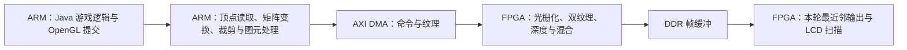

# 原版 Java 1.2.5：CPU 采样、向量候选与测时修正

> 2026-10-28 配置更正：历史脚本写入了 1.2.5 不读取的 `renderDistance` 键，本文的 Tiny 标注须按归档 `viewDistance` 复核；已确认 R75–R78 实际为 Far。原始计数及同组对照不重写，详见 [Mali 试验及视距核查](MALI_JAVA125_2026-10-28.md)。

2026-10-27。**最终受控 ABBA：原库 4.969 FPS，向量候选 4.953 FPS，没有实质提速，继续保留原库。** 本轮完成 CPU 指令采样、数值一致性验证，并修复了测时及场景控制问题。最初约 +3.1% 的短测因角色位置漂移和计时边界问题不予采信；全部原始数据、死亡失败轮与修正后复测分别保留。

## 1. 本轮条件与范围

原版客户端 JAR 不变，SHA-1 为 `4a2fac7504182a97dcbcd7560c6392d7c8139928`。所有性能轮次均使用冻结的 Superflat 世界起点、400×240、完整 256×256 纹理、Tiny/Fast、关闭云、双 TMU、纹理页精确去重及最近邻呈现。初轮采用正常难度、10 秒暖机、约 20 秒测量；最终复测统一为和平难度、60 秒暖机、约 30 秒测量。每轮重新启动 JVM并正常退出。所有试验只修改 RAM 临时目录；每次恢复原 v23 位流和原 options 文件，SD 启动文件没有更新。

本轮性能场景没有启用 FSR 或 CNN 风格迁移。FPGA 位流、源分辨率、纹理尺寸和实际绘制内容没有作为优化开关调整。候选只用于原版 Java 的私有库，没有替换其他游戏的公共 GL 库。

当前实际链路为：

## 2. CPU 采样看到了什么

R33 使用 CPU-clock perf 事件，2 ms 周期，选取当时最忙的线程并采样约 17 秒，共 **18,611 个样本，lost/dropped/corrupt 均为零**。记录了真实进程 maps、原始 IP 及 JIT 编译日志。用于符号化的未裁剪 GL ELF 经同版 strip 后与实机 C420 基线库逐字节相同，避免用近似符号解释另一份二进制。

| 线程 | 样本数 | GL 模块占本线程样本 | 主要热点占本线程样本 |
|---|---:|---:|---|
| Java 主渲染线程 | 6,561 | 43.42% | float 数组读取 10.47%，数组类型/步长分派 3.37%，顶点 fetch 3.08% |
| 原生顶点工作线程，按函数推断 | 4,683 | 94.58% | 矩阵变换 8.67%，向量复制赋值 8.26%，移动赋值 7.20% |

这些比例是**用户态 CPU 抽样归属**，不是独占墙钟时间，也不是 FPGA 利用率。内联函数会影响归属。JIT 地址复用、解释器和未记录生成代码分别保留为不确定类别，没有把它们全部解释成游戏逻辑。

R34 的常规进程计数也显示编译线程在测量窗口内仍相当活跃。10 秒暖机未保证 JVM 进入稳态。R33 开启了高频采样和详细 JIT 日志，因此独立验收明确将其标为 `accepted_performance_run=false`，未混入帧率对照。

证据：[采样与符号结果](../report/minecraft-java-125/swap-fence/r33-cpu/symbols.json)、[R33 诊断验收](../report/minecraft-java-125/swap-fence/board-acceptance-r33.json)。原始完整证据包 SHA-256：`2b1b21795f92e0d19b39415563d52ad937527fc4015eb42951194c4728993940`。

## 3. 向量候选实际修改了什么

私有 `Vec.hpp` 将手写复制构造、复制赋值、移动构造、移动赋值及空析构改为默认实现。旧移动形参是 `const Vec&&`，新移动形参为 `Vec&&`；对 const 右值仍可使用复制。默认构造及所有浮点运算、数组读取、矩阵公式、裁剪和插值公式均保持原样。

这一改动让向量具备平凡复制语义，为编译器减少对象搬运和返回开销提供条件。**内部 C++ 调用 ABI 可能改变**，因此没有沿用旧对象做单文件替换：在独立目录完整重编译 GL、GLX 及相关目标，审计 539 项源码指纹、170 个依赖向量头文件的编译对象和公开 GL 符号。所有相关对象使用真实双 TMU、最大纹理 256、关闭软件像素渲染的配置。

- 基线库：`c42097546f078e3c5245d60ea1c7b8821ee23a14c1a974ffdd6635efe0517463`。
- 候选库：`30b8fc908459ff25498b5e3a209aff1f1edce952790997202a2b1651f3a2c651`。
- [构建审计](../build/minecraft-java-125/vector-values/build-audit.json)、[唯一改动的头文件快照](../build/minecraft-java-125/vector-values/Vec.hpp)、[独立构建脚本](../scripts/build_java_vec.sh)。

FPGA 逻辑和资源没有增加。该专用双 TMU 位流仍为 LUT 65,624／70,560，BRAM 149／216，DSP 330／360；不是新一轮硬件综合结果。

## 4. 正确性验证

实际在 AArch64 上分别运行旧版和候选版 CPU 检查，而非只在 x86 上验证。双 TMU 几何用例包含 96 次 draw、11,520 个输入顶点，覆盖四种图元、变换、裁剪及缓存命中/未命中；序列化 11,710 个输出三角形的有效字段，共 **2,248,320 字节，两版逐字节一致**。只比较有效字段，不比较未定义填充字节。

另一组检查覆盖 2／3／4 分量向量、6,144 组位模式，每组检查五种值搬运结果，包含 NaN 负载、正负无穷、负零、非正规数、const 右值、自移动和跨函数返回。两版 **368,640 字节结果逐位一致**。Vec4 大小 16、对齐 4，VertexParameter 大小 88、TransformedTriangle 大小 72 均相同。

各轮继续检查真实 FPGA 的双纹理、显示列表、局部纹理更新、队列提交、换页、完整纹理和原版客户端。每个新运行器在上板前分别通过 Windows 与 POSIX 的九项锁/故障恢复检查。

## 5. 性能轮次及必须保留的失败

| 编号 | 渲染库 | 结果 | 世界新帧率 |
|---|---|---|---:|
| R34 | 旧版 | 通过并恢复 | 7.6308 |
| R35 | 候选 | 通过并恢复；CPU 几何/位模式检查通过 | 7.8080 |
| R36 | 候选 | **失败并恢复：玩家死亡，测量结束时处于 GUI** | 不计分 |
| R37 | 旧版 | 运行并恢复；最终位置偏移，对照条件未通过 | 7.4243，仅留原读数 |
| R38 | 候选 | 一次替补复测，通过并恢复 | 7.7130 |

原计划 ABBA 因 R36 失败而中断。实际顺序为 **A、B、失败 B、A、B**，有效记录为两组交错 A/B，不能称为完整 ABBA，也不能隐藏失败后只展示成功次数。没有读取或修补原版游戏字段来防止死亡，也没有删除世界状态检查使死亡轮“通过”。

**测时仍有一项方法限制：**现行 Java 日志在开始的 `plgpuctl status` 子进程之前记录起始时间，在结束子进程之后记录终止时间，计数器实际读取时刻未单独回传。这些值按既有协议可复算，但子进程开销会影响短窗口的分母，不能把约 3% 的差异直接归因为纯渲染提速。后续需在同一次板侧计数器读取中记录单调时钟和读取耗时，并完整重测两版；本轮原始数字不回填或改写成新口径。

死亡图像原始 RGB565 SHA-256 为 `1f218b37b34e05c2b6640d08bda4d65922cce44e93454497ad40daea77c31a23`。这一轮正常关闭、帧对应、硬件错误计数及恢复检查通过，但游戏测量未通过。它不能用于计算有效世界 FPS。

最终按各组**总完成帧数／总测量时长**汇总，准确数值与原始证据哈希见[可复算汇总](../report/minecraft-java-125/swap-fence/vector-values-comparison/acceptance.json)。两次/组、约 20 秒的窗口没有统计置信区间或长期平稳性结论。

原始 NBT 又显示 R37 的最终位置变为 `[-164.6165, 5.6200, -118.0721]`，不同于冻结起点；R36 的 Health 为 −3、DeathTime 为 20。缺少窗口内位置记录时，不能假定 R37 的测量视角一直与其他轮一致。[全部原始 NBT 解析](../report/minecraft-java-125/swap-fence/vector-values-comparison/world-health-and-pose.json)已保留。该旧组在汇总中明确标记 `performance_comparison_valid=false`。

## 6. 修正后的受控 ABBA：最终结果

新增 `linux/java_minecraft/java_status_clock.py`，在同一次只读 GET_STATUS ioctl 前后记录板侧单调时钟；以两次读取各自的中点计算计数窗口，子进程启动、模块导入及输出耗时均不进入分母。实机空闲读数与原 `plgpuctl status` 一致，实际测量八个读取的最大跨度为 **97,381 ns，约 0.097 ms**。这是带时间边界的配对采集，不宣称 FPGA 各寄存器硬件原子快照。

同时通过原版 options 设置和平难度，暖机延长至 60 秒，测量目标 30 秒，并协调 Java 自动关闭及父运行器超时至 240 秒。未修改客户端 JAR，也未直接赋值游戏对象以维持存活。实际各窗口约 30.99 秒，使用板侧真实计数器时间。

| 编号 | 库 | 完成帧数 | 窗口 FPS |
|---|---|---:|---:|
| R39 | 原库 A | 152 | 4.9037 |
| R40 | 候选 B | 153 | 4.9370 |
| R41 | 候选 B | 154 | 4.9692 |
| R42 | 原库 A | 156 | 5.0335 |

原库合计 **308 帧／61.989 秒 = 4.9686 FPS**，候选合计 **307 帧／61.982 秒 = 4.9531 FPS**，读数差 **−0.31%**，实际仅相差一帧。两次候选均落在原库两次波动范围内，因此没有依据把这版默认向量操作作为性能升级发布。

四轮原始 NBT 全部验证：位置与朝向均与冻结起点相同，Health=20、DeathTime=0，最终世界时间均为 2279；没有死亡或位置漂移。每轮 30 幅原生 RGBA 回归帧相同，跨另外三轮比较 **34,560,000 字节**一致；所有硬件错误为零，原 options、冻结世界、v23 位流均恢复。独立[受控汇总](../report/minecraft-java-125/swap-fence/vector-controlled-comparison/acceptance.json)可直接复算。

新条件下仍有约 **7%～14% 单核量级**的编译线程 CPU 占用，60 秒暖机不等于已证明完全稳态；每库两次也不构成长时间流畅性验收。新旧组在难度、暖机、计数窗口上均不同，**不能用旧组约 7.5～7.8 与新组约 5 FPS 的绝对差值推导优化收益或退化**。本轮性能结论只来自 R39～R42 内部同条件比较。

## 7. 下一步优先级与路线调整

1. **复用已修正的基准，再做充分暖机后的采样。** 本轮已完成配对时钟、和平难度、60 秒暖机及存档姿态核验；下一次可延长至 120 秒暖机、至少 60 秒测量，先检查编译活动和线程负载，再判断当前完整场景的热点。新测试条件应重新建立整组基线。
2. **针对显示列表的重复读取做专用提交。** `ports/java_display_lists.hpp::OwnedBatch` 已把列表顶点保存为 Vec4/Vec3，但 `replay()` 又将这些数组重新包装成通用 RenderObj，再由 `VertexPipeline::fetch/getFromArray` 重做类型、尺寸和步长分派。下一候选应为这条已知格式路径增加直接提交；没有启用的颜色、法线和纹理数组仍须使用调用时常量，矩阵及纹理状态也必须继续按帧生效。不能简单缓存整帧或把调用时颜色烘焙进列表。
3. **再对新库重新采样。** 这轮默认值语义不是消除整个 `fromArray` 热点的证明；应先看热点如何迁移，再决定固定长度 float 读取、列表提交与工作线程传输各自收益。
4. **把硬件大改留为独立风险项。** 该双 TMU 配置 LUT 已约 93%、DSP 约 92%；Java 端 CPU 顶点和 JIT 开销仍明确存在。FSR 处理输出像素，本身不能让 CPU 每秒产生更多不同的世界帧。更大幅提升需要减少前端重复工作或单独评估顶点硬件化，不能从本轮短测推导出 32／60 FPS 已可达。

## 8. 复核与交付状态

`scripts/verify_java_profile.py` 校验各成功轮的原始归档、位流、原版 JAR、正常退出、实际完成帧、硬件错误、原 options 与冻结世界恢复；`scripts/verify_java_vec_failure.py` 单独保留死亡失败；`scripts/summarize_java_vec.py` 核验 CPU 字段和跨轮原生 RGBA 字节后计算汇总。

RAM 接收器改用正式 `request shutdown` 协议退出，传输器在关闭串口前等待回显恢复确认，避免连续命令丢尾或接收器残留锁。相关问题发生在启动准备阶段，没有移除 GPU 隔离检查，也没有写 SD。

本轮候选保留在 `build/minecraft-java-125/vector-values`。最终活动硬件恢复原 v23；旧库、位流及此前所有成功/失败证据保留。

最终 staged Java 库为原 C420 基线，向量候选没有替换默认。修正后的生成/验收入口为 `prepare_java_controlled_round.py`、`verify_java_profile.py`、`summarize_java_controlled.py`；配对时钟源码及完整四轮证据均在项目内。最后状态见 `report/board_serial/java_controlled_final_state_r42.log`。
