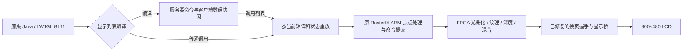

# 原版 Minecraft Java 1.2.5：显示列表实现与实机像素验收

2026-10-26，R16/R17。已补上原版世界渲染所需的一部分 OpenGL 显示列表能力，并在真实 RasterIX FPGA 上通过 9 组逐字节像素对照。官方 JAR 未修改。**当前仍只通过主菜单和选择世界，尚未通过进入世界或游戏 FPS 测试。**

## 本轮改动

原有 `glGenLists` 返回 0，`glNewList/glEndList/glCallList` 等为空实现。新增私有驱动保留既有完整 256 纹理、像素中心、纹理单元边界检查与换页修复，实现：

- 列表编号预留、删除、孔洞复用和 `glIsList`；用区间保存大批量预留，300 万个编号无需创建 300 万个对象。
- `GL_COMPILE` 与 `GL_COMPILE_AND_EXECUTE`。编译期间保存服务器命令，客户端数组设置仍立即执行；立即执行模式避免把内部辅助调用重复记录。
- 矩阵、支持的固定状态和立即模式命令重放；固定长度向量、矩阵参数复制保存。
- `glDrawArrays/glDrawElements` 在编译时按索引提取顶点及已启用的属性数组。原始数组随后被改写、释放或重新绑定，不应改变已编译几何。
- 重放时使用当时的矩阵；未启用属性数组时使用当时的常量颜色等状态，不把编译时矩阵烘焙到顶点中。
- 嵌套列表按编号晚绑定，子列表重新定义立即生效；`glCallLists` 保存偏移数据并在执行时使用列表基址。
- 查询列表编号、编译模式、基址与最大嵌套层数；递归上限 64 层。
- 修复 `GL_UNSIGNED_BYTE` 索引被解释为有符号字节的问题，实测覆盖索引 128、129、130。

实现位于 [`java_display_list_store.hpp`](../ports/java_display_list_store.hpp)、[`java_display_lists.hpp`](../ports/java_display_lists.hpp)，由[源码生成器](../scripts/prepare_java_display_lists.py)接入私有 RasterIX 实现入口。LWJGL 的过程地址直接指向 `impl_gl*`，因此接入实现函数，而不是只修改导出的 `gl*` 包装层。

列表记录有 64 MiB 的命令/几何记账预算；它不是整个进程 RSS 限制。尚不支持在列表中记录所有纹理图像、像素和其他 OpenGL 命令，生成记录明确列出编译期间拒绝的入口。本轮通过范围是下表中的几何、矩阵及固定状态，不是完整 OpenGL 兼容性认证。大世界的列表内存占用和长时间压力仍待测试。

最后核对了实际构建的 537 个私有源码文件及头文件指纹。编号/命令存储测试另以 AddressSanitizer 和 UndefinedBehaviorSanitizer 运行通过；该主机测试不替代下面的 FPGA 绘制验收。记录见 [`build-audit.json`](../build/minecraft-java-125/display-lists/build-audit.json)。



ARM 保存与重放调用、执行原有顶点处理，像素由真实 FPGA RasterIX 渲染。本轮验收固定 nearest 呈现，没有把 FSR 或 CNN 风格迁移作为通过项。

## 九组实机对照

每组先直接绘制参考帧，再通过列表绘制相同场景。每张原始帧为 400×240 RGBA，共 384,000 字节。

| 测试 | 核验内容 | R17 结果 |
|---|---|---|
| 数组快照与编译状态 | 编译不修改当前颜色/矩阵；改写数组后仍正确 | 全帧相同 |
| 调用时矩阵与常量 | 在调用时改变矩阵及常量颜色 | 全帧相同 |
| 无符号字节索引 | 大于 127 的索引；改写索引及顶点 | 全帧相同 |
| 编译并执行 | 首次立即执行只发生一次 | 全帧相同 |
| 编译并执行后重放 | 内部辅助调用没有重复记录变换 | 全帧相同 |
| 嵌套晚绑定 | 重定义子列表，父列表无需重编译 | 全帧相同 |
| 偏移与基址 | 改写原始偏移数组不影响列表 | 全帧相同 |
| 立即模式向量快照 | 改写 `glVertex2fv` 原始参数 | 全帧相同 |
| 删除后的嵌套调用 | 子列表删除后不再绘制 | 两张均为空帧 |

R17 导出了 **18 张原始帧**。主机独立读取 9 对数据，逐字节比较 **3,456,000 字节的实际绘制结果**，并检查前八组有预期数量的着色像素、最后一组为空，避免把两张空白图误判为绘制通过。


图中展示每组重放结果。直接绘制参考帧与对应重放帧均保存在 `r17-board/display-list-*-{reference,actual}.rgba`；最后的黑图是删除子列表测试的正确结果。

## 回归与恢复

| 项目 | R16 | R17 |
|---|---:|---:|
| 显示列表像素测试 | 9/9 | 9/9，加完整原始帧主机复核 |
| 原生纹理单元边界检查 | 12/12 | 12/12 |
| 连续换页实际调用 / 完成 | 122/122 | 122/122 |
| 完整红帧检查 | 96,000 像素 | 96,000 像素 |
| 原版菜单 GLX 调用 / GPU 完成 | 551/551 | 547/547 |
| 原版模拟鼠标进入选择世界 | 通过 | 通过 |
| 正常退出、实际恢复 v23 | 通过 | 通过 |

换页测试为 121 次显式循环加一次窗口创建 swap，销毁默认缓冲另有一帧。菜单帧数受启动时间等影响，**不能据此计算可玩世界 FPS**。

两轮均使用相同私有库：SHA-256 `fc8daf4bacf9c6d9023b30fe7b13674e58ffbb481df88fabe22e04e8570571d3`，1,637,240 字节。FPGA 位流继续为 SWF1 `a158190b133db4f32b1ab05fb4b3ae2fa5e1df3c45b82fc43ffb9bfc7dc2d261`，没有新增 FPGA 面积。

试验全程持有原有互斥锁、检查运行凭据和故障保护，使用 RAM/JTAG 传送。最后恢复 v23 `035c30597ce7ed94dff24a733dbbb81fa68998e8d3fba52ef45902d23ccb01d9`，GPU 队列及错误计数归零，旧运行凭据恢复。R15 驱动、已验收 runner 和回退位流保留，SD 启动文件未改。

官方客户端 SHA-1 仍为 `4a2fac7504182a97dcbcd7560c6392d7c8139928`。实际版本仍为 `OpenGL ES-CM 1.1`，真实纹理单元仍为一个。原生入口检查通过不等于 Java GL13 可用。

## 双纹理路线的进一步核对

按已有配对 OOC 层次综合报告拆分，新增 70 DSP 的来源是：

| 部件 | 单 TMU | 双 TMU | 增量 |
|---|---:|---:|---:|
| 属性/透视矫正 | 30 | 60 | +30 |
| TMU0 | 40 | 40 | 0 |
| TMU1 | 0 | 40 | +40 |

每个 TMU 的 40 DSP 又由纹理环境组合 16、纹理过滤 24 构成。见[可复核拆分数据](../report/minecraft-java-125/swap-fence/dual-tmu-dsp-breakdown.json)。

因此，**仅共享新增透视运算还不够**：理想扣除 30 DSP 后整机仍约 365/360。若同时共享纹理环境或过滤，算术预算分别约 349 或 341 DSP；这些数字尚未计调度、上下文缓冲与控制开销，也没有对应实现或布局布线结果。直接双 TMU 的 LUT 预算已达 70,193/70,560，DSP 降下来也不代表一定能布通。

两周提交窗口内，建议优先评估独立 Java 双 TMU 配置，先验证原版世界；原有 CNN/FSR 演示保留现有配置。另一条路线是同时共享透视与部分纹理运算，在统一配置中保留全部功能，但必须先通过背压、纹理返回顺序、上下文和时序测试。不能用声明两个纹理单元、把 unit1 映射到 unit0，或忽略 LWJGL 错误来代替实现。

日志中仍存在 `DeviceUploadList` 页分配失败及 `glFlush` 未实现记录。这是传输队列层的问题，和本轮 OpenGL 显示列表前端是不同层次；后续仍需修复上传/提交与排空语义。当前验收保持 `java_gl13_verified=false`、`java_gameplay_verified=false`、`java_fps=null`。

## 证据复核

| 记录 | 文件字节数 | SHA-256 |
|---|---:|---|
| R16 | 191,612 | `787d67e9d1db0b0bcd78d2aa776e8dc29ecac606a781ecc6b9bd8c116fcbc26d` |
| R17 | 203,483 | `bae57893da5b0cf8ba779894a8974fbcddb00bc79804d01a154b121cf504347b` |

```powershell
python scripts/verify_java256_round2.py --revision r17 --sha256 bae57893da5b0cf8ba779894a8974fbcddb00bc79804d01a154b121cf504347b
python scripts/summarize_java_dual_tmu.py
```

结果：[R17 独立验收](../report/minecraft-java-125/swap-fence/board-acceptance-r17.json)、[R16 独立验收](../report/minecraft-java-125/swap-fence/board-acceptance-r16.json)、[源代码/位流/时序门禁](../report/minecraft-java-125/swap-fence/local-r17.json)。
