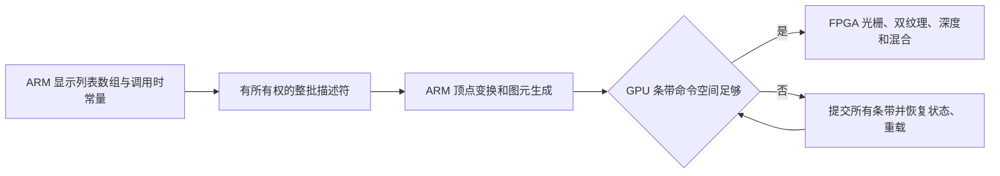

# 原版 Java：整批提交与 GPU 条带溢出修复

> 2026-10-28 配置更正：历史脚本写入了 1.2.5 不读取的 `renderDistance` 键，本文的 Tiny 标注须按归档 `viewDistance` 复核；已确认 R75–R78 实际为 Far。原始计数及同组对照不重写，详见 [Mali 试验及视距核查](MALI_JAVA125_2026-10-28.md)。

2026-10-27 开始，2026-10-28 续测。本轮继续优化未修改的 Minecraft Java 1.2.5。整批顶点提交已经实现；新增消费计数暴露了工作线程在 GPU 条带命令缓冲不足时提前结束命令流的问题。最终同二进制连续 ABBA 得到 **4.0473 → 4.4301 FPS（+9.46%）**；只代表本组完整渲染的静止场景短窗。

## 为何先修正完整性

R54 原 C420 库仍得到 154 帧／30.975 秒，即 4.9717 FPS。随后 R55 整批候选的 ARM 字段与生命周期测试、原生像素测试均通过，但游戏结束计数为 submitted_vertices=115,428,988、consumed_vertices=83,359,507，因此运行器拒绝验收，java_fps=null，随后恢复原 v23。consumed 仅在整批完成时累加，差额不能作为实际遗漏顶点的精确数量。

原工作线程用 handleNextCommand 的返回值控制遍历。多条带 addMultiListTriangle 在某个输出缓冲不足时返回 false，调用层直接结束整个 CPU 命令列表，既没有继续处理后续几何，也没有把这个情况作为明确的运行失败上报。旧逐顶点处理也走这条逻辑。

使用真实 ThreadedVertexTransformer、变换和光栅命令生成代码，把每个 GPU 缓冲缩为 64 KiB 的主机压力测试复现了这一行为：预期每条带 4,000 个三角形，旧版每条带仅产生 332 个、没有执行末尾 commit；修复版三个条带均产生 4,000 个，分别有 13 次 commit 和 12 次 load。此处是软件命令生成压力测试，不是 FPGA 像素仿真，也不是板上游戏每帧三角形数。

因此，历史约 5 FPS 仍是当时实际完成帧计数，但不能当作已经证明完整几何处理的基线。R55 不计入性能结果；R50 与新测试相隔数小时也排除。R51～R53、R56～R57、R60～R61 没有执行。

修复条带容量后的 R58 逐顶点路径通过，122 帧／30.002 秒，4.0665 FPS。R59 所有原生探针与游戏正常关闭均完成，但退出总量为 147,241／147,232 个批次、88,989,580／88,987,340 个顶点，仍差 9 批次、2,240 个顶点，被严格核验拒绝。原 deinit 会清空未提交的后台缓冲；这类上下文销毁尾部丢弃不能直接解释为测量窗口漏绘制。v3 在清空缓冲之前显式执行 flushCommands(true)，排空并等待消费，随后再重置默认屏幕。R59 原始失败状态保留。

V3 首次整批 R63 通过，总提交／消费均为 87,390,916 顶点；第二次 R64 的早期统计仍差 154 批次、4,864 顶点，故原组中断，没有补成成功。进一步沿 GLInitGuard 的实际调用链确认：首次绘制注册的 atexit 统计回调，会先于全局 GL guard 析构执行；Renderer 的排空发生在更晚的 destroy 中。旧计数文件可能先于排空写出。v4 保留 Renderer 的排空，并在 GLInitGuard 完成 destroy 后重写最终计数及 phase=after_renderer_destroy 的旁证文件。运行器和独立验收同时核对阶段、四个计数字段及提交／消费相等；原生开关两模式也要求相同检查。R64 仍保留为失败，R65 没有执行。

## 实现

1. 显示列表保存的数组由共享所有权保护。调用时常量被快照保存；矩阵、纹理绑定及其他状态按原命令顺序生效。CPU 命令流使用 12 字节批次描述符，后台直接读取数组并执行原顶点变换，避免逐顶点创建、复制和拆解完整命令。
2. 每个 CPU 缓冲各有一组保留引用，读线程结束后才释放。每组限制 4,096 个描述符和 32 MiB 引用预算；允许单个超大对象独占一组。这不是所有显示列表存储的硬内存上限。
3. GPU 每次添加输出三角形或普通命令前检查条带剩余容量，预留 4 KiB。当容量不足时，为所有活动条带追加 color/depth/stencil commit，完成上传后恢复寄存器、纹理与雾状态，重新 load 条带，再继续当前几何。它沿用现有 IF framebuffer 提交机制，不额外 swap 屏幕。
4. 销毁上下文前显式提交并等待最后的命令；所有数组引用在后台读线程退出后释放。
5. 工作线程处理失败会显式传给等待它的线程；不能再把失败当作正常流结束。有了 GPU 侧实际容量控制，v2 不再用旧 4 MiB 逐顶点逻辑字节数限制压缩批次，而仍保留实际 CPU 缓冲和引用预算限制。

候选仍保留逐顶点路径作为对照。没有改变客户端 JAR、向量/矩阵算式、几何数量或纹理尺寸；没有增加 FPGA 逻辑。Java 专用双 TMU 位流与之前相同，LUT 65,624／70,560、DSP 330／360、BRAM 149／216。顶点前端仍在 ARM，本轮游戏使用最近邻呈现，未启用 FSR 或 CNN。

v4 库 SHA-256：`6fae946e39231e8fb250cbe550f522aaa17e841192f2f3c23070d6732c7738e5`。完整构建审计核对 544 项冻结核心源码、单独覆盖的 Renderer.cpp 与 glx.cpp、116 个私有头使用对象和公开 GL 接口。v2 库 `85f5fa13…` 保留。失败 v1 库 `528e4e1a…` 及对应源码、R55 证据原样保留。

## 验证范围

- 字段检查覆盖 32 种数组开关、三组调用时常量及 24,672 个顶点，包含 NaN 负载、负零等位模式。
- 生命周期检查覆盖源列表删除后消费、4 字节对齐、调用时属性快照、引用预算及非零起始片段。
- 主机条带压力测试对照旧实现的截断和修复实现的完整输出；同一检查已编译进 AArch64 单元程序，实际执行结果随首轮证据归档。
- 每轮保留原 30 幅原生回归图、六幅直接读取模式图和六幅整批模式图。首两轮额外运行 65,536 顶点的可见几何压力探针，覆盖三个条带并核对末尾标记、GPU 分批日志、两模式完整 RGBA 一致和全部批次消费。
- 四轮采用同一修复库，R66/R69 关闭直接读取及整批提交，R67/R68 开启二者。冻结世界、和平难度、400×240、完整 256 纹理、Tiny/Fast、60 秒暖机和配对计数时钟保持一致。

## 实测结果

完整连续顺序为 **R66 逐顶点、R67/R68 整批、R69 逐顶点**，同一个 v4 二进制；两组都保留 GPU 条带容量修复与退出排空。这里只比较直接读取加整批提交的组合收益，不能单独归因于其中一个步骤。

| 轮次 | 提交方式 | 完成新帧 | 配对计数窗口 | FPS | 非编译线程 CPU，核 |
|---|---|---:|---:|---:|---:|
| R66 | 逐顶点 | 126 | 31.000551 s | 4.064444 | 1.2918 |
| R67 | 整批 | 136 | 30.953996 s | 4.393617 | 1.0603 |
| R68 | 整批 | 139 | 31.121947 s | 4.466302 | 1.0462 |
| R69 | 逐顶点 | 125 | 31.016121 s | 4.030162 | 1.2660 |

按总完成帧／总时间加权：逐顶点 **251 帧／62.016672 秒＝4.0473 FPS**，整批 **275 帧／62.075942 秒＝4.4301 FPS**，本组读数变化 **+9.46%**。两次整批是否均高于两次基线范围：**是**。每组只有两次约 30 秒窗口，未建立统计置信区间或长期帧节奏结论，距离 32／60 FPS 仍很远。

剔除 Compiler 命名线程后，采样平均 CPU 为 **1.2789 → 1.0532 核**，变化对应占用下降 **17.64%**。它是进程任务累计 CPU 的观察；CPU 与 GPU 计数窗口边界不同，不是函数独占成本、能耗或调频收益。

编译活动仍有差异：名字含 Compiler 的线程合计在 R66/R69 为单核的 **14.08%／23.62%**，在 R67/R68 为 **9.89%／9.60%**。60 秒暖机没有证明 JIT 状态相同，因此 +9.46% 是本组观测，不能完全归因于原生代码改动，也不能保证长时间仍保持相同收益。

两次整批均由析构后的阶段证明核对：R67 为 145,636 批／87,845,596 顶点；R68 为 181,167 批／86,422,952 顶点，提交与消费完全相等。数量覆盖整个进程，不仅是 FPS 测量窗口。原生两模式也验证最终阶段，首两轮可见大批次探针实际触发 GPU 条带分批。

原始 NBT 确认四轮位置、朝向不变，Health=20、DeathTime=0。四轮最终世界时间相同。每轮 42 幅原生图跨另外三轮共比较 **48,384,000 字节**一致；首两轮另有大批次模式图核对。最大计数读取跨度 **0.0739 ms**。正常退出、GPU 错误、原选项及冻结世界恢复均通过，最终恢复 v23，SD 未更新。

[可复算汇总](../report/minecraft-java-125/swap-fence/queued-arrays-v4-comparison/acceptance.json)、[失败轮与未执行编号清单](../report/minecraft-java-125/swap-fence/failed-queued-trials.json)。失败轮没有补写为成功，旧条件数字不混入本组。

## 后续优先级

当前仍是约 4 FPS 的静止场景自动测试。整批方案保留为可选实验，尚未更新通用库或 SD，也未通过运动场景、真实键鼠及长期帧节奏验收。

下一步先重新采样最忙线程，区分顶点变换、三角形命令生成和纹理页工作。代码已确认 GPU 命令缓冲直接取自 DMA mmap；可单独对照“普通 RAM 生成后整块复制”的缓存方案，但其缓存属性和收益尚未实测。再评估保留运算顺序的批量矩阵处理。FSR 负责输出像素放大，无法直接消除这里的 ARM 前端开销。

## 复现与证据

- [完整构建审计](../build/minecraft-java-125/queued-arrays-v4/build-audit.json)
- [真实工作线程容量测试](../build/minecraft-java-125/queued-arrays-v4/gpu-spill-test.json)
- [主机及 ARM 单元程序构建记录](../build/minecraft-java-125/queued-arrays-v4/unit-build.json)
- [R55 失败原始记录](../report/minecraft-java-125/swap-fence/r55-board/result.json)
- [R55 提交/消费计数](../report/minecraft-java-125/swap-fence/r55-board/minecraft-queued.jsonl)
- [R64 早期统计失败记录](../report/minecraft-java-125/swap-fence/r64-board/result.json)
- [R59 退出阶段失败记录](../report/minecraft-java-125/swap-fence/r59-board/result.json)
- 构建入口为 `scripts/build_java_queued_v4.sh` 和 `audit_java_queued_v4.py`；使用 `/var/tmp/rix-java-queued-v2-source` 的冻结头文件及源码，通过独立 CMake 目标替换 Renderer.cpp 及 glx.cpp，全部 GL 目标在 v4 目录重新构建。单元程序沿用字节相同的 v2 构建，输入摘要完整核对；生产 Renderer 的退出排空通过 v4 实机总量与最终阶段证明验证。

本轮全部使用 RAM 试验包，SD 启动文件不更新。四轮短窗与静止视角不代表运动场景或长期帧节奏验收。
