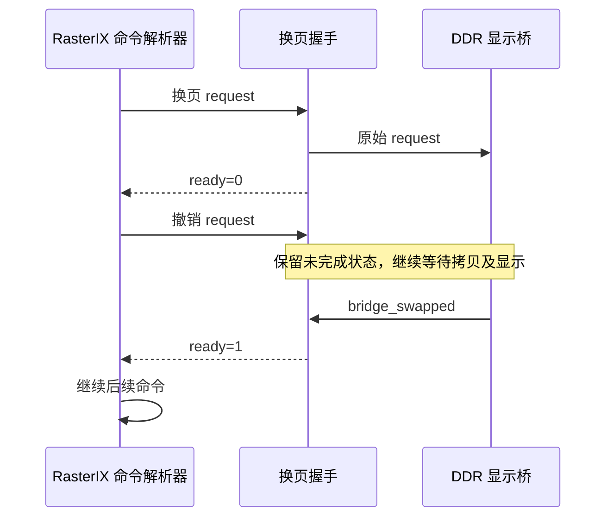

# Java 1.2.5：快速换页握手修复

本轮处理 R9/R10 观察到的应用换页次数与实际 FPGA 完成帧数不一致。原版游戏 JAR、完整 256×256 纹理、400×240 渲染及 LCD 接口保持原方案。新的硬件改动位于独立候选工程，原 v23 和第一版 256 纹理位流保留。

## 已复现的原因

RasterIX 的 CommandParser 采用“发出 apply、观察 busy、撤销 apply、等待完成”的协议。它不要求 apply 一直保持到显示结束。顶层原连接为：

```verilog
assign gpu_fb_swapped = !swap_fb || bridge_swapped;
```

当解析器观察到 busy 并撤销 apply 后，`swap_fb` 也随之撤销。这时显示桥仍可能在读 PS DDR、写显示缓冲或等待 LCD 换页，但上述表达式已经返回 ready。解析器会提前继续处理后续命令，下一次换页可能落在显示桥尚未空闲的阶段。

| 阶段 | request | 显示桥 | 旧 ready | 新 ready |
|---|---:|---|---:|---:|
| 无换页、允许 clear/commit | 0 | 空闲 | 1 | 1 |
| 提交换页 | 1 | 接受请求 | 0 | 0 |
| 解析器撤销请求 | 0 | 仍在拷贝或等待显示 | **1，过早完成** | **0，继续等待** |
| 显示桥确认完成 | 0 | 已显示 | 1 | 1 |

新模块 `rix_swap_fence` 保留换页的未完成状态，直到真实 `bridge_swapped` 到来。空闲时仍允许清屏、提交和读回，不会要求这些命令等待一个并不存在的换页确认。模块与显示桥使用同一个 GPU 时钟和复位域。



这给出了一个已经在真实模块连接中复现的漏接原因；是否解释实机的全部帧数差异，仍以新候选的板上对照为准。

## 因果仿真

测试直接连接上游 **CommandParser** 与项目实际的 **rix_frame_bridge**，并行比较旧 ready 连接与新握手模块。模型加入 AXI 读写停顿、延迟 B 响应和延迟的显示确认，在 32 次换页间插入 commit，首尾还验证 clear/readback。另验证请求保持、撤销后继续等待和等待期间复位。

| 检查 | 旧连接 | 新握手 |
|---|---:|---:|
| 提交的换页命令 | 32 | 32 |
| 显示桥接受换页 | **4** | **32** |
| 完成拷贝/显示 | 未达到 32 | **32 / 32** |
| 显示桥忙时接受的后续命令 | **60** | **0** |

实际 XSim 输出：

```text
REPRODUCED LEGACY_SWAP_LOSS requested=32 accepted=4 early_commands=60
PASS SWAP_FENCE requested=32 swaps=32 copies=32 presents=32 early=0
PASS SWAP_FENCE_REGRESSION legacy_reproduced=1 real_parser=1 real_bridge=1
```

这里使用 8×4 小帧验证控制协议，不能据此声称游戏帧率或整幅图像已经通过。候选上板另有 **400×240、121 次连续 GPU 清屏换页**。探针记录实际 GLX 调用数及销毁前 GPU 完成编号，并完整回读最终红色帧。LWJGL 创建窗口自带一次 swap，因此本平台实际有 122 次 GLX 调用，再加一次原有的销毁默认帧，共 123 个完成帧。

## 独立产物与验收边界

- RTL：[rix_swap_fence.v](../src/rtl/gpu/rix_swap_fence.v)。
- 仿真：[tb_swap_fence.sv](../sim/tb_swap_fence.sv)、[运行脚本](../scripts/run_swap_fence_sim.ps1)。
- 独立 Vivado 工程：`build/vivado_java256_swap/rix_java256_swap.xpr`。
- 新 top/control 副本：`build/minecraft-java-125/swap-fence/rtl/`；源文件摘要共 203 项。
- 保留原来的四个纹理能力 CSR，在新候选另外增加 `0xa8=0x53574631`（SWF1）。仅在新候选加载与凭据核验后读取。
- 本地验收检查时序、路由、CDC、DRC、位流格式及源文件摘要；板测验证实际换页、纹理像素、菜单输入和原 v23 恢复。

此前单改 `RIX_PRESENT_STRATEGY=serial` 未解决差异。上述问题发生在硬件请求/完成协议中，不能用应用 swap 调用数代替 GPU 或 LCD 已完成的帧数。

## 纹理单元边界

同时生成了独立的 ARM 图形驱动，给 `glActiveTexture`、`glClientActiveTexture` 和 32 个 `glMultiTexCoord*` 入口加上范围检查。当前硬件仍为 **一个 TMU**；非法纹理单元应返回 `GL_INVALID_ENUM`，保留当前激活单元、纹理绑定及纹理坐标，第二纹理单元没有被静默映射到第一单元。

实机探针覆盖 `GL_TEXTURE0-1`、`GL_TEXTURE1` 和 `0xffffffff`，分别检查激活单元、客户端单元、四维坐标和原版光照路径使用的二维坐标接口，共 12 项。此处只验证边界和状态保持，不代表已实现第二 TMU、光照贴图、显示列表或完整 OpenGL。

### 软件板测结果

R12 的 Java 探针在进入驱动前被 LWJGL 拒绝：`GL13.glActiveTexture` 报 `Function is not supported`，失败证据完整保留，实际恢复 v23。当前实现声明 `OpenGL ES-CM 1.1`，尚未向 Java 提供完整的 GL13 能力。

R13 使用独立的原生 GLX/C ABI 诊断程序，12 项非法单元检查全部通过，RGB/RGBA 纹理及原版菜单回归通过，真实恢复 v23。它只验证驱动入口的边界和状态，没有改变 Java 能力检查，结果明确记录 `java_gl13_verified=false`。

## R14/R15 实机换页验收

新硬件已完成整机布局布线，位流 SHA-256 为 `a158190b133db4f32b1ab05fb4b3ae2fa5e1df3c45b82fc43ffb9bfc7dc2d261`。GPU 的现有纹理能力和显示 ABI 保持原配置；父事务实际读取到新增的 SWF1 标记。

| 整机资源 | 第一版完整 256 纹理 | 新换页握手候选 |
|---|---:|---:|
| LUT | 65,636 | 65,663（93.06%） |
| FF | 71,940 | 72,002（51.02%） |
| BRAM Tile | 204 | 204（94.44%） |
| DSP | 325 | 325（90.28%） |

新候选的建立/保持/脉宽余量为 **+0.179 / +0.011 / +0.124 ns**，路由错误和 Critical CDC 为零。原 BD 41-1267 地址视图告警仍保留；不是无告警工程。

R14 首轮压力探针用了当前驱动不支持的 RGB 读回格式，检查失败并正常恢复，未把失败改成通过。旧探针源码、编译类和日志保留。R15 改为已支持的 RGBA 读回，并直接记录原生 GLX 调用次数，完整回读 400×240 的红帧，不依赖对窗口创建行为的猜测。

| 实际检查 | R13 旧握手 | R15 新握手 |
|---|---:|---:|
| 同一原版客户端的 GLX swap 调用 | 1,076 | **544** |
| 客户端期间实际 GPU 完成帧，不含销毁默认帧 | 553 | **544** |
| 请求与完成帧逐次对应 | 未通过 | **通过** |
| 最后客户端前台帧编号 | 566 | 680 |
| 图像内容 | 选择世界 | 选择世界，原始字节一致 |
| 正常退出、真实恢复 v23、硬件错误为零 | 通过 | 通过 |

这个变化修复了提前返回和换页漏接，不代表世界渲染帧率翻倍。25 秒窗口包含启动、全景主菜单和静态世界选择界面，仍不能当作游戏 FPS。

R15 连续清屏压力测试另外完成：

- 121 次显式循环换页，加窗口创建时的一次 swap，**122 次原生 GLX 调用与 122 次 GPU 完成逐次对应**。
- 销毁前帧编号 122，销毁默认帧编号 123，五个 GPU 队列/帧编号一致，错误为零。
- 独立主机复核完整 **96,000 个 RGB565 像素均为 0xf800 红色**，不是只检查屏幕中心。
- 12 项原生 API 状态检查、RGB 196,608 像素测试和原始 Mojang RGBA 65,536 像素测试再次通过。
- 原版正常响应模拟鼠标并进入选择世界，窗口和 GUI 均为 400×240。


最终实际恢复原 v23：旧运行凭据按原字节恢复，GPU 状态 3、启用 1、五个帧/队列编号均为零，全部错误为零，POST 模式 1、快照占用为零，无遗留游戏进程。本轮未更新 SD 启动文件。

## 第二 TMU 的资源评估与后续路线

两个独立 GPU OOC 综合使用相同的 256 纹理、1024 字节外部缓存、定点插值和其他参数，仅改变 TMU 数量。它们不是两个整机布局布线结果。

| GPU OOC 资源 | 一个 TMU | 两个 TMU | 增量 |
|---|---:|---:|---:|
| LUT | 8,912 | 13,442 | +4,530 |
| FF | 9,211 | 13,472 | +4,261 |
| BRAM Tile | 35.5 | 35.5 | 0 |
| DSP | 84 | 154 | **+70** |

将增量加到当前整机，仅作预算估算：LUT 约 **70,193 / 70,560**，DSP 约 **395 / 360**。因此，保留现有 CNN、FSR 等部件时，直接复制第二个 TMU 已超过 DSP 总量，LUT 也几乎没有布线余量。双 TMU 尚未进行整机实现或部署。

原版 `es.class` 已有 GL1.1＋`GL_ARB_multitexture` 分支：有 ARB 多纹理扩展且没有 GL13 时，会使用 ARB 入口。后续可以在真正实现两个逻辑纹理单元后提供相应入口及扩展声明，不需要先实现所有 GL13 功能。

建议先评估 **FPGA 内共享透视矫正/采样运算资源的两个逻辑纹理单元**，或采用单独的 Java 硬件配置。400×240、60 Hz 的输入只有 5.76 Mpixel/s，资源复用值得验证，但目前尚无该共享流水线的实现或性能结果。显示列表、纹理上传队列及 glFlush/glFinish 语义仍需处理；世界生成、世界渲染和游戏 FPS 尚未通过。

## 原始证据与复核

| 记录 | 证据包 SHA-256 | 状态 |
|---|---|---|
| R12 Java GL13 探针 | `88f109f485a0c8a29628275c23e219ddecf8ee0d7323560326a0baa0d79d974e` | Java 失败，恢复成功 |
| R13 原生驱动与旧握手 | `f403b3003ca4b5013e9c48c4259832d7a000b67ce038483f1acf6d24b78e9ec5` | API 通过，帧对应未通过 |
| R14 首轮压力探针 | `72620996a951900e3856209990a6ab7c8bba45c2670902cac5f5e63d511a30f8` | 探针格式错误，失败保留 |
| R15 严格换页检查 | `62c8f6c742e08394cf5cf07802966887c3dcb1f7d0299d00a71060cc3404dedf` | 本节全部换页检查通过 |

R15 证据包为 190,405 字节，包含两个原始前台帧、五项测试日志、原始/退役凭据及真实加载/恢复事务。客户端前台帧 SHA-256 为 `7b5a9a28f0005f1f4ceaceae304d20a8e9b4513d93c3b765272d70c5eaef7212`。

```powershell
python scripts/verify_java256_round2.py --revision r15 --sha256 62c8f6c742e08394cf5cf07802966887c3dcb1f7d0299d00a71060cc3404dedf
```

结果：[R15 独立验收](../report/minecraft-java-125/swap-fence/board-acceptance-r15.json)、[硬件时序/资源验收](../report/minecraft-java-125/swap-fence/local-r15.json)、[配对 OOC 资源估算](../report/minecraft-java-125/swap-fence/dual-tmu-resource-estimate.json)。复核脚本明确保留 `java_gl13_verified=false`、`java_gameplay_verified=false` 和 `java_fps=null`。
