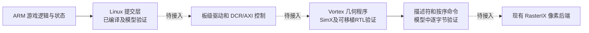

# Vortex 并发几何前端与 Linux 接口验证

**路线已停止（2026-10-30）**：用户决定放弃本路线，回到 ARM 几何前端。以下保留当时的实现、性能与验证证据，不再作为接下来的任务清单。当前主线见 [ARM 前端主线恢复](F:/1FPGA/Xilinxprj/prj2/rasterix-linux/docs/ARM前端主线恢复_20261030.md)。

日期：2026-10-30。目标平台：AXU3EG / XCZU3EG。

## 本轮结论

几何程序已从单任务原型推进到 **四个 warp 并发处理四个独立任务**，功能与接口验证通过。不过，大批次测试暴露了设备程序的吞吐限制，当前还不能据此切换 MC 前端或承诺游戏加速。

先看原功能用例：同一设备程序在两种调度宽度下，几何计算阶段的对比结果如下。

| 模型与条件 | 单任务批次累计周期 | 四任务批次累计周期 | 加速比 | 周期减少 |
|---|---:|---:|---:|---:|
| SimX，关闭工作区污染 | 15,564,668 | 5,259,217 | 2.9595× | 66.21% |
| Verilator + 可移植浮点 RTL，关闭工作区污染 | 15,209,968 | 5,160,497 | 2.9474× | 66.07% |

两行均使用完整的 **45 组用例、54 次调用、213 条输出记录**，两种宽度均通过参考对照。每次调用仅 **1～3 个顶点，合计 149 个顶点**，主要用于验证完整功能、状态衔接和隔离，不能代表大 draw 性能。213 条记录包含模板状态命令，不能解释成 213 个三角形。每次检查完整 4 MiB 数据池、返回状态、身份字段和结果区哨兵。

这里的周期为每批设备任务的 `min(begin) → max(end)` 区间，再对所有批次求和。它涵盖设备工作区初始化与几何计算，结束点位于结果元数据写入之前；不含完整的启动、主机上传/回读和写回排空开销。存储模型使用未标定的 HBM2 默认配置。**这些数字不是板上帧率，也不是 MC 的端到端加速比。**

Linux 用户态提交接口已抽出，异步故障分支测试通过；接口探针和完整客户端均已编译为 AArch64 对象。尚未链接 AXU3EG 物理设备后端，也未接入现用 MC。

## 大批次补测与路线修正

为避免只用小用例判断性能，增加每任务 3、192、2046 顶点三档，每档四个独立副本，合计 12 次调用、8964 个顶点。内容为非单位模型/投影/纹理矩阵下的重复三角形；它是合成基准，尚未采集真实 MC draw。生成时使用冻结的 `SequentialVertexTransformerCalc` 与 `Rasterizer` 独立参考检查三个 band，随后导出完整输入/预期池。

native、SimX 与可移植浮点 RTL 的大批次均逐字节通过。下表每行处理四份相同大小的任务，加速比仅比较 SimX 的单任务与四任务；没有做大批次 RTL 的单任务计时对照。

| 每任务顶点数 | SimX 单任务总周期 | SimX 四任务周期 | SimX 加速比 | 可移植 RTL 四任务周期 |
|---|---:|---:|---:|---:|
| 3 | 1,045,740 | 264,799 | 3.9492× | 259,707 |
| 192 | 20,493,812 | 5,202,124 | 3.9395× | 5,136,383 |
| 2046 | 211,296,456 | 53,639,483 | 3.9392× | 52,969,763 |

这说明并发调度对大批次同样有效，但绝对计算开销仍然高。以 100 MHz 作理想预算比较，60 Hz 每帧只有约 1,666,667 个核时钟；四个各 2046 顶点的合成任务，需要约 32 倍于这一预算的计算周期，而且尚未计入传输和启动。可移植 RTL 的大批次成本也在相同量级。它不是游戏帧率预测，但足以说明：**不能仅靠加大批量、增加传输带宽，就把当前通用程序直接用于高顶点量 MC。**

在这个合成场景下，单任务的增量成本约为每顶点 2.6 万周期；增加批量主要摊薄固定准备成本，没有消除这部分成本。设备程序已使用 `-O3`，这些数据并非未优化的调试编译结果。

因此下一阶段先测设备内变换、装配/裁剪、参数生成、输出各自的周期，再决定改写范围。源码中沿用的 HLS 全局池、代理访问、顶点反复搬运是排查候选，需要验证适合指令处理器的局部结构体与一次性状态解码能否降低成本；目前没有动态热点采样，不能把某个函数或软件双精度辅助函数断言为主因。保留完整通用路径作为功能参考，任何快路径都要通过原有功能和大批次对照。warp 内 SIMD 还需要解决分歧转换和按线程工作区隔离，不能直接把 `block_dim` 改成 4。

板级控制与内存通路仍要接，但现用 MC 保持原链路；先用大批次预算和真实游戏输入证明新前端的性能，再切换。

## 并发是怎样实现的

原几何算法有九个可写全局暂存对象，直接启动多个任务会互相覆盖。本轮将以下对象改为按 warp 索引的四份存储：顶点暂存、统一状态、法线矩阵输入/逆矩阵/矩阵对象、纹理变换标志、图元装配器、平面裁剪器和越界标志。越界访问的只读零值回退对象也改为任务隔离，避免共享静态初始化保护。

设备通过只读 `VX_CSR_WARP_ID` 选择工作区。原始 HLS/RasterIX 源码保留；准备脚本在独立副本上进行机械转换，记录转换前后摘要。每个任务重新构造装配和裁剪对象，跨批次状态从显式 carry 数据恢复。

调度方式为 `block_dim=1`、最多四个 CTA，每个 warp 只有一个活动线程。四个 warp 的任务能够重叠执行，**尚未启用 warp 内多个线程的 SIMD 并行**。大函数的分歧转换仍关闭；这一设置成立的前提就是每个 warp 只有一个活动线程。

同一 strip、fan 等流的前后批次保持依赖顺序，每个流在一个批次中最多出现一次。continuation 输入使用上一轮实际设备输出，随后叠加下一段顶点；没有用 CPU 参考结果替代设备 carry。不同流可并发，完成记录按原始提交序号归位，再生成三个 band 的命令。

四任务调度共 16 个批次，其中 13 个批次具有真实重叠的设备执行区间。后面几个批次受单一长流依赖限制，只能串行。

## 验证证据和适用范围

| 检查 | 结果 | 范围 |
|---|---|---|
| native 四线程 + NaN 工作区污染 | 45 组 /54 次 /213 条通过 | 检查暂存隔离及参考语义 |
| SimX 四任务 + 工作区污染 | 完整通过，13 个批次重叠 | 执行编译后的 RISC-V 程序 |
| SimX 单任务/四任务，无污染 | 均完整通过 | 同一程序的周期对照 |
| 最终用户态队列客户端 + SimX | 完整通过 | 使用公共提交接口，非测试专用复制代码 |
| Verilator 可移植浮点 RTL + 工作区污染 | 完整通过，13 个批次重叠 | 真实指令、调度、缓存及可移植浮点 RTL |
| Verilator 单任务/四任务，无污染 | 均完整通过 | 独立于 SimX 的周期对照 |
| 超时、部分入队失败、忙碌复用、地址边界、事件失败 | 通过 | 故障注入检查异步内存所有权 |
| AArch64 编译 | 两个对象通过架构检查 | 编译通过，未链接物理后端 |

所有完整回归生成的三个 band 命令文件，其 SHA-256 分别一致。原始与并发副本的输入摘要、最终程序、日志、结果文件、AArch64 对象及 PL FSR 归档均已审计。

**目标 Xilinx 浮点 IP 仍有验证缺口。** 首次使用实际综合配置构建 Verilator 时，缺少 `xil_fma/xil_fdiv/xil_fsqrt` 模型，构建失败。失败日志保留。随后在独立构建树中移除 `VIVADO` 宏，改用上游可移植浮点 RTL，完成上述回归。两者浮点实现不同：可移植路径支持 IEEE 非规格化数，目标厂商路径使用 FTZ。可移植 RTL 通过不能替代目标 IP 或整机上板验证。

最终设备程序为 **74,992 字节**，SHA-256：

```text
282d12482be524cbaf37f12dadc2c179548c8ae1448ccc284e81abf8428d1053
```

所有调度宽度、队列客户端版本和可移植 RTL 试验使用同一设备程序。ELF 中 `.text=66,320`、`.rodata=4,460`、`.bss=39,556` 字节；程序文件还包含其他段及符号页脚。工作区增加的是程序数据存储，本轮没有增加综合核的 warp 数或执行通道数。

## Linux 用户态接口

公共代码：

- [任务 ABI](F:/1FPGA/Xilinxprj/prj2/rasterix-linux/ports/vortex_geometry_abi_r2.hpp)：任务 24 字节、批次参数 24 字节、结果 64 字节。
- [提交与等待接口](F:/1FPGA/Xilinxprj/prj2/rasterix-linux/ports/vortex_geometry_queue_r2.hpp)：`enqueueGeometry / waitGeometry / quiesceGeometry`。
- [异步故障测试](F:/1FPGA/Xilinxprj/prj2/rasterix-linux/sim/test_vortex_geometry_queue_r2.cpp)。

调用方提供一个专用顺序队列、内核句柄、四槽数据池、任务表和结果表。每槽 4 MiB，任务表 96 字节，结果表 256 字节。接口检查任务数、模式、顶点数、序号、缓冲地址对齐及 RV32 地址范围。

任务表、参数、结果和完成事件由提交对象持有；对象禁止拷贝。输入/输出池及所有 Vortex 句柄仍归调用方所有，必须保持有效，且在完成前不能修改对应输入或提交元数据。同一组资源只使用一个 binding，并由调用方串行管理。

超时只返回超时状态，继续保留事件和缓冲区占用。部分入队失败也保留占用，防止已经排队的上传访问被复用的主机内存。只有完成等待成功，或确认整个专用队列排空成功后，才允许重新提交。物理 Linux 驱动还需在进程退出等情况下独立保护仍被 PL 访问的 DMA 内存。

AArch64 产物位于 `build/minecraft-java-125/vortex-frontend-r2/client-check-r2/`：

| 文件 | 大小 | 状态 |
|---|---:|---|
| `vortex-queue-linux-aarch64.o` | 3,632 B | 接口全部路径已编译 |
| `geometry-client-linux-aarch64.o` | 77,064 B | 完整回归客户端已编译 |

这里使用现有 PetaLinux 2020.1 AArch64 SDK。对象文件仍依赖 Vortex SDK 符号，**不能当成可在板上直接运行的驱动或可执行文件**。回归程序显式只允许 `simx/rtlsim`。

## 资源预算

本轮没有重新综合，也没有修改目标核 RTL 配置。仍引用上一轮双执行通道配置的独立布线结果：

| 项目 | LUT | FF | DSP | BRAM36 等效 |
|---|---:|---:|---:|---:|
| Vortex 独立核 | 24,139 | 25,592 | 12 | 20 |
| 无 FSR 底座与独立核名义相加 | 62,189 | 69,186 | 169 | 91 |
| 相对于 ZU3 总量的名义剩余 | 8,371 | 71,934 | 191 | 125 |

名义 LUT 占用约 88.14%。这一加法尚未包含新的地址转换、启动控制、写事务排空及相关 glue，也不是整机布局布线结果。100 MHz 的原独立核时序通过，不能据此判断整机时序已经通过。原 PL FSR 源码及归档保持完整。

## 接入板子前必须补齐的工作



优先实现板级控制和内存通路，再接真实游戏。新的 Vortex 核不能直接使用原 HLS 几何驱动的控制寄存器。当前综合对象为 `Vortex_axi`；模型运行时还使用软件命令处理器，不能把其 CP/DMA 功能视为已经包含在这 24,139 LUT 中。物理后端需要移植软件命令处理器，或提供直接启动的几何专用后端。

板级接口至少需要：DCR 写入与启动握手、完成/错误状态、CPU 与设备缓存同步、AXI 写事务和缓存写回的排空。完成条件不能只检查 `busy` 或结果 magic。

设备地址也要重新规划。当前程序的固定映像区为 **`0x80000000–0x8001bf44`（右端不含）**；SDK 的普通分配从 `0x00010000` 开始。每 hart 栈配置为 8 KiB，16 个 hart 共需 128 KiB 的地址范围 **`0xfffd0000–0xffff0000`**。这些是 GPU 地址，尚未对应到板上实际保留的 PS DDR。

可采用 CMA 加 GPU 地址窗口转换的方案，将低地址缓冲、程序区、栈和 I/O 区映射到实际 DDR。应先验证实际 CMA 可用区、窗口不重叠、栈高水位和越界访问，再确定保留容量及物理地址。当前未修改设备树或分配板上内存。

传输路径必须同时收敛：当前完整池回归每次上传 4 MiB、回读 4 MiB，54 次调用合计 **432 MiB**，目的是核对全部内存。正式路径应上传状态、有效顶点和必要 carry，读取返回状态、有效输出和 carry；进一步使用共享 DMA 缓冲。每个顶点为 80 字节，每条输出记录为 256 字节，不能把整池回归拷贝直接带入逐 draw 游戏路径。

游戏适配还需保持几何输出与纹理、模板、混合等像素状态命令的相对顺序。本轮验证了几何任务及三个 band 的有序输出，尚未验证完整游戏命令流中的状态屏障。

最后完成目标 Xilinx 浮点 IP 检查、整机综合布线、上板单三角形/多任务/游戏对照，才报告真实 CPU 几何耗时变化和 FPS。

## 证据与复现

主证据：[audit-r2.json](F:/1FPGA/Xilinxprj/prj2/rasterix-linux/build/minecraft-java-125/vortex-frontend-r2/audit-r2.json)。该审计检查所有大小批次结果、源摘要、同一设备程序、AArch64 对象、三个 band 输出一致性、上游 RTL 无逻辑改动及原 FSR 归档完整性。基线与每次队列改版分别冻结，不覆盖失败日志或先前通过的结果。

在已有配置与冻结源目录下，下面是本轮对应命令；相同 attempt 的结果已存在，脚本会拒绝覆盖。复跑应使用新的 attempt，且同一配置树的模型作业按顺序执行。

```bash
cd /mnt/f/1FPGA/Xilinxprj/prj2/rasterix-linux
python3 scripts/run_vortex_parallel_r2.py simx --batch 1 --poison 0 --attempt r1
python3 scripts/run_vortex_parallel_r2.py simx --batch 4 --poison 0 --attempt r1
python3 scripts/run_vortex_parallel_r2.py simx --batch 4 --poison 1 --queue --queue-source r3 --attempt r3
python3 scripts/run_vortex_rtl_smoke_r2.py --portable-fpu --full --attempt r1
python3 scripts/run_vortex_rtl_smoke_r2.py --portable-fpu --full --measure --batch 1 --poison 0 --attempt r1
python3 scripts/run_vortex_rtl_smoke_r2.py --portable-fpu --full --measure --batch 4 --poison 0 --attempt r1
python3 scripts/check_vortex_queue_client_r2.py --queue-source r3 --attempt r2
python3 scripts/prepare_vortex_dense_fixtures_r2.py
python3 scripts/run_vortex_parallel_r2.py native --batch 4 --poison 1 --suite dense --attempt r1
python3 scripts/run_vortex_parallel_r2.py simx --batch 1 --poison 0 --suite dense --queue --queue-source r3 --attempt r1
python3 scripts/run_vortex_parallel_r2.py simx --batch 4 --poison 0 --suite dense --queue --queue-source r3 --attempt r1
python3 scripts/run_vortex_rtl_smoke_r2.py --portable-fpu --full --measure --batch 4 --poison 0 --suite dense --attempt r1
python3 scripts/audit_vortex_parallel_r2.py --attempt r2
```

首次准备入口为 `prepare_vortex_parallel_r2.py`、`prepare_vortex_queue_r2.py --attempt ...` 和 `prepare_vortex_portable_rtl_r2.py`，均拒绝覆盖已有候选目录。当前所需构建目录及工具已经准备好。
